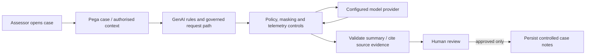

# Pega GenAI Control Plane: Data Boundaries, Grounding and Human Approval

**PFA-226** | **Audience:** Senior and Lead System Architects | **Status:** Reference architecture; live Pega test pending

Adding an LLM to a case is not merely a prompt integration. The architectural question is which data can leave each boundary, who can act on the result and what evidence survives.

## 1. The enterprise failure this design prevents

A claims team wants AI-generated summaries of sensitive claim attachments to help assessors. The assessor should receive a useful summary, but the model must not trigger an irreversible payout or expose unrelated customer information. A simplistic design passes the whole case clipboard to the LLM and inserts its response as trusted case data. A governed design identifies minimal permitted context, enforces entitlements, masks sensitive fields where necessary, evaluates output and routes consequential changes through human approval.

## 2. Component and execution architecture

The following diagram is an **illustrative reference design**. It is not a screenshot from a running Pega environment.

## 3. Which Pega objects own each concern?

| Component | Why it exists |
|---|---|
| `Case context selection` | Restrict input to data authorised for the current business operation |
| `Pega GenAI integration` | Platform-managed request and response workflow |
| `Gateway / model control plane` | Provider policy, monitoring and supported masking capability |
| `Review assignment` | Human approval before material business-state change |
| `Audit record` | Prompt/template version, source references, reviewer, outcome |
| `Fallback process` | Manual review when provider is unavailable or answer fails checks |

The named objects above are a mix of actual Pega rule categories and illustrative application-specific names. They are not a claim that all such rules exist in a default Pega installation.

## 4. Implementation design and decision sequence

1. Draw the full data boundary: operator browser, Pega runtime, governed GenAI service and eventual model provider. Document allowed geography, retention and logging.

2. Define a purpose-specific data projection instead of sending pyWorkPage or unfiltered attachments. Read only fields needed for the summary.

3. Evaluate whether sensitive text requires masking, redaction or exclusion before request execution. Validate platform feature support and exact configuration for the deployed release.

4. Separate grounded evidence from model wording. A summary must link to source pages or document references so an assessor can correct it.

5. Classify the returned text as untrusted output. It must never directly grant privileges, invoke high-risk tools or approve payment.

6. Record a human-review step, explicit approval identity and the content finally accepted into the case.

7. Test provider outage and delayed completion: the case must remain processable without the GenAI service.

## 5. What an architect must choose

| Approach | Effect and trade-off |
|---|---|
| Direct LLM invocation from browser | High data-governance and credential risk; no server-side audit boundary |
| Pega governed GenAI path with scoped context | Aligns with platform control plane and case workflow |
| External specialised summarisation service | Potentially justified for custom model policies; must still meet identity, audit and privacy requirements |

**Decision standard:** choose the smallest design that satisfies consistency, auditability, security, performance and operational recovery, not the design that simply looks easiest in Dev Studio.

## 6. Failure modes and root-cause investigation

**Prompt injection:** an uploaded invoice instructs the AI to reveal other claims. Treat attachment text as untrusted content. **Hallucination:** an invented payout amount appears in the summary; prohibit automatic value adoption and require source-grounded review. **Cross-case leakage:** grounding retrieves a previous customer's document through an overbroad search index; enforce entitlements at retrieval. **Provider outage:** delayed summary blocks the case; provide a manual workflow. **Unbounded cost:** repeated button clicks generate huge context windows; apply usage quotas and event deduplication.

For troubleshooting, preserve the application/ruleset version, access context, precise business identity, timestamp and correlation ID. Never include secrets or production customer documents in publicly shared traces.

## 7. Verification matrix for a Pega lab

These are **tests to run**, not tests that have already passed.

| Experiment | Evidence and expected assertion |
|---|---|
| Cross-tenant context | Injected case ID of another client must not retrieve restricted data |
| Malicious attachment | Prompt-injection wording is ignored as an instruction |
| Unsupported assertion | Fabricated monetary amount is flagged for reviewer confirmation |
| Redaction | Sensitive fields omitted or masked per policy across request/log path |
| Availability | Provider down; user completes the case via manual route |
| Audit | Approved output has source, template version, reviewer and timestamps |

At the end of the experiment, attach redacted screenshots of the relevant rule forms, Clipboard/Tracer/PAL evidence when applicable, and an actual observed outcome. If any result differs, update the design instead of changing the evidence description.

## 8. Production readiness and ownership

Monitor input/output volume, latency, failed or rejected generations, human correction rate, cost and policy violations. Keep a data-flow diagram and model inventory current. Product availability and provider support change quickly: revalidate deployment-specific GenAI features at each upgrade.

**Architecture acceptance:** the design has an explicit owner, a version-specific reproducible test, a failure/recovery procedure, the relevant security controls and a way to detect regressions.

## 9. Product references and limitations

- [Pega Academy: Pega GenAI architecture](https://academy.pega.com/topic/pega-genai-architecture/v1)
- [Pega Academy: GenAI architecture module](https://academy.pega.com/module/pega-genai-architecture/v1)

Pega functionality changes by release. Treat exact editor labels, extension points and service behaviours as version-sensitive until verified in the target environment. This independent article is neither an official Pega document nor a claim of an executed customer implementation.
