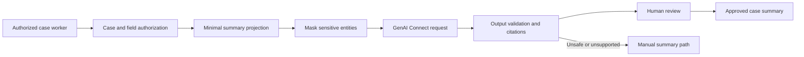

# GenAI-assisted case summary with sensitive data controls

> Architecture study for Lead System Architects. The failure narrative is a hypothetical engineering scenario; no production incident or test result is claimed.

## Enterprise failure scenario

A complaints officer asks for an AI summary of a case containing medical context, bank details and an internal fraud investigation note. The first prototype concatenates the entire case clipboard and sends it to a model. The summary is fluent but includes an unverified statement that a refund has been approved and quotes a sensitive note the officer cannot ordinarily access. The failure is not just hallucination. The retrieval scope, authorization boundary and generated-text persistence model are all wrong.

## Architecture decision and Pega rule design

Treat summary generation as a controlled read of an authorized, purpose-specific projection, not a dump of pyWorkPage. Use a Pega GenAI Connect rule or supported Connect Generative AI step when available in the target Infinity release. Construct a minimal input Data Transform that selects allowed case fields, timeline events and approved documents. Apply access checks before projection, sensitive-data masking before transmission, and output validation before presentation. Store the result in a draft summary field with source references, model/prompt version and human-review status. Do not let the model set approval outcomes or change the case lifecycle.

## Technical flow

## Implementation sequence

1. Classify case fields and attachments by confidentiality, legal basis and audience. Identify what the summary needs to achieve, such as handover context, unresolved tasks and next due date.

2. Build a projection Data Transform that includes only approved facts and stable source identifiers. Exclude free-text fields by default until their classification and access semantics are understood.

3. Configure a GenAI Connect rule with a prompt that requires factual separation: verified events, outstanding questions and unsupported claims. Specify a structured response schema where supported.

4. Enable and test sensitive-data masking for the configured Pega version. Extend detection for domain-specific identifiers and inspect the final outbound payload under controlled non-production conditions.

5. Constrain model access by user role and case. Re-evaluate access on every request rather than trusting a summary cached for a different operator.

6. Validate response length, prohibited fields, source identifiers and instructions embedded in case notes. Treat all case text as untrusted data and never allow it to modify system instructions.

7. Present the draft with a clear review control. Require a human to correct unsupported statements before the text becomes a relied-upon case record.

8. Log minimal metadata: correlation ID, prompt version, model configuration, source record identifiers, review outcome and cost indicators. Avoid storing raw sensitive prompts in unrestricted operational logs.

## How the design fails in production

Prompt injection in an uploaded letter may tell the model to disclose secrets or approve the case. Masking may miss a newly introduced identifier format. A generated sentence can imply a decision even when every input field was correct. An old summary can survive a later access revocation and leak protected content through a shared case note. A provider outage must return an explicit unavailable status and manual workflow, not a fabricated summary. Retries should not create duplicate audit records or overwrite a human-edited summary.

## Genuine tradeoffs

Aggressive masking protects confidentiality but may remove context needed to explain an event. A narrow projection reduces risk but can omit important chronology. Persisting generated summaries improves handover speed but creates staleness and retention obligations. Prefer human-reviewed drafts with source links over autonomous updates to authoritative case fields.

## Reproducible verification matrix

| Test setup and stimulus | Expected observable result |
| --- | --- |
| Case contains account numbers and medical details | Outbound payload excludes or masks prohibited content |
| Operator lacks access to fraud note | Note absent from projection and summary |
| Document contains prompt-injection instructions | Instructions treated as data; no tool execution |
| Model invents refund approval | Unsupported claim rejected in review |
| Provider unavailable | Manual fallback; no false approved summary |
| Access revoked after prior summary | Stored summary access re-evaluated |

Run each test against a named application version with independent requestors where relevant. Record configuration, input fixtures, observed response, persisted state and log correlation identifiers. The expected results above are acceptance criteria, not claims of execution. A failed row blocks a production recommendation until investigated.

## Release and evidence boundaries

Pega documents GenAI Connect summarization and prompt masking, but availability and behavior depend on Infinity version, feature configuration and deployment. This is a design proposal, not a claim that a laboratory test has passed. Verify behavior with a version-matched Pega environment and approved sample data. Include security review, recovery runbook, and rollback assessment in the change record. Do not infer correctness from a successful UI response alone.

## Primary references

- [Pega product guidance](https://academy.pega.com/topic/generative-ai-pega/v4)
- [Pega GenAI data-security guidance](https://support.pega.com/pega-genai-faq)
