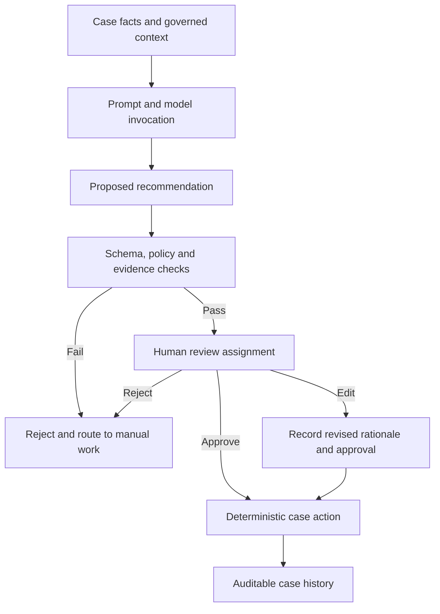

# Human approval for AI-generated recommendations

**Scope:** Pega enterprise architecture and LSA implementation guidance. Version-dependent configuration and recovery semantics require verification against the target platform release.

## A plausible recommendation that bypassed policy

A commercial insurance underwriting case uses a language model to draft a recommendation from case notes and policy documents. The output advises approval despite an excluded industry code. The screen labels the response as a recommendation, but the workflow automatically advances to the approval stage when the model returns the word "approve". A reviewer never sees the exclusion. The system has transformed untrusted generated text into an executable business decision.

A human-in-the-loop architecture must create a real approval boundary. A decorative "review" label is insufficient if the case advances automatically, if the approver lacks source evidence, or if a background worker can bypass the assignment. The model can propose; deterministic Pega rules enforce mandatory policy and authorized operators commit the business action.

## Decision boundary

Represent the model output in a dedicated data object with RecommendationID, model/prompt version, case version, cited evidence identifiers, proposed action, confidence or uncertainty descriptor, policy-check results and generation timestamp. Do not treat a self-reported model confidence as a calibrated probability. Store only permitted content and apply retention rules to generated text and prompt metadata.

Use a case stage such as Evaluate recommendation with a Review recommendation assignment. Configure routing to a qualified work queue, role and privilege. Use Access of Role to Object and privileges for action authorization, plus Access Control Policy rules where row-level or field-level protection is required. The approver must be able to reject, edit with a reason, or request more evidence. A rejection must not be retried automatically until a new model output happens to pass.

A deterministic decision table or decision strategy should validate exclusions, required fields and threshold conditions independently of the model. Do not let the model author its own policy test. The generated recommendation is advisory even if it is syntactically valid.

## Implementation sequence

1. Identify the irreversible business actions, their legal owner and mandatory approval roles. Define what the model is permitted to suggest and what it may never execute.
2. Design the case data model for the proposal, source references, prompt version and human decision. Separate sensitive raw context from the reviewer-facing summary.
3. Create a generation step that invokes an approved model interface with bounded inputs and a fixed output schema. Reject malformed or ungrounded outputs.
4. Run independent eligibility and exclusion checks using Pega decision rules. If the model contradicts a hard rule, show the conflict and route to manual assessment.
5. Create an assignment with Approve, Revise and Reject flow actions. Make the reviewer inspect source evidence and attest to required checks before approval.
6. On submission, re-check the case version and critical facts. If the policy, identity or source data changed during review, invalidate the proposal and regenerate or reassess.
7. Execute the authorized business action only after the approval is persisted. Avoid invoking irreversible integrations before the case commit and required reconciliation logic are established.
8. Record who approved, what they saw, which proposal version they acted on and what edits they made. Restrict access to that audit trail by case and role.
9. Build dashboards for rejection reasons, override patterns, policy conflicts and missing citations. Review these signals for model quality, but do not equate acceptance rate with correctness.

## Tradeoffs

Mandatory human approval increases cycle time and staffing cost, but is appropriate for consequential decisions. A risk-tiered approach may allow automatic handling of low-impact, reversible suggestions after deterministic validation, while requiring review for financial, safety or legal outcomes. A rich explanation improves review quality but can expose unnecessary personal data. Keep evidence references narrow and authorized. Storing the full model response supports auditability but may increase retention and privacy risk; choose a governed record of the exact material presented.

## Production failure mechanics

A common race occurs when an operator approves a recommendation after the case has been amended by another team. Without version checking, the approval authorizes stale facts. Another failure is prompt injection inside an uploaded document instructing the model to bypass review. Treat retrieved documents as data, not instructions, and maintain the deterministic approval gate regardless of model content. If the model provider is unavailable, preserve the case and route to a manual review path; do not infer approval from missing output.

## Reproducible verification matrix

| Scenario | Execution | Expected control |
| --- | --- | --- |
| Excluded applicant | Model proposes approval | Policy conflict blocks execution |
| Missing evidence | Omit source reference | Review cannot approve without exception |
| Unprivileged operator | Attempt approval through API | Authorization denied |
| Concurrent edit | Change case after proposal generated | Stale proposal invalidated |
| Prompt injection | Insert instructions in source document | No bypass of validation or assignment |
| Provider outage | Force model timeout | Manual path available, no false approval |
| Override audit | Reviewer edits and approves | Original, edited text and identity traceable |

No model outputs or test results are fabricated here. Verify the platform release's GenAI facilities, audit retention and access control implementation before use.

## Primary reference

- [Pega Academy: Generative AI in Pega](https://academy.pega.com/topic/generative-ai-pega/v3)

## Architecture flow

## Evidence required before production approval

Attach a reviewed architecture decision, application and Pega release versions, rule identifiers, sanitized test evidence, observed results, open risks and rollback criteria. The matrix is a design-backed verification plan rather than a claim of completed laboratory testing.
