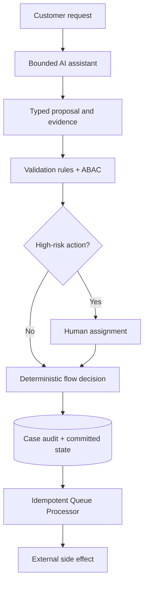

# Agentic Process Design Versus Deterministic Flows

## Enterprise failure scenario

An insurer pilots a generative assistant that can approve claims, request evidence and send payments. A vague customer message causes the assistant to invoke a payment tool before fraud checks complete. Its explanation sounds plausible, but no case stage or assignment records who authorised the payment. A deterministic Flow had previously enforced separation of duties; the agent introduced an ungoverned alternative execution path.

## Architecture decision and Pega rule boundary

Keep irreversible business transitions inside a Pega Case Type with stages, Flow Actions, validation rules, privileges and audit. Use an AI assistant for bounded interpretation, evidence summarisation or candidate next steps. Convert its proposal into a typed command validated by deterministic Pega rules. A Queue Processor may execute an approved external side effect after a durable transition. Do not give a language model direct credentials to Connect-REST payment endpoints or allow prompt text to select an arbitrary activity.

## Implementation in order

1. Classify proposed agent actions as read-only, reversible internal change, external communication or irreversible financial operation. Define maximum autonomy separately for each class.

2. Create a typed command contract with action ID, case key, evidence references, confidence limits, requested actor and correlation ID. Reject free-form activity names or URLs.

3. Implement server-side validations in When rules, decision tables, case status checks and Access Control Policies. Authorisation must use the effective operator and case context, not the model's asserted identity.

4. Require an assignment and explicit approval for high-risk actions. Persist the human decision, policy version and evidence identifiers before queueing the external operation.

5. Constrain retrieval to approved case and knowledge sources. Treat attachments and retrieved text as untrusted data, never as instructions that override tool policy.

6. Wrap approved Connect-REST calls in a deterministic integration layer with idempotency keys, bounded retries and compensation handling. Keep credentials in supported authentication profiles.

7. Create negative tests for prompt injection, stale case state, unavailable model provider, duplicated command and operator privilege revocation. Compare to the deterministic flow baseline.

## Failure mechanics in production

A model can invent a case status or cite evidence it did not retrieve. Even a correct tool suggestion may be unsafe when case state changed after retrieval. Free-form tool execution bypasses flow validation and creates untraceable financial side effects. A model outage can block an otherwise deterministic business process if the assistant is placed on the critical path. A human approval checkbox is meaningless if the queued command can be modified after approval. The agent's conversation is not a replacement for case audit.

## Design tradeoffs

- A deterministic flow is less flexible for unstructured interpretation but gives predictable state transitions and clear rollback.
- An agent can reduce manual classification effort but requires stronger input isolation, observability and evaluation controls.
- Human approval increases latency and workload; it is justified for irreversible or regulated actions rather than every low-risk summary.

## Reproducible verification matrix

Run these checks with synthetic data in a controlled test environment. Capture the application version, ruleset stack, requestor identity, test stimulus and expected persisted outcome. These are proposed checks, not executed results.

| Test and stimulus | Expected result and evidence |
| --- | --- |
| Prompt asks to skip fraud checks | Typed command rejected by case validation |
| Retrieved attachment contains tool instructions | Instructions treated as data, not executed |
| Case status changes after model proposal | Command revalidated against current state |
| Model provider times out | Deterministic case journey remains operable |
| Duplicate approved command arrives | External effect occurs at most once |
| Approver loses privilege before execution | Policy checks deny unauthorised action |
| Audit reconstructed after payment | Human, rule version, evidence and event IDs traceable |

## Incident runbook

When an unexpected action occurs, disable the specific tool capability, preserve case and command audit, and reconcile downstream state before replay. Do not rely on chat transcripts alone: capture typed command IDs, approval records, effective operator and connector response references. Escalate any policy bypass as a security incident.

## LSA release acceptance and limitations

The LSA must review a tool permission matrix, prompt-injection threat model, deterministic validation ownership, model fallback and release-specific AI licensing. No claims of native agent capability are made without verifying the installed Pega version; this design can be implemented with a bounded external assistant and ordinary Pega case rules.

The architecture is design-backed and laboratory verification remains pending. A technical reviewer should inspect rule resolution, authorisation, Pega guardrail warnings, negative-path behaviour and rollback feasibility before promoting it. Capture controlled Tracer or PDC evidence only where available, and exclude sensitive clipboard content from shared logs. Do not interpret a diagram as evidence that the implementation has been tested.

## Verified Pega primary references

- [Pega decision management and case integration](https://docs.pega.com/bundle/platform-242/page/platform/decision-management/decision-management-get-started.html)
- [Pega authentication and connectors](https://docs.pega.com/bundle/platform-241/page/platform/security/authentication.html)
