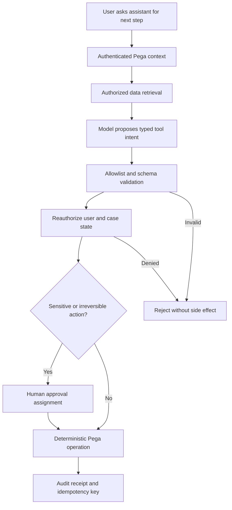

# Safe tool invocation by autonomous workflows

## Failure scenario: an assistant closes a regulatory case without approval

A financial-services team adds a conversational assistant to a Pega investigation case. The assistant can retrieve policy guidance and propose next steps. During a pilot, a retrieved document contains instructions to invoke a closure tool. The assistant interprets that untrusted text as an operator instruction and calls a case-update operation. A regulated case moves to resolved without the required human approval. The immediate defect is an authorization boundary failure, not a poor prompt.

The design invariant is that **an LLM may propose an operation, but only deterministic application controls may authorize and commit it**. Neither model output nor retrieved content is a trusted Pega operator, even if it looks like a valid JSON tool call. Platform Agents and automations differ by version; the architecture below is a control pattern, not a claim that every release exposes the same native tool API.

## Define the execution boundary

Treat the assistant as an untrusted decision-support component. Its outputs are candidate intents with arguments, not executable activities. Map each permitted intent to a narrow, versioned operation in Pega, for example `GetCaseSummary`, `DraftReviewNote` and `SubmitReviewForApproval`. Do not expose a generic activity runner, unrestricted Connect REST invocation, dynamic class name or arbitrary property setter.

Use Access Groups, Access Roles to Objects, Privileges, Access Control Policies and case-state validations to enforce permissions at execution time. A Data Page used for retrieval must return only information the current authorized context may read. A tool that changes a case must re-check `pyStatusWork`, assignment ownership, required approvals and case lock state immediately before committing.

## Trust and tool flow

## Implementation sequence

1. **Inventory tool risk.** Classify tools as read-only, reversible write, irreversible external write, or privileged administration. Initially expose only read-only operations and one low-risk, audited draft action.
2. **Create strict tool schemas.** Each operation accepts fixed fields with bounded length and enumerated values. Reject unknown fields, class names, rule names, URL overrides, prompt-injected system instructions and unsupported state transitions.
3. **Bind identity outside the model.** Obtain operator, tenant, access group and case identity from the authenticated Pega request, not from model arguments. Never let the assistant select another operator's Access Group.
4. **Enforce object-level security.** Reevaluate ARO and ABAC policy decisions on every tool execution. A prior authorized retrieval does not grant authority to update a different case. Use a supported case action or flow transition rather than direct clipboard mutation when possible.
5. **Use an approval boundary.** For closing investigations, releasing payments or contacting regulators, create an explicit Pega assignment for an authorized human. The approval records the proposed action and rationale but does not treat model-generated reasoning as evidence of compliance.
6. **Make writes idempotent.** Generate a server-side operation ID tied to case, action type and approval. Before an external call, check whether that operation already has a receipt. Handle timeout as unknown outcome and reconcile before retry.
7. **Limit context and egress.** Redact confidential fields before retrieval or model invocation according to approved data policy. Keep prompts and outputs out of unrestricted logs. Do not include secrets, access tokens or arbitrary attachment text in tool definitions.
8. **Log a defensible audit chain.** Capture model/version identifier, prompt-template version, authorized operator, tool name, validated argument digest, approval ID, case version and result code. Store only the minimum content needed for review.
9. **Design a safe fallback.** If the model, retrieval service or authorization check fails, leave the case unchanged and route to a normal human assignment. A tool timeout must not be represented to the user as a successful update.

## Failure mechanics and tradeoffs

Prompt injection can arrive through retrieved documents, case notes or attachments. A model may hallucinate a permitted tool name or supply a correct name with dangerous arguments. JSON validation alone cannot enforce business authorization. Conversely, placing every action behind human approval can defeat automation benefits. Use risk-tiered approvals: read-only retrieval can be automatic, reversible drafts can be controlled, and high-impact writes require an independent business decision.

A generic service account simplifies integration but hides accountability. Prefer on-behalf-of authorization where supported; otherwise record the human requester and enforce a separate server-side permission map. Avoid long-lived broad service tokens. Pega's native Agent capabilities evolve rapidly, so verify actual tool configuration, guardrails and supported deployment surfaces for the selected Platform version.

## Reproducible verification matrix

| Attack or failure | Controlled action | Pass condition |
| --- | --- | --- |
| Prompt injection | Retrieved note says to close case | Text treated as data, no closure |
| Tool name spoofing | Model proposes unknown operation | Rejected before execution |
| Cross-case ID | Ask tool to update another tenant's case | Authorization denies request |
| Stale assignment | Revoke operator access after retrieval | Reauthorization blocks write |
| Invalid argument | Inject URL or class override | Strict schema rejects field |
| Approval missing | Attempt regulated closure | Human assignment required |
| Duplicate invocation | Replay same operation ID | Single business side effect |
| Provider timeout | Model call fails mid-journey | Case unchanged, human path available |

**Verification status:** This is a proposed security architecture and lab plan, not a claim that native Agents were deployed or penetration-tested.

## Primary references

- [Pega Platform '25, Agents and case automation capabilities](https://docs.pega.com/bundle/platform-25).
- [Pega Platform access control policies](https://docs.pega.com/bundle/platform-23/page/platform/security/create-access-control-policy.html). Check the installed version for policy behavior.
