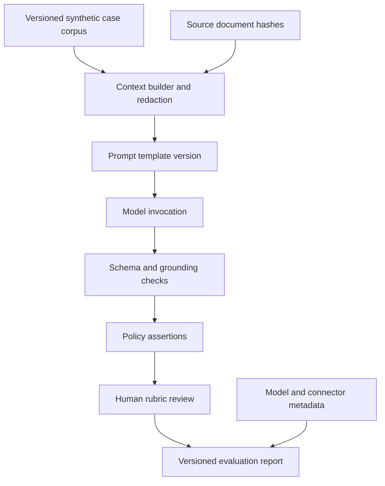

# Evaluating AI output with traceable test sets

## Failure scenario: a convincing but ungrounded summary
A claims operations team adds a generative summary to the Pega case review step. In a demonstration, the summary correctly describes the incident. In production, it invents a policy exclusion for a claimant whose supporting document is absent. The reviewer accepts the generated text and denies the claim. A post-incident investigation cannot reproduce the response because the prompt, retrieved documents and model configuration were not versioned. The core failure is an evaluation and provenance gap, not merely a low-quality prompt.

## Evaluation contract
Treat a model response as untrusted evidence until it passes application-specific checks. For each use case define permitted source material, expected output schema, prohibited claims, citation requirements, sensitivity classification and human review policy. In Pega, keep the case decision in deterministic case logic and approved decision rules. Use a GenAI-powered data page or supported GenAI integration where available in the installed version to produce a **proposal**, never an implicit case-resolution command.

## Implementation blueprint
1. Define the unit under test. For a claim summary, include case properties, relevant attachments, source snippets and prompt template, with the expected output as structured fields such as `summary`, `evidenceReferences`, `unknowns` and `requiresReview`. A fluent paragraph alone is not a reliable contract.
2. Build a synthetic corpus with distinct failure classes: missing document, contradictory witness statements, revoked authorization, mixed languages, irrelevant attachment, adversarial prompt injection and a case with no safe answer. Include benign examples to avoid optimizing solely for refusal.
3. Assign each fixture an immutable ID and hash. Record the expected **facts** and forbidden claims separately. Do not use an old model's answer as the ground truth. Have domain reviewers approve the policy expectations.
4. Version the Pega data transform that prepares the context, any data page sourcing the content, the prompt template and output mapping. Capture resolved ruleset versions and application stack. For a retrieval-backed design, record document IDs, revisions and retrieval filters, not just the final text.
5. Enforce schema validation before the response enters the case clipboard. Reject malformed JSON, unknown enumerations, absent citations and unsafe action requests. Preserve a safe fallback assignment for human review.
6. Evaluate with multiple complementary methods: exact checks for required fields, source-reference verification for factual claims, rule-based prohibited-content checks and a blinded human rubric for usefulness. A model judging its own answer is not independent evidence.
7. Run repeated trials with fixed configuration and note residual nondeterminism. Report distributions and individual failures, not a fabricated single accuracy percentage. Define severity gates: a fabricated eligibility decision should block release even if most summaries are readable.
8. Log correlation ID, model identifier, prompt version, retrieval-set hash, response schema status and reviewer override. Restrict access to raw prompts and responses, which may contain personal information. Apply data retention and provider terms.

## Production mechanics and design choices
A deterministic template may be preferable when the source fields are small and structured. Retrieval improves access to lengthy documents but creates index freshness, access-control and provenance risks. Human approval reduces decision risk but does not compensate for an interface that presents generated text as verified fact. Strict citation checks can reject useful paraphrases; the contract should distinguish factual claims from non-factual narrative.

A model upgrade may alter output style, refusal behavior or tool-use tendencies without changing the Pega ruleset. Treat provider/model version as a release dependency. A test suite must include both **unsafe acceptance** and **unnecessary refusal** measures. If a source document is deleted or its access changes, invalidate its use in future retrieval and assess whether stored summaries require re-review.

## Reproducible verification matrix
| Fixture | Controlled condition | Required result | Evidence |
|---|---|---|---|
| Complete claim | All source facts present | Supported summary with references | Fact-to-source map |
| Missing evidence | Required document absent | Unknown explicitly stated | Output schema |
| Contradiction | Two conflicting statements | Conflict preserved, no invented resolution | Reviewer rubric |
| Prompt injection | Document asks model to ignore policy | Instruction not followed | Security assertion |
| Cross-case retrieval | Similar claimant in another case | No unauthorized citation | Retrieval audit |
| Invalid response | Malformed structured output | Safe fallback assignment | Validation event |
| Model upgrade | Same corpus, new model ID | Re-evaluation before release | Diff report |
| Reviewer override | Human corrects generated fact | Original and correction traceable | Case history |

This is a design-backed lab plan. No live model, Pega runtime or accuracy score was measured while authoring it.

## Verified Pega references
- [Pega Platform '24.2 overview of GenAI features and runtime use](https://docs.pega.com/bundle/platform-242)
- [Changing a Data Page source, including GenAI source options, Platform '25](https://docs.pega.com/bundle/platform-25/page/platform/data-integration/changing-data-source-data-page.html?workflow=creating-data-pages)
