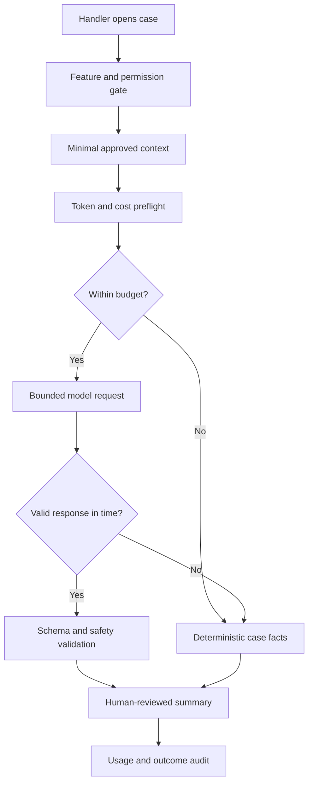

# LLM request cost and latency budgets
## Failure scenario
An insurance claims team adds a GenAI-generated case summary to every assignment open. A summary request includes all case notes and attachment extracts even when the handler only needs a two-sentence status. At peak load, provider throttling slows the case view; retries produce duplicate model calls and costs rise. The team cannot attribute spend because it records only HTTP status, not the model, input size or case feature. A convenience feature has become a synchronous dependency of a regulated workflow.

## Model the budget at the case boundary
Separate the user-visible interaction budget from the model service's timeout and cost envelope. Define an explicit use-case contract: purpose, input fields, maximum source size, permitted provider, output schema, data classification, human review, fallback and retention. Pega Platform releases supporting GenAI Data Page sources or GenAI Connect rules can map requests and responses into a Data Page. Availability and configuration depend on release, product entitlements and deployment. For unsupported versions, a governed Connect REST integration may be required; do not describe every GenAI feature as universal.

Treat `D_CaseSummary` as a deliberately narrow read-only source, not a place to dump `pyWorkPage`. The input Data Transform should select approved fields and truncate or summarize oversized notes before invoking a provider. Cache only where identity, authorization, freshness and data retention are demonstrably safe. A requestor-specific case summary must never be stored in a global node cache without isolation.

## Implementation sequence
1. Define a service-level objective for opening the assignment and a smaller sub-budget for optional AI content. Never block case save or mandatory eligibility evaluation on a nonessential summary. Agree a cost ceiling per feature, operator group and daily aggregate before enabling the capability.
2. Create a data classification matrix for case notes, attachments, personal identifiers, protected attributes and internal procedures. Use Access Control Policies and application roles for source access, then apply a separate outbound allowlist. Authorization to view a field does not automatically authorize sending it to a model provider.
3. Design a `Data Transform` that builds a compact request DTO. Exclude raw attachments by default; use bounded extracts and a documented truncation policy. Record prompt template version, model identifier, token-estimate method and case revision, but not full prompt text in unrestricted logs.
4. Configure a GenAI Data Page source or Connect REST integration according to the target Pega version. Use an approved Authentication Profile or provider connection, explicit connection and response timeouts, and controlled response mapping. Ensure credentials never enter clipboard properties visible to ordinary users.
5. Estimate input and output usage before dispatch, with a conservative margin for provider-specific tokenization. Apply concurrency limits and per-user quotas outside the case transaction. A client-side disabled button is not a cost control.
6. Define retry semantics. A timeout after a provider accepted a request may still be billable; automatic retries can multiply spend. Use a request correlation key, a bounded retry policy for transient failures and provider idempotency features only when documented.
7. Validate output against an explicit schema, reject malformed or unsupported claims, and label generated text as draft. Persist the human approval decision separately from the model response if a summary becomes part of the case record.
8. Add a deterministic fallback: show status, last assignment, SLA and known case facts from Pega properties. If the provider is unavailable, the handler must still complete the business step.
9. Instrument request count, estimated versus billed usage where available, error class, latency percentiles, fallback rate, approval rate and per-feature spend. Do not invent provider price or token metrics; use the current contract and invoices.
10. Rehearse a model switch with a fixed test set to detect output and cost changes. Reassess data residency, retention and prompt injection risks whenever a new provider or retrieval source is introduced.

## Tradeoffs and failure mechanics
Precomputation reduces interactive latency but can produce stale summaries after a case update. Synchronous generation is fresher but consumes the interaction budget. Caching lowers repeated cost while increasing access-revocation and retention risks. Smaller prompts are cheaper but can omit crucial context; use explicit factual coverage tests rather than assuming shorter is always better.

A dangerous failure is a 504 response followed by a retry when the first provider request actually completed. Another is a prompt template change that silently doubles the output size. Distinguish estimated, accepted and billed requests in telemetry and reconcile provider invoices with application-level usage.

## Verification matrix
| Test | Stimulus | Expected result | Evidence |
|---|---|---|---|
| Oversized case | Long notes and attachments | Bounded input and safe truncation | DTO size audit |
| Provider timeout | Delayed model response | Case view remains usable | UI and timeout trace |
| Duplicate request | Retry after ambiguous timeout | No uncontrolled call storm | Correlation IDs |
| Permission change | Revoke case access | No new model request or cached leak | Access audit |
| Invalid output | Missing schema fields | Reject and show fallback | Validation log |
| Cost ceiling | Exceed synthetic quota | Model call suppressed | Budget decision |
| Model revision | Run fixed prompts on two versions | Differences reviewed | Evaluation diff |

All budgets are design parameters and tests are pending. Provider rates and Pega GenAI configuration must be verified against the deployment and contract.
## Verified primary guidance
- [Creating a Data Page, Pega Platform '25, including GenAI source](https://docs.pega.com/bundle/platform-25/page/platform/data-integration/creating-data-page.html?workflow=creating-data-pages)
