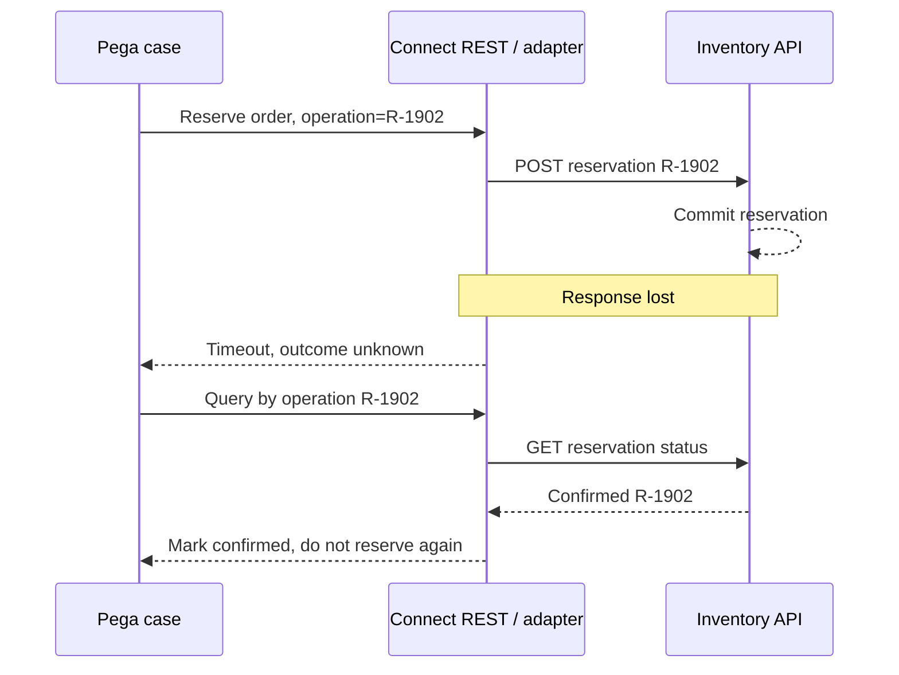

# Connect REST Reliability: Timeouts, Retries and Uncertain Outcomes

**PFA-091** | **Audience:** Senior and Lead System Architects | **Status:** Reference architecture; live Pega test pending

A timed-out connector does not mean a failed business operation. Build a Pega integration contract that can distinguish rejections, transient failures and completed requests with lost responses.

## 1. The enterprise failure this design prevents

A fulfilment case reserves stock using a remote inventory API. A request times out after eight seconds, while the remote system may already have allocated inventory. A naive Flow retries the same POST with a new reference and reserves twice. A naive error handler assumes the stock allocation failed and cancels the case. Both designs violate the business contract. The correct boundary combines Pega Connect REST error handling with a business operation identity, explicit timeout budget and reconciliation path.

## 2. Component and execution architecture

The following diagram is an **illustrative reference design**. It is not a screenshot from a running Pega environment.

## 3. Which Pega objects own each concern?

| Component | Why it exists |
|---|---|
| `Connect-REST ReserveInventory` | Request mapping, endpoint, authentication and response mapping |
| `Integration adapter activity/data transform` | Translate transport errors into domain outcomes |
| `D_ReservationStatus` | Read external status by stable operation ID |
| `ReserveInventory retry policy` | Differentiate safe retries from uncertain operations |
| `Case .ReservationOperationID` | Persist business identity before dispatch |

The named objects above are a mix of actual Pega rule categories and illustrative application-specific names. They are not a claim that all such rules exist in a default Pega installation.

## 4. Implementation design and decision sequence

1. Allocate a stable reservation operation key when the business first requests stock, not inside each connector invocation.

2. Model the dependency's contract in advance: Is there a status lookup? Is duplicate reservation with the same key idempotent? Does it return an existing result?

3. Configure the connector's request and response mapping so the case only receives a normalized result such as Confirmed, Rejected, Pending or Unknown.

4. Set connection and response timeouts in context of the user's complete latency budget. Never allow chained connector timeouts to exceed the interactive request target unnoticed.

5. Classify outcomes: 4xx validation rejection, authentication failure, 429 rate limiting, 5xx transient server errors, timeout with unknown effect. Handle them differently.

6. On an unknown outcome, query the remote operation first or safely retry the same idempotency key if the partner contract supports it. Do not create a new business identity.

7. Add correlation identifiers and redact sensitive payloads in logs. Separate diagnostic IDs from customer names, tokens and personal information.

## 5. What an architect must choose

| Approach | Effect and trade-off |
|---|---|
| Synchronous Connect REST in an interactive step | Appropriate for short, read-only or immediate confirmation calls with tight latency bounds |
| Queue Processor with asynchronous confirmation | Appropriate for slow side effects with managed retries and business status visibility |
| Integration facade / API gateway | Useful when deduplication, security policy or vendor-specific reliability should be centralised |

**Decision standard:** choose the smallest design that satisfies consistency, auditability, security, performance and operational recovery, not the design that simply looks easiest in Dev Studio.

## 6. Failure modes and root-cause investigation

**Unknown outcome:** timeout after remote commit; inspect partner status before replay. **Retry storm:** 429 response produces immediate repeated attempts across workers; honour backoff and dependency capacity. **Authentication lapse:** an expired client credential is misclassified as a transient timeout; halt repeated calls and escalate secret rotation. **Partial transaction:** case commits Pending but no external call is observed; verify when queuing occurs relative to Pega transaction commit. **Bad response mapping:** a successful transport status contains an application-level rejection that the UI ignores.

For troubleshooting, preserve the application/ruleset version, access context, precise business identity, timestamp and correlation ID. Never include secrets or production customer documents in publicly shared traces.

## 7. Verification matrix for a Pega lab

These are **tests to run**, not tests that have already passed.

| Experiment | Evidence and expected assertion |
|---|---|
| Normal reserve | Single operation ID and partner receipt are persisted |
| Lost response | Drop HTTP response after successful reserve; no second reservation |
| Remote 400 | Permanent business or schema rejection, not automatic retry |
| HTTP 429 | Backoff and throughput control protect vendor quota |
| 5xx outage | Failure policy records Pending/Unknown and support can recover |
| Timeout budget | Pega time plus network time plus downstream time stays inside agreed experience contract |

At the end of the experiment, attach redacted screenshots of the relevant rule forms, Clipboard/Tracer/PAL evidence when applicable, and an actual observed outcome. If any result differs, update the design instead of changing the evidence description.

## 8. Production readiness and ownership

Track per-operation latency, result classification, retry count, correlation ID and age of unresolved outcomes. Alert on oldest Pending reservations rather than merely counting HTTP errors. Keep credentials out of Tracer attachments or support exports.

**Architecture acceptance:** the design has an explicit owner, a version-specific reproducible test, a failure/recovery procedure, the relevant security controls and a way to detect regressions.

## 9. Product references and limitations

- [Pega Academy: Queue processors and job schedulers](https://academy.pega.com/topic/queue-processors-and-job-schedulers/v2)
- [Pega developer discussion: Connect REST error response handling](https://forums.pega.com/t/how-to-configure-exception-handling-in-connect-rest-when-source-is-within-pega/6649/4)

Pega functionality changes by release. Treat exact editor labels, extension points and service behaviours as version-sensitive until verified in the target environment. This independent article is neither an official Pega document nor a claim of an executed customer implementation.
