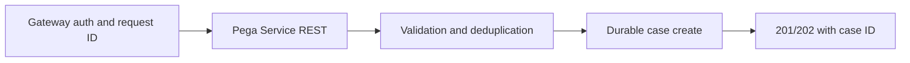

# Service REST for synchronous case creation

**PFA-092** | Pega Lead System Architect study | Lab verification pending

## Business situation

A retail bank's partner portal creates loan cases via Service REST. On a slow network the caller retries the POST because no response arrives. The Pega case creation already committed, so the second POST creates a duplicate application.

The engineering objective is to prove a bounded, authorized and recoverable transaction. A response from an interface or query is useful evidence but not, by itself, proof that a remote effect and Pega case state were committed as one unit.

## Proposed processing design

## Relevant Pega rules and interfaces

1. **Service REST:** record real class/ruleset, source system, trusted principal and support responsibility for this component.
2. **Service Package:** record real class/ruleset, source system, trusted principal and support responsibility for this component.
3. **Case Type:** record real class/ruleset, source system, trusted principal and support responsibility for this component.
4. **case creation API:** record real class/ruleset, source system, trusted principal and support responsibility for this component.
5. **transaction-safe request ledger:** record real class/ruleset, source system, trusted principal and support responsibility for this component.

## Detailed implementation decisions

1. Authenticate and authorize the service caller separately from interactive users, with an approved service package and scoped privileges.

2. Require a stable external submission ID and persist a uniqueness mapping to created case ID, safe under concurrent identical requests.

3. Perform input schema validation and entitlement before creating the business case; reject unsupported customer/case combinations explicitly.

4. Keep initial case creation within a bounded response budget; move optional scoring and notifications to asynchronous processing with a Pending status.

5. On duplicate retry return the existing case identity and original accepted status instead of creating another case.

Before coding, create a lightweight interface specification containing endpoint or source, message/record identity, required fields, timeout/consistency objective and expected behavior for missing or duplicated information.

## Design alternatives

- **Pattern 1:** Synchronous full case workflow simplifies client but scales poorly.
- **Pattern 2:** accept-and-enrich reduces latency but requires status query.

The ADR should identify which requirement would fail under the rejected pattern and how the selected design handles both slow and unavailable dependencies.

## Failure scenario to diagnose

A retry after connection loss duplicates a loan, or a malformed service package grants system-wide creation rights.

Use Pega Tracer, PAL, DBTrace and service-side request/receipt logs when relevant. Reconcile case ID with external operation ID and event/version so a retry is not accidentally interpreted as a new business command.

## Acceptance tests

1. **Controlled test 1:** Send 10 parallel identical posts. Capture the committed state, error type, elapsed time and whether any remote effect occurred.
2. **Controlled test 2:** drop response after commit. Capture the committed state, error type, elapsed time and whether any remote effect occurred.
3. **Controlled test 3:** submit unauthorized customer case. Capture the committed state, error type, elapsed time and whether any remote effect occurred.

These are test instructions. No benchmarks, live screenshots or successful lab outcomes have been fabricated. A validated edition must state its Pega release and retain sanitized configuration evidence.

## Production runbook requirements

Specify who can replay failed actions, the expiry time for unresolved outcomes, backpressure or throttling limits and a repair path. For reporting and data retention, verify authorization, point-in-time interpretation and historical evidence as well as throughput. For integrations, distinguish callback acceptance from final business completion.

## Primary reading

- [Pega Academy: Authentication](https://academy.pega.com/topic/authentication/v6)

*Independent architectural reference using fictional examples. Version-sensitive details should be rechecked against the deployed release.*
