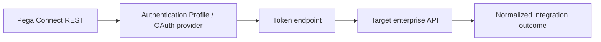

# OAuth Token Rotation for Connect REST: Designing Failure Recovery Without Sharing Secrets

**PFA-093** | Technical design study for Pega Senior and Lead System Architects | Laboratory verification pending

## Architecture problem

A production Connect REST integration fails every few hours when its OAuth access token expires. One solution stores a token in a requestor-scoped page and shares that token with background processing. That cannot work reliably across requestors or nodes. Credentials belong to an explicit authentication profile and governed provider configuration with rotation and monitoring.

## System design

This diagram records a proposed boundary, not a fabricated Pega runtime screenshot. The interfaces and exact rule forms must be verified in a permitted sandbox.

## Feature inventory and design responsibilities

| Pega rule or component | Review requirement |
|---|---|
| Connect REST | Primary configuration and ownership boundary |
| Authentication Profile | Explicit input/output and identity contract |
| OAuth 2.0 Provider data instance | Apply platform-version-specific controls |
| Client credential secret management | Test failure handling and observability |
| Integration error mapping and telemetry | Validate runtime access and support procedure |

## Implementation approach

1. Determine the actual OAuth grant and whether interactive user delegation or machine identity is required; avoid reusing a human access token for queued jobs.

2. Configure a supported Authentication Profile and OAuth provider where applicable, keeping secrets out of rule parameters and logs.

3. Define token cache/refresh expectations for distributed nodes and workers; never rely on a particular browser requestor being alive.

4. Plan dual-credential overlap for secret rotation when provider policy permits, and rehearse the exact cutover.

5. Distinguish 401/invalid token from 403/insufficient entitlement. Blind retry cannot fix missing authorization.

6. Protect token endpoint capacity during a synchronized expiry event and monitor token acquisition latency and rate.

7. Redact access tokens and refresh tokens from every trace, exception message and support export.

## Design alternatives

| Option | Architectural trade-off |
|---|---|
| Hard-coded token in application rule | Insecure and brittle |
| Managed profile/provider configuration | Explicit reusable service identity and rotation controls |
| Custom token service | May fit unusual vendors, adds operational and security responsibilities |

Choose the option that satisfies the business consistency contract and operational constraints. Avoid proving only the success path while deferring security, stale state and recovery behaviour.

## Failure modes and troubleshooting

Token expiry can cascade across background nodes. Clock skew can make a token appear valid locally after the provider rejects it. Secret rotation can invalidate old credentials before all nodes use the new version. Use auth failure telemetry and verified retry controls.

Capture a sanitized case ID or operation identifier, relevant runtime node, application/ruleset version and timestamps. Correlate the origin and outcome across Pega and partner systems instead of relying on a single status message.

## Verification experiments

| Scenario | Evidence required |
|---|---|
| Experiment 1 | Expire access token and verify controlled refresh/retry. |
| Experiment 2 | Rotate client secret while old token remains active. |
| Experiment 3 | Return HTTP 403 with valid token, ensure no token-refresh loop. |
| Experiment 4 | Restart node and verify queued integration can still authenticate. |

These are experiments to perform in a Pega lab. The article does not claim that any test has passed. A lab-verified version should include actual configuration screenshots, observed results and target Pega version.

## Production acceptance

Before deployment, the implementation needs documented data ownership, access context, expected peak volume, case compatibility, timeouts and retry boundaries, monitoring, escalation owner and a tested operational repair path. If the design changes a data model or class structure, verify legacy case paths and queued work.

## Pega technical source

- [Primary Pega reference](https://academy.pega.com/topic/authentication/v6)

Independent original technical analysis. Pega version-specific features and terminology must be confirmed against the target release; the scenario is fictional.
