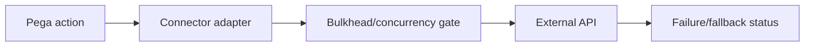

# Circuit breaker and bulkhead placement around Pega

**PFA-094** | Pega Lead System Architect study | Lab verification pending

## Business situation

A Pega case action calls three APIs from one external vendor. During a vendor outage all requests time out at 20 seconds and retries multiply traffic. More Pega web threads accumulate until healthy services also slow.

The engineering objective is to prove a bounded, authorized and recoverable transaction. A response from an interface or query is useful evidence but not, by itself, proof that a remote effect and Pega case state were committed as one unit.

## Proposed processing design

## Relevant Pega rules and interfaces

1. **Connect REST:** record real class/ruleset, source system, trusted principal and support responsibility for this component.
2. **Authentication Profile:** record real class/ruleset, source system, trusted principal and support responsibility for this component.
3. **Data Page:** record real class/ruleset, source system, trusted principal and support responsibility for this component.
4. **Queue Processor:** record real class/ruleset, source system, trusted principal and support responsibility for this component.
5. **operation correlation:** record real class/ruleset, source system, trusted principal and support responsibility for this component.

## Detailed implementation decisions

1. Identify independent dependency failure domains and give each a latency/concurrency budget. A connector retry loop is not a circuit breaker by itself.

2. Place a circuit breaker or rate-limiting bulkhead in a supported integration gateway or adapter layer where state is shared and observable.

3. Classify operations as read-only, idempotent write or uncertain write; only safe retries may be automated without partner reconciliation.

4. During a sustained outage, fail fast for noncritical enrichment and park important business operations as Pending with a repair path.

5. Test recovery after half-open probing and cap queued retries to avoid stampedes when vendor returns.

Before coding, create a lightweight interface specification containing endpoint or source, message/record identity, required fields, timeout/consistency objective and expected behavior for missing or duplicated information.

## Design alternatives

- **Pattern 1:** Per-connector timeouts isolate one request but don't cap fleet load.
- **Pattern 2:** gateway bulkhead protects shared capacity but needs ownership.

The ADR should identify which requirement would fail under the rejected pattern and how the selected design handles both slow and unavailable dependencies.

## Failure scenario to diagnose

Saturation causes unrelated Pega operations to wait on DB threads or network pools. An overaggressive breaker can block a healthy recovered vendor.

Use Pega Tracer, PAL, DBTrace and service-side request/receipt logs when relevant. Reconcile case ID with external operation ID and event/version so a retry is not accidentally interpreted as a new business command.

## Acceptance tests

1. **Controlled test 1:** Simulate 500ms to 20s vendor slowdown. Capture the committed state, error type, elapsed time and whether any remote effect occurred.
2. **Controlled test 2:** inject 429. Capture the committed state, error type, elapsed time and whether any remote effect occurred.
3. **Controlled test 3:** restore API and watch ramp-up. Capture the committed state, error type, elapsed time and whether any remote effect occurred.

These are test instructions. No benchmarks, live screenshots or successful lab outcomes have been fabricated. A validated edition must state its Pega release and retain sanitized configuration evidence.

## Production runbook requirements

Specify who can replay failed actions, the expiry time for unresolved outcomes, backpressure or throttling limits and a repair path. For reporting and data retention, verify authorization, point-in-time interpretation and historical evidence as well as throughput. For integrations, distinguish callback acceptance from final business completion.

## Primary reading

- [Pega Academy: Authentication](https://academy.pega.com/topic/authentication/v6)

*Independent architectural reference using fictional examples. Version-sensitive details should be rechecked against the deployed release.*
