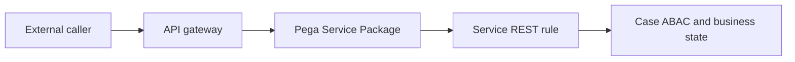

# API gateway responsibilities versus service rules

**PFA-095** | Pega Lead System Architect study | Lab verification pending

## Business situation

A financial-services API gateway validates OAuth scopes, but a Pega Service REST still allows a valid caller to request any tenant's case. Another developer adds IP allowlisting to a Service Package and assumes that is sufficient authorization.

The engineering objective is to prove a bounded, authorized and recoverable transaction. A response from an interface or query is useful evidence but not, by itself, proof that a remote effect and Pega case state were committed as one unit.

## Proposed processing design

## Relevant Pega rules and interfaces

1. **API gateway:** record real class/ruleset, source system, trusted principal and support responsibility for this component.
2. **Service Package:** record real class/ruleset, source system, trusted principal and support responsibility for this component.
3. **Service REST:** record real class/ruleset, source system, trusted principal and support responsibility for this component.
4. **Access Role:** record real class/ruleset, source system, trusted principal and support responsibility for this component.
5. **Access Control Policy:** record real class/ruleset, source system, trusted principal and support responsibility for this component.

## Detailed implementation decisions

1. Define the gateway's responsibilities for TLS, token verification, rate limiting, threat protection and correlation headers.

2. Define Pega's responsibility for operator/service identity, record-level permission, business validation and allowed case state transitions.

3. Map gateway claims to a trusted Pega authorization context only through a verified mapping contract.

4. Never use the presence of a gateway as an excuse to omit Pega-side access checks on case ID and tenant ID.

5. Test direct API requests through permitted gateway paths, including forged customer IDs and mismatched roles.

Before coding, create a lightweight interface specification containing endpoint or source, message/record identity, required fields, timeout/consistency objective and expected behavior for missing or duplicated information.

## Design alternatives

- **Pattern 1:** Gateway centralizes edge controls.
- **Pattern 2:** Pega rules must still enforce case-specific business authorization.

The ADR should identify which requirement would fail under the rejected pattern and how the selected design handles both slow and unavailable dependencies.

## Failure scenario to diagnose

A valid service token for Client A reads Client B record because the Pega API trusts user-supplied tenant input.

Use Pega Tracer, PAL, DBTrace and service-side request/receipt logs when relevant. Reconcile case ID with external operation ID and event/version so a retry is not accidentally interpreted as a new business command.

## Acceptance tests

1. **Controlled test 1:** Cross-tenant case lookup with valid token. Capture the committed state, error type, elapsed time and whether any remote effect occurred.
2. **Controlled test 2:** invalid scope. Capture the committed state, error type, elapsed time and whether any remote effect occurred.
3. **Controlled test 3:** direct endpoint bypass attempt if policy permits testing. Capture the committed state, error type, elapsed time and whether any remote effect occurred.

These are test instructions. No benchmarks, live screenshots or successful lab outcomes have been fabricated. A validated edition must state its Pega release and retain sanitized configuration evidence.

## Production runbook requirements

Specify who can replay failed actions, the expiry time for unresolved outcomes, backpressure or throttling limits and a repair path. For reporting and data retention, verify authorization, point-in-time interpretation and historical evidence as well as throughput. For integrations, distinguish callback acceptance from final business completion.

## Primary reading

- [Pega Academy: Authentication](https://academy.pega.com/topic/authentication/v6)

*Independent architectural reference using fictional examples. Version-sensitive details should be rechecked against the deployed release.*
