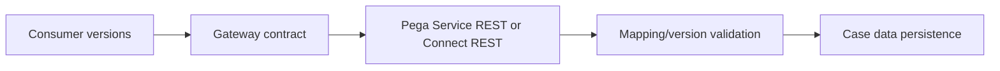

# REST schema evolution without breaking consumers

**PFA-097** | Pega Lead System Architect study | Lab verification pending

## Business situation

An enterprise client adds a mandatory field to its JSON schema. A Pega Service REST consumer deployed yesterday rejects the request, while an old mobile client still uses the previous format. A rolling upgrade requires an explicit compatibility window.

The engineering objective is to prove a bounded, authorized and recoverable transaction. A response from an interface or query is useful evidence but not, by itself, proof that a remote effect and Pega case state were committed as one unit.

## Proposed processing design

## Relevant Pega rules and interfaces

1. **Service REST:** record real class/ruleset, source system, trusted principal and support responsibility for this component.
2. **Connect REST:** record real class/ruleset, source system, trusted principal and support responsibility for this component.
3. **JSON mapping:** record real class/ruleset, source system, trusted principal and support responsibility for this component.
4. **Data Transform:** record real class/ruleset, source system, trusted principal and support responsibility for this component.
5. **PegaUnit contracts:** record real class/ruleset, source system, trusted principal and support responsibility for this component.

## Detailed implementation decisions

1. Publish a versioned contract including required fields, null behavior, enum extensions, error schema and deprecation timetable.

2. Prefer additive optional fields where possible; reject incompatible breaking changes in a new version rather than altering an existing contract silently.

3. Map partner response into a stable internal Data class so case logic is not coupled directly to external JSON names.

4. Build consumer-driven contract tests for old and new clients, including unknown fields and missing optional values.

5. Rehearse mixed-version traffic in pre-production and measure errors by client version after release.

Before coding, create a lightweight interface specification containing endpoint or source, message/record identity, required fields, timeout/consistency objective and expected behavior for missing or duplicated information.

## Design alternatives

- **Pattern 1:** Single mutable endpoint saves routing complexity but risks consumers.
- **Pattern 2:** versioned endpoint preserves compatibility but needs retirement governance.

The ADR should identify which requirement would fail under the rejected pattern and how the selected design handles both slow and unavailable dependencies.

## Failure scenario to diagnose

A previously optional field becomes required and historical queued payloads can no longer be processed after deployment.

Use Pega Tracer, PAL, DBTrace and service-side request/receipt logs when relevant. Reconcile case ID with external operation ID and event/version so a retry is not accidentally interpreted as a new business command.

## Acceptance tests

1. **Controlled test 1:** Replay old JSON after new deployment. Capture the committed state, error type, elapsed time and whether any remote effect occurred.
2. **Controlled test 2:** send new enum to old client. Capture the committed state, error type, elapsed time and whether any remote effect occurred.
3. **Controlled test 3:** verify error response version. Capture the committed state, error type, elapsed time and whether any remote effect occurred.

These are test instructions. No benchmarks, live screenshots or successful lab outcomes have been fabricated. A validated edition must state its Pega release and retain sanitized configuration evidence.

## Production runbook requirements

Specify who can replay failed actions, the expiry time for unresolved outcomes, backpressure or throttling limits and a repair path. For reporting and data retention, verify authorization, point-in-time interpretation and historical evidence as well as throughput. For integrations, distinguish callback acceptance from final business completion.

## Primary reading

- [Pega Academy: Authentication](https://academy.pega.com/topic/authentication/v6)

*Independent architectural reference using fictional examples. Version-sensitive details should be rechecked against the deployed release.*
