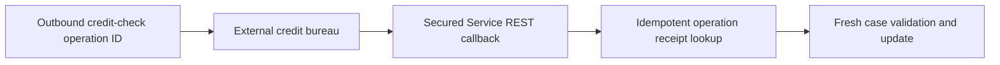

# Asynchronous Partner Callbacks: Stopping Late Responses from Overwriting New Decisions

**PFA-098** | **Audience:** Senior and Lead System Architects | **Status:** Architecture design, live Pega verification pending

## The actual failure

A credit bureau assesses version one of a lending application. The applicant corrects income information and requests version two. Version two completes successfully, then the old version-one callback arrives. An endpoint that locates a case by customer ID alone may overwrite the newer decision. Correct correlation needs a durable operation identity, request version and explicit state transition policy.

## System interaction and ownership

This is a conceptual reference architecture, not a product screenshot or observed runtime trace. Its boundaries must be verified for the actual Pega deployment version and external systems.

## Pega implementation inventory

| Component or rule | Design consideration |
|---|---|
| Connect REST credit-check request | Owns a defined runtime decision or state boundary |
| Service REST callback and Service Package | Needs a documented input/output contract |
| Case assessment version | Requires version-specific access and execution testing |
| Operation receipt data class | Produces diagnostics for failure isolation |
| Case update with lock handling | Carries operational ownership |

## How to implement and validate the architecture

1. Assign and persist a unique immutable request operation ID at dispatch time, separate from the customer ID.

2. Establish callback authentication and required sender verification independently of interactive SSO.

3. Validate schema, operation ID, replay window and current assessment version before opening the case for mutation.

4. Persist a callback receipt so retrying the same message cannot create a second decision or notification.

5. Reject superseded results or record them as historical evidence, according to approved business policy.

6. Return controlled acknowledgement to the sender without leaking existence or details of other customers' cases.

For a production build, annotate the actual class names, access group, ruleset version, node role and recovery owner. Ensure each external operation has an explicit system of record; a successful Pega case save does not, by itself, certify that an external service committed a change.

## Architectural choices

| Pattern | Consequence |
|---|---|
| Correlate by customer ID | Convenient but unsafe with concurrent or amended applications |
| Operation ID and version | Safe out-of-order responses, needs durable correlation |
| Polling instead of callbacks | Avoids inbound webhook security but increases partner traffic and latency |

Choose by the actual confidentiality, scale, consistency and failure-recovery constraints. A seemingly quicker configuration can shift cost into production support, data repair or lost auditability.

## Failure mechanics and support diagnosis

A callback can be authentic yet obsolete. A handler can have overly broad application privileges. Two duplicate messages may race before the receipt is persisted. Test concurrency and require a transaction-safe uniqueness or business-state guard, not only a transient in-memory flag.

Correlate one affected case ID and operation ID across rule execution, logs and dependent services. Record the effective application/ruleset versions and node. Avoid exporting live client data or confidential prompts in community evidence.

## Test matrix

| Test | Expected verification |
|---|---|
| Experiment 1 | Send same signed callback twice and prove one business effect. |
| Experiment 2 | Send version-one result after version two approval; no overwrite. |
| Experiment 3 | Send invalid credentials and expect no case mutation. |
| Experiment 4 | Replay after node restart and confirm operation ID persists. |

These are **experiments to execute**, not assertions of a completed test. Include Pega configuration screenshots and sanitized Clipboard, Tracer, PAL or service evidence only after an authorised lab run. A failing experiment is valuable evidence and should update the design.

## Release and production readiness

Before promoting the design, confirm: observable business state; retry and rollback constraints; tenant and privilege isolation; capacity target; accountable support team; release-specific configuration; and a documented repair procedure. A green rule test or a running node does not imply the complete business operation succeeded.

## Primary reference

- [Pega Academy technical documentation](https://academy.pega.com/topic/authentication-design-considerations/v5/in/65751)

This article is an independent architectural study. The example scenario is fictional. It is not affiliated with Pegasystems, and no performance measurement or live test result is claimed.
