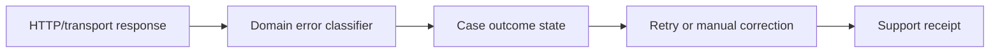

# Integration error taxonomies and business recovery

**PFA-099** | Pega Lead System Architect study | Lab verification pending

## Business situation

A claims integration treats all non-2xx responses as a generic error and sends the same retry event. A business 409 conflict, invalid 400 payload and uncertain timeout all become 'Technical Failure', obscuring who should repair them.

The engineering objective is to prove a bounded, authorized and recoverable transaction. A response from an interface or query is useful evidence but not, by itself, proof that a remote effect and Pega case state were committed as one unit.

## Proposed processing design

## Relevant Pega rules and interfaces

1. **Connect REST:** record real class/ruleset, source system, trusted principal and support responsibility for this component.
2. **Data Transform error mapping:** record real class/ruleset, source system, trusted principal and support responsibility for this component.
3. **Queue Processor:** record real class/ruleset, source system, trusted principal and support responsibility for this component.
4. **case exception stages:** record real class/ruleset, source system, trusted principal and support responsibility for this component.
5. **error ledger:** record real class/ruleset, source system, trusted principal and support responsibility for this component.

## Detailed implementation decisions

1. Define the domain outcome vocabulary: Accepted, Rejected, Correctable, Retryable, Unknown and DuplicateResolved.

2. Map technical HTTP and vendor application codes explicitly into those outcomes, including successful transport with a business rejection body.

3. Do not retry permanent schema/eligibility errors unchanged; create an actionable business correction assignment.

4. Treat timeout after a write as uncertain remote effect and query by operation ID or safely retry identical idempotency key.

5. Expose errors to operators by recovery action, not raw connector stack trace, and monitor aggregate age per category.

Before coding, create a lightweight interface specification containing endpoint or source, message/record identity, required fields, timeout/consistency objective and expected behavior for missing or duplicated information.

## Design alternatives

- **Pattern 1:** One generic exception is easy to implement but difficult to recover.
- **Pattern 2:** typed taxonomy yields supportable workflows.

The ADR should identify which requirement would fail under the rejected pattern and how the selected design handles both slow and unavailable dependencies.

## Failure scenario to diagnose

An HTTP 200 contains a partner-level rejected flag yet Pega marks the case Approved, or 503 retries ignore a business cutoff.

Use Pega Tracer, PAL, DBTrace and service-side request/receipt logs when relevant. Reconcile case ID with external operation ID and event/version so a retry is not accidentally interpreted as a new business command.

## Acceptance tests

1. **Controlled test 1:** Inject 200 with business reject. Capture the committed state, error type, elapsed time and whether any remote effect occurred.
2. **Controlled test 2:** 400 input error. Capture the committed state, error type, elapsed time and whether any remote effect occurred.
3. **Controlled test 3:** timeout after remote commit. Capture the committed state, error type, elapsed time and whether any remote effect occurred.

These are test instructions. No benchmarks, live screenshots or successful lab outcomes have been fabricated. A validated edition must state its Pega release and retain sanitized configuration evidence.

## Production runbook requirements

Specify who can replay failed actions, the expiry time for unresolved outcomes, backpressure or throttling limits and a repair path. For reporting and data retention, verify authorization, point-in-time interpretation and historical evidence as well as throughput. For integrations, distinguish callback acceptance from final business completion.

## Primary reading

- [Pega Academy: Queue processors](https://academy.pega.com/topic/queue-processors-and-job-schedulers/v2)

*Independent architectural reference using fictional examples. Version-sensitive details should be rechecked against the deployed release.*
