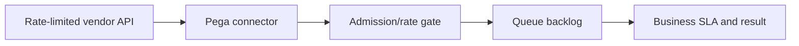

# API rate limits under seasonal transaction peaks

**PFA-101** | Pega Lead System Architect study | Lab verification pending

## Business situation

A benefits portal receives twenty times normal transaction volume before a filing deadline. Its tax-status vendor permits only 200 requests per minute, but Pega user traffic rises to 3000 per minute. Direct synchronous connectors now return widespread 429 responses.

The engineering objective is to prove a bounded, authorized and recoverable transaction. A response from an interface or query is useful evidence but not, by itself, proof that a remote effect and Pega case state were committed as one unit.

## Proposed processing design

## Relevant Pega rules and interfaces

1. **Connect REST:** record real class/ruleset, source system, trusted principal and support responsibility for this component.
2. **Queue Processor:** record real class/ruleset, source system, trusted principal and support responsibility for this component.
3. **Job Scheduler:** record real class/ruleset, source system, trusted principal and support responsibility for this component.
4. **API gateway:** record real class/ruleset, source system, trusted principal and support responsibility for this component.
5. **retry ledger:** record real class/ruleset, source system, trusted principal and support responsibility for this component.

## Detailed implementation decisions

1. Get contractually allowed rate, burst and concurrency limits from the vendor, including separate read/write quotas.

2. Classify operations that can wait from those requiring immediate confirmation, and reject or defer intake honestly when capacity is exhausted.

3. Throttle outbound requests through a shared gateway or reliable quota coordinator; per-node limits are insufficient across a cluster.

4. Use exponential bounded backoff respecting Retry-After semantics where supplied and preserve operation IDs.

5. Measure queue arrival minus service rate; if demand exceeds quota for hours, throttling alone cannot satisfy deadlines and requires business negotiation.

Before coding, create a lightweight interface specification containing endpoint or source, message/record identity, required fields, timeout/consistency objective and expected behavior for missing or duplicated information.

## Design alternatives

- **Pattern 1:** Synchronous calls serve immediate feedback until quota reached.
- **Pattern 2:** queued operations control load but create an explicit backlog.

The ADR should identify which requirement would fail under the rejected pattern and how the selected design handles both slow and unavailable dependencies.

## Failure scenario to diagnose

A restarted cluster launches all delayed retries together, hitting the same limit again. A 429 is not evidence the external operation was applied.

Use Pega Tracer, PAL, DBTrace and service-side request/receipt logs when relevant. Reconcile case ID with external operation ID and event/version so a retry is not accidentally interpreted as a new business command.

## Acceptance tests

1. **Controlled test 1:** Simulate 10x peak for 15 minutes. Capture the committed state, error type, elapsed time and whether any remote effect occurred.
2. **Controlled test 2:** restart workers during backlog. Capture the committed state, error type, elapsed time and whether any remote effect occurred.
3. **Controlled test 3:** observe oldest deadline vs quota. Capture the committed state, error type, elapsed time and whether any remote effect occurred.

These are test instructions. No benchmarks, live screenshots or successful lab outcomes have been fabricated. A validated edition must state its Pega release and retain sanitized configuration evidence.

## Production runbook requirements

Specify who can replay failed actions, the expiry time for unresolved outcomes, backpressure or throttling limits and a repair path. For reporting and data retention, verify authorization, point-in-time interpretation and historical evidence as well as throughput. For integrations, distinguish callback acceptance from final business completion.

## Primary reading

- [Pega Academy: Queue processors](https://academy.pega.com/topic/queue-processors-and-job-schedulers/v2)

*Independent architectural reference using fictional examples. Version-sensitive details should be rechecked against the deployed release.*
