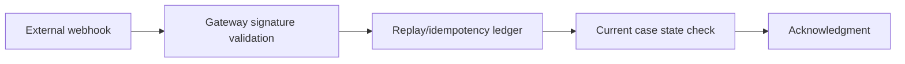

# Signed webhooks and replay attack prevention

**PFA-103** | Pega SSA/LSA reference implementation | Actual lab test pending

## Incident and business outcome

A payments processor calls a Pega Service REST endpoint when settlement completes. The endpoint verifies only a shared API key. An attacker or misconfigured sender replays the same signed or previously accepted payload, reopening a completed case.

The architecture must identify a stable operation identity and separate case state, asynchronous delivery, integration outcome and authorization. The same message can execute more than once unless the business protocol rules out duplicate effects.

## Processing architecture

## Pega execution artifacts

1. **Service REST**. Document the version, queue/service context, business identifier and observable failure outcome.
2. **Service Package**. Document the version, queue/service context, business identifier and observable failure outcome.
3. **Authentication Service**. Document the version, queue/service context, business identifier and observable failure outcome.
4. **correlation receipt**. Document the version, queue/service context, business identifier and observable failure outcome.
5. **case locking**. Document the version, queue/service context, business identifier and observable failure outcome.

## Implementation design steps

1. Define and validate a provider-supported signature scheme covering the exact bytes, timestamp and relevant headers; do not invent an algorithm the sender does not implement.

2. Use TLS and sender authentication as baseline, and rotate signing secrets through approved secret management.

3. Reject messages outside the agreed replay window, but also persist message/operation IDs to handle valid duplicates inside that window.

4. Resolve case from a stable business operation identity and check case state before mutation; customer name or editable request body is not an authorized key.

5. Return safe duplicate acknowledgments while preserving trace evidence; never repeat downstream settlement on replay.

A complete application example should use a documented rule and class naming scheme, stable case/operation IDs, data shape, service API contract and a support-owned recovery path. Exact settings must be tested in the target Pega release.

## Alternatives

- **Choice 1:** Static bearer key authenticates broadly but cannot prove payload integrity.
- **Choice 2:** HMAC/mTLS plus durable replay ledger gives stronger verification.

Architecture acceptance depends on business correctness after a duplicate, delay or partial failure, not merely on low response time when the partner is healthy.

## Failure mechanics

A signed old event can still be maliciously replayed and accepted if timestamp and event ID are not checked; clock skew handling needs policy.

For diagnostics capture the Pega case version, queue item/operation ID, current access group, retry attempt, outbound request correlation and remote receipt. An error status is not evidence the remote system made no change.

## Validation experiments

1. **Scenario 1:** Tamper signed body. Record actual result, remote side effect count and elapsed time or backlog age.
2. **Scenario 2:** replay exact signed message. Record actual result, remote side effect count and elapsed time or backlog age.
3. **Scenario 3:** send late event after case cancelled. Record actual result, remote side effect count and elapsed time or backlog age.

All tests remain proposed. The article does not claim that a live Pega lab was executed or that hypothetical measurements are production evidence.

## Deployment and ongoing support

Add a rollback or forward-repair plan for in-flight queue items and live cases. Include alerting for broken items, oldest age, invalid business payloads and provider failures, together with safe replay privileges and audit trail. For sensitive data, verify inbound/outbound minimization and identity controls.

## Official Pega reference

- [Pega Academy: Authentication](https://academy.pega.com/topic/authentication/v6)

*Independent technical study with fictional scenario. Verify configuration against the deployed Pega release.*
