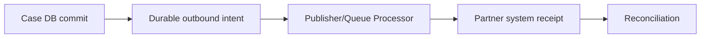

# Transactional outbox options for critical integrations

**PFA-104** | Pega SSA/LSA reference implementation | Actual lab test pending

## Incident and business outcome

A case is committed as Issued while a Queue Processor was supposed to publish PolicyIssued to another system. A database failure before the queue enqueue step leaves an issued case with no event, and an immediate enqueue before commit can publish an event for a case that rolled back.

The architecture must identify a stable operation identity and separate case state, asynchronous delivery, integration outcome and authorization. The same message can execute more than once unless the business protocol rules out duplicate effects.

## Processing architecture

## Pega execution artifacts

1. **Case transaction**. Document the version, queue/service context, business identifier and observable failure outcome.
2. **Queue Processor**. Document the version, queue/service context, business identifier and observable failure outcome.
3. **integration outbox data model**. Document the version, queue/service context, business identifier and observable failure outcome.
4. **Job Scheduler**. Document the version, queue/service context, business identifier and observable failure outcome.
5. **receipt class**. Document the version, queue/service context, business identifier and observable failure outcome.

## Implementation design steps

1. Identify exactly when the case transition, queued item and external event become durable in the target Pega runtime; test supported enqueue commit semantics.

2. Where the business needs strong no-lost-event guarantees, design a durable outbound intent record committed with relevant local business state if the persistence approach supports one transaction.

3. Use a background publisher that reads pending intents, sends with stable event ID and records receipt or Unknown for reconciliation.

4. Make external consumers idempotent and capable of rejecting stale operation versions; duplicate delivery must be assumed possible.

5. Create a repair query for committed cases without confirmed event receipts and demonstrate restart-safe replay.

A complete application example should use a documented rule and class naming scheme, stable case/operation IDs, data shape, service API contract and a support-owned recovery path. Exact settings must be tested in the target Pega release.

## Alternatives

- **Choice 1:** Fire-and-forget after commit can lose events.
- **Choice 2:** durable outbox/intent improves recovery but adds table, dispatch and audit responsibilities.

Architecture acceptance depends on business correctness after a duplicate, delay or partial failure, not merely on low response time when the partner is healthy.

## Failure mechanics

Crash between case save and enqueue loses event; crash after partner accepts before acknowledgment creates duplicates if no stable event ID.

For diagnostics capture the Pega case version, queue item/operation ID, current access group, retry attempt, outbound request correlation and remote receipt. An error status is not evidence the remote system made no change.

## Validation experiments

1. **Scenario 1:** Crash before/after case commit. Record actual result, remote side effect count and elapsed time or backlog age.
2. **Scenario 2:** restart publisher after partner accept. Record actual result, remote side effect count and elapsed time or backlog age.
3. **Scenario 3:** reconcile 1000 issued cases vs receipts. Record actual result, remote side effect count and elapsed time or backlog age.

All tests remain proposed. The article does not claim that a live Pega lab was executed or that hypothetical measurements are production evidence.

## Deployment and ongoing support

Add a rollback or forward-repair plan for in-flight queue items and live cases. Include alerting for broken items, oldest age, invalid business payloads and provider failures, together with safe replay privileges and audit trail. For sensitive data, verify inbound/outbound minimization and identity controls.

## Official Pega reference

- [Pega Academy: Queue processors](https://academy.pega.com/topic/queue-processors-and-job-schedulers/v2)

*Independent technical study with fictional scenario. Verify configuration against the deployed Pega release.*
