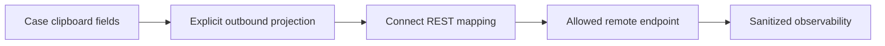

# Preventing sensitive fields from reaching remote logs

**PFA-105** | Pega SSA/LSA reference implementation | Actual lab test pending

## Incident and business outcome

A compliance case calls a remote service with a JSON body containing personal documents, account identifiers and internal risk comments. Request/response debugging logs all fields and moves confidential customer data into an uncontrolled log platform.

The architecture must identify a stable operation identity and separate case state, asynchronous delivery, integration outcome and authorization. The same message can execute more than once unless the business protocol rules out duplicate effects.

## Processing architecture

## Pega execution artifacts

1. **Connect REST**. Document the version, queue/service context, business identifier and observable failure outcome.
2. **Authentication Profile**. Document the version, queue/service context, business identifier and observable failure outcome.
3. **Data Transform**. Document the version, queue/service context, business identifier and observable failure outcome.
4. **Access Control Policy**. Document the version, queue/service context, business identifier and observable failure outcome.
5. **logging/PDC**. Document the version, queue/service context, business identifier and observable failure outcome.

## Implementation design steps

1. List approved data elements for each integration contract and exclude sensitive case fields that are irrelevant to its purpose.

2. Build a narrow outbound request Data class / mapping; never serialize pyWorkPage or a whole customer page as a convenience.

3. Do not pass secrets in query strings or diagnostic messages. Use managed authentication profiles and least-privileged credentials.

4. Map partner error details to safe error codes; raw remote error bodies can contain secrets or PII.

5. Test connector tracing, gateway logs, Queue Processor broken-item diagnostics and replay tools to ensure sensitive values remain masked.

A complete application example should use a documented rule and class naming scheme, stable case/operation IDs, data shape, service API contract and a support-owned recovery path. Exact settings must be tested in the target Pega release.

## Alternatives

- **Choice 1:** Full case payload reduces mapping work but leaks data and couples schemas.
- **Choice 2:** purpose-specific projection costs effort but enforces minimisation.

Architecture acceptance depends on business correctness after a duplicate, delay or partial failure, not merely on low response time when the partner is healthy.

## Failure mechanics

Error handling may log the entire original request after a 500, leaking tokens even if success-path mapping was clean.

For diagnostics capture the Pega case version, queue item/operation ID, current access group, retry attempt, outbound request correlation and remote receipt. An error status is not evidence the remote system made no change.

## Validation experiments

1. **Scenario 1:** Inspect outbound payload for forbidden fields. Record actual result, remote side effect count and elapsed time or backlog age.
2. **Scenario 2:** force 500 and inspect logs. Record actual result, remote side effect count and elapsed time or backlog age.
3. **Scenario 3:** rotate token and confirm no historical token remains. Record actual result, remote side effect count and elapsed time or backlog age.

All tests remain proposed. The article does not claim that a live Pega lab was executed or that hypothetical measurements are production evidence.

## Deployment and ongoing support

Add a rollback or forward-repair plan for in-flight queue items and live cases. Include alerting for broken items, oldest age, invalid business payloads and provider failures, together with safe replay privileges and audit trail. For sensitive data, verify inbound/outbound minimization and identity controls.

## Official Pega reference

- [Pega Academy: Authentication](https://academy.pega.com/topic/authentication/v6)

*Independent technical study with fictional scenario. Verify configuration against the deployed Pega release.*
