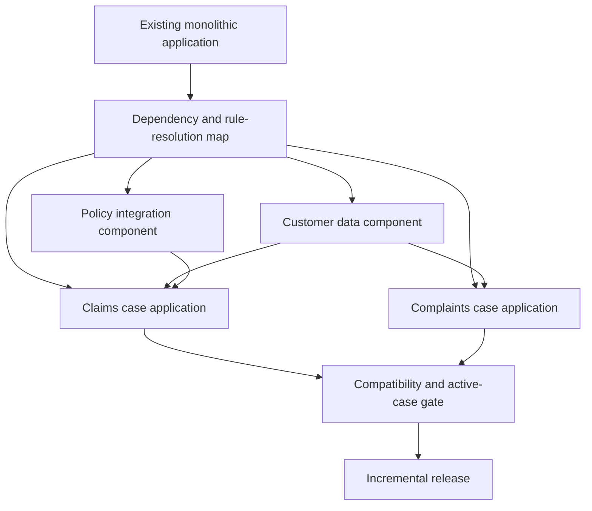

# Decomposing monolithic Pega applications safely

> Original architecture design study. The enterprise scenario is illustrative; no test execution or measured result is claimed.

## Enterprise failure scenario

A multinational insurer has one Pega application containing claims, underwriting, complaints and shared customer lookup. Every release changes the same implementation ruleset. A simple address validation change triggers regression testing for unrelated case types, and the teams cannot upgrade their shared framework independently. A proposed rewrite creates four applications in one sprint, but active claims still reference flow rules and class names in the old application. Decomposition without a migration contract risks stranded cases and inconsistent rule resolution.

## Architecture and Pega-specific configuration decisions

Decompose by bounded business capability and rule ownership, not by an arbitrary number of rulesets. Separate reusable stateless components, such as customer-reference integration and correspondence templates, from stateful case orchestration. Use built-on applications and ruleset dependencies where in-platform reuse is justified. Keep the existing work class and persistence contract stable during initial extraction, unless a separately tested case migration is explicitly approved. Prefer a strangler sequence: introduce a component, migrate one consumer, verify resolution, then expand. Do not copy all rules into a new framework and call it reuse.

## Technical flow

## Step-by-step implementation

1. Map applications, rulesets, class inheritance, work classes, data pages, activities, integrations, Access Groups, delegated rules and deployment products. Mark active case instances and their flow-rule dependencies.

2. Choose a candidate with stable inputs and outputs, such as address verification. Define the contract using a Data Page, data class and connector boundary rather than exposing implementation activities to consumers.

3. Create a component application or reusable ruleset with a documented owner, version and compatibility policy. Preserve class and rule naming where changing them would disrupt existing consumers.

4. Refactor callers incrementally. Replace direct rule references with a documented interface and validate which rule resolves for each Access Group, class and ruleset version.

5. Use a temporary compatibility facade where old callers cannot change immediately. Make its deprecation date and consumers visible; avoid two independently maintained implementations of the same business rule.

6. Separate deployment packages and environment-specific configuration. Identify cross-application data instances, authentication profiles, queues and reports that must remain consistent during partial rollout.

7. Test long-running cases created before the change, cases opened mid-deployment and new cases created after the release. Include flow resumption, assignments, SLA events and background items.

8. Roll out by one business capability and one consumer cohort. Observe errors and support demand, then remove legacy rules only when no active instance or dependent application still needs them.

## Production failure mechanics

A component extracted into a lower built-on layer may change rule resolution for every consumer, even if the code appears identical. A class move can alter class-to-table mapping and break report definitions. An old case may resume a flow version that was withdrawn. An activity with hidden clipboard assumptions may fail outside its original case context. A shared integration can become a central bottleneck or release dependency. Removing the legacy implementation before all consumers are migrated makes rollback impossible. Capture compatibility tests at the rule, case and operational levels.

## Engineering tradeoffs

Built-on components enable governed reuse but can couple application release cadences. Independent services allow stronger runtime isolation but add network latency, identity management and distributed failure modes. A large up-front rewrite simplifies diagrams but raises migration risk; incremental extraction leaves temporary duplication that must be tracked. Choose boundaries that reflect business ownership and lifecycle, not a desire for symmetrical architecture.

## Reproducible verification matrix

| Test stimulus | Expected evidence and acceptance criterion |
| --- | --- |
| Old open case resumes after extraction | Flow and assignment continue with correct rule version |
| New case uses componentized lookup | Same approved business result as baseline |
| Two applications consume shared component | Rule resolution and security correct for both |
| Component unavailable or connector fails | Controlled case error and recovery path |
| Rollback of one consumer | Compatible component contract retained |
| Legacy rules removed after migration | No unresolved references or active case dependencies |

For every matrix row, capture the target Pega version, input fixture, operator or service identity, expected outcome, actual persisted state and correlated logs. Test negative paths using isolated non-production records. These are planned tests, not executed results.

## Release and evidence constraints

Pega Academy documents built-on applications and reusable components, including applications with case types and ruleset collections without case types. Available migration tools, package behavior and upgrade compatibility must be checked for the deployed Pega version. Document the deployment dependency graph, security review, rollback boundary and operational owner before production adoption. A passing UI demonstration is not sufficient evidence of correct persistence, authorization or idempotency.

## Verified primary source

- [Pega Academy guidance](https://academy.pega.com/topic/built-applications-and-components/v1/in/20031/20481/20506)
