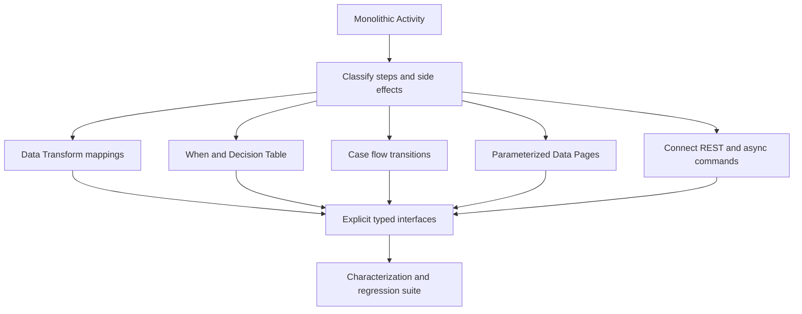

# Transitioning from activity-heavy legacy designs

**Audience:** Pega Lead System Architects and platform engineers. Design guidance is not a claim of laboratory validation.

A government benefits platform implements most case logic in a 180-step activity. It opens work objects, copies pages, calls Java utilities, decides eligibility, sends notifications and commits the case. A small policy change causes unexpected updates because the activity's step page changes halfway through execution. Tracer shows each step executing, but the architecture has no stable transaction or responsibility boundaries.

The goal is not to eliminate every Activity rule. It is to separate declarative data mapping, business decisions, orchestration, persistence and external effects so each can be reasoned about and verified independently.

## Decomposition map

Classify every legacy step into one of six categories: data mapping, validation, decision, case progression, integration, or persistence. Identify where primary page, step page and parameter page change. Record side effects, exception transitions, lock acquisition and Commit or Rollback calls. A rule's length is less important than hidden state and unbounded coupling.

Prefer Data Transform rules for deterministic page mapping, Validate rules for data validity, When or Decision Table rules for business decisions, Data Pages for read-oriented data access, case flows for state transitions, and supported connector rules for external calls. Activities remain appropriate for narrow orchestration where the platform requires them. Never move an Obj-Save or Commit into a Data Transform merely to reduce the activity count.

## Implementation sequence

1. Select a bounded business journey rather than rewriting the entire application. Capture entry conditions, output properties, work status, history events, connector effects and error behavior.
2. Run a characterization suite on the current implementation with synthetic cases. Record actual outputs and transaction boundaries. Do not label existing behavior correct merely because it is reproducible.
3. Trace the activity in non-production to identify page context, class, parameter flow and repeated loads. Create a dependency map of called activities, data transforms, functions and integrations.
4. Introduce explicit input and output data classes for the business operation. Remove reliance on named temporary pages left by unrelated flow actions.
5. Extract pure mapping steps into a Data Transform with clear Applies To and target page. Use parameters for context, not global clipboard state. Verify the rule's behavior when invoked from another case type.
6. Extract business policy into Decision Tables or When rules with versioned test cases. Keep exception and missing-data outcomes explicit rather than relying on default branches.
7. Replace repeated database lookup activities with parameterized data pages where read semantics and refresh behavior fit. Validate cache scope and key composition, particularly for tenant-specific data.
8. Move user-visible progression into a case flow with assignments and SLAs. Let flow processing own its transaction semantics; review and remove unnecessary explicit Commit calls in flow-related activities.
9. Separate outbound irreversible effects into an idempotent integration command and, where appropriate, a Queue Processor. Persist intent and define recovery after ambiguous external responses.
10. Use a strangler pattern: route one controlled case cohort through the new implementation, compare outcomes, then expand. Keep a bounded rollback switch that does not strand active cases.

## Tradeoffs

A large activity is sometimes operationally efficient because its state is local to one call, but that efficiency disappears when page context and transaction behavior are undocumented. A highly fragmented rule design can also be harmful: dozens of tiny rules with no clear contract make tracing harder. Choose boundaries around stable business responsibilities and testable inputs and outputs, not arbitrary step counts.

Data pages simplify read access but introduce caching and freshness decisions. Decision Tables make policy visible but require governance over delegated changes. Async integration improves resilience but changes user experience from immediate success to accepted/pending; the case model and UI must reflect that distinction.

## Production failure mechanics

The most dangerous refactor changes commit timing. In the old activity, an external call might run before a database commit. In the new flow, the case may commit first and the external call run asynchronously. That is often safer, but compensation and status reporting must be designed. A second failure is rule resolution drift: an extracted Data Transform resolves differently under a child application's ruleset stack. Test in each actual access group and application version. A third is stale clipboard data copied into a new mapping rule; compare the input page class and key, not only the final visible field.

## Reproducible verification matrix

| Scenario | Procedure | Acceptance |
| --- | --- | --- |
| Mapping equivalence | Replay representative input pages | Expected normalized properties match |
| Missing data | Remove optional and mandatory fields | Explicit validation and safe defaults |
| Rule resolution | Run under two application stacks | Intended rule version selected |
| Interrupted flow | Pause before assignment completion | No premature external side effect |
| Retry | Lose connector response after success | Idempotent reconciliation |
| Case lock | Parallel edits during refactored operation | No silent overwrite |
| Tenant isolation | Same external ID in two tenants | No cross-tenant page reuse |
| Rollback cohort | Disable new path for new cases | Existing cases remain resumable |

## Release evidence

Retain a step-to-rule traceability map, decision table tests, transaction-boundary review and business reconciliation results. Use a measured cutover gate rather than claiming that fewer activity steps automatically mean better performance. Specific API, data page and flow behavior depends on the deployed Pega version.

**Primary references:** [Pega Platform: best practices for Infinity application development](https://docs.pega.com/bundle/platform-242/page/platform/app-dev/best-practices-infinity-application-development.html) and [Pega Platform: Commit method](https://docs.pega.com/bundle/platform-88/page/platform/reference/methods/commit.html).
