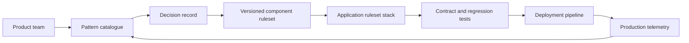

# Building an Enterprise Pattern Library for Pega

## Enterprise failure scenario

Five product teams each implement customer lookup, retries and audit differently. One team uses a reusable activity that commits the case unexpectedly; another copies an old authentication profile into a new application. A central architecture team responds with a giant framework ruleset, which then blocks independent releases. The missing asset is a small, versioned pattern library with explicit contracts and evidence, not another monolithic inheritance hierarchy.

## Architecture decision and Pega rule boundary

Catalogue patterns as architectural decisions tied to Pega rule types, supported extension points and operational contracts. Use component rulesets for stable shared behaviour and application-specific rulesets for case orchestration. Prefer narrow Data Pages, Data Transforms, Connect-REST and Queue Processor handlers over opaque multi-purpose activities. A pattern entry must state when not to use it, supported platform versions, security assumptions, rule-resolution implications and migration strategy.

## Implementation in order

1. Inventory duplicated implementations and classify them by business invariant, platform mechanism, integration boundary and operational ownership. Do not start by extracting every shared activity.

2. Choose initial patterns with repeatable evidence: parameterised customer data page, idempotent queue handler, REST timeout policy, case-lock conflict handling and ABAC boundary.

3. For each pattern define a minimal public contract: inputs, outputs, exceptions, privileges, data classes, ruleset dependencies and version compatibility. Include a concrete anti-example.

4. Package stable behaviour in a component ruleset or supported component mechanism. Keep application-specific flows, SLAs and customer semantics outside the shared layer.

5. Create PegaUnit or equivalent contract tests plus integration tests for authentication, cache scope, retry semantics and case resume. Publish test fixtures without customer data.

6. Introduce semantic versioning and a consumer inventory. A breaking change must use a new compatible version or a coordinated migration, not silent rule override.

7. Publish decision records, diagrams, troubleshooting steps, performance caveats and deprecation dates alongside the component. Track actual adoption and defects, not only downloads.

## Failure mechanics in production

A shared rule can resolve differently depending on the application stack and class inheritance. A seemingly harmless change to a base data transform can alter several case types at once. A component that assumes one access group or tenant context leaks privilege assumptions into every consumer. Copying a component instead of depending on a versioned ruleset creates divergent forks. Centralised governance without clear ownership becomes a bottleneck; permissive reuse without contract tests spreads failures.

## Design tradeoffs

- A shared component reduces duplication when semantics are stable, but creates coupling and release coordination cost.
- An application-local pattern may be preferable when tenant policy or case lifecycle differs materially.
- A central review board improves consistency but should automate contract evidence and delegate safe local decisions to product LSAs.

## Reproducible verification matrix

Run these checks with synthetic data in a controlled test environment. Capture the application version, ruleset stack, requestor identity, test stimulus and expected persisted outcome. These are proposed checks, not executed results.

| Test and stimulus | Expected result and evidence |
| --- | --- |
| Two applications import same component version | Identical contract behaviour under documented assumptions |
| Consumer overrides a rule | Rule-resolution result matches declared extension point |
| Component adds required parameter | Compatibility test blocks breaking promotion |
| Operator from second tenant invokes pattern | Data isolation and access controls preserved |
| Queue handler receives duplicate event | Idempotency contract holds across consumers |
| Component rollback during active cases | Open-case compatibility validated |
| Deprecated pattern still referenced | Pipeline reports consumers before removal |

## Incident runbook

If a shared component regression appears, map the exact ruleset versions and applications affected before deploying a hotfix. Use the consumer registry to target contract tests and rollback. Avoid a global emergency override that changes unaffected products. Record incident learning as a revised pattern decision, not only a patch to code.

## LSA release acceptance and limitations

The pattern library is useful only when every entry has an owner, decision context, example implementation, verification matrix and supported-version policy. Review Pega component and ruleset documentation for the target platform. Architecture quality is measured by safe reuse and fewer cross-application incidents, not the number of published templates.

The architecture is design-backed and laboratory verification remains pending. A technical reviewer should inspect rule resolution, authorisation, Pega guardrail warnings, negative-path behaviour and rollback feasibility before promoting it. Capture controlled Tracer or PDC evidence only where available, and exclude sensitive clipboard content from shared logs. Do not interpret a diagram as evidence that the implementation has been tested.

## Verified Pega primary references

- [Pega organising rules into rulesets](https://docs.pega.com/bundle/platform-242/page/platform/app-dev/organizing-rules-into-rulesets.html)
- [Pega documenting a component](https://docs.pega.com/bundle/platform-88/page/platform/app-dev/documenting-component.html)
