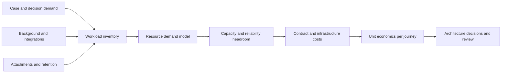

# Cost modelling for platform service consumption

## Failure scenario: a faster application with a larger operating bill
An enterprise consolidates six workflow applications onto a common Pega platform. The business case assumes that sharing a cluster will reduce cost. After rollout, case search and interaction latency deteriorate during nightly data flows, background workers consume additional capacity and document storage grows faster than forecast. A proposal to move all workloads to a larger node pool ignores the real drivers: duplicate integration calls, large clipboard payloads, attachment transfer, and peak-time queue demand.

## Cost is a workload model, not a node count
Separate contractual licensing from engineering resource consumption. Pega licensing and cloud service terms are contract-specific and must come from the customer's agreement, not a public guessed price. Engineering costs can be estimated from measured workload: interactive request volume, case creations and updates, queue processor jobs, decision requests, stored case and attachment bytes, external API calls, network transfer and operational support. For each workload, identify its unit, peak profile, service objective and owner. Model shared-platform overhead explicitly.

## Build the model
1. Define the unit of value: completed claim, onboarding journey, approved account, decision request or active case month. Do not mix them. A long-running case can generate hundreds of service requests and years of storage.
2. Capture representative Pega telemetry from PDC, PAL, alerts and service/queue dashboards. Record request rates, latency distribution, database operations, heap pressure, queue age and integration fan-out. Protect personal data in telemetry. Capture at least one seasonal or campaign peak if relevant.
3. Map Pega rule execution to cost drivers. Data pages may reduce connector calls but increase cached memory; large case BLOBs increase database I/O; Report Definitions can drive query load; queue processors move work out of the interactive path but still consume compute and stream capacity.
4. Build a dependency bill of materials: application nodes, background processing, database, search, stream services, object repository, network egress, identity provider, monitoring, scanning and downstream API usage. Mark which services are managed by Pega Cloud, customer-managed or third party. Avoid double counting bundled services.
5. Use a scenario table rather than a single forecast. Compare current volume, a plausible growth case and a stress peak. For each scenario, estimate CPU, memory, storage growth and concurrency from measured resource-per-unit, then add explicit headroom for recovery and failover.
6. Separate fixed, variable and step-function costs. A new always-on service may create a fixed baseline; storage and external API requests may scale approximately with volume; capacity may jump when a node pool or contractual tier changes.
7. Compare architecture options: synchronous versus queued integration, repository versus database attachment storage, report tuning versus warehouse extraction, shared component versus isolated service, and managed versus customer-operated dependencies. Include migration and support effort, not only monthly infrastructure.
8. Establish a quarterly cost review tied to application release changes. A new rule that adds a nested data page or another audit attachment can shift unit economics without any visible infrastructure deployment.

## Design tradeoffs and failure mechanics
Consolidation improves utilization when workload peaks are complementary. If every application has the same month-end peak, sharing can increase contention and the cost of protective overprovisioning. Caching reduces repeated calls but creates freshness and access-revocation risks. Retention cuts storage growth but cannot override legal hold. Aggressive queue batching can lower per-item overhead but increase recovery time and blast radius.

Do not infer platform inefficiency from a higher cloud bill without separating new business volume, service level, licensing, storage retention and third-party prices. Do not equate CPU utilization with customer value. A service running at low utilization may provide essential disaster-recovery headroom. Conversely, an expensive node pool can be masking a small number of poor Report Definitions or connector retries.

## Reproducible verification matrix
| Scenario | Input change | Expected analysis | Evidence |
|---|---|---|---|
| Baseline | Representative workload | Cost per completed journey | Telemetry and cost ledger |
| Growth | Higher case creation rate | Capacity slope and threshold | Load-test curves |
| Peak | Concurrent batch and UI | SLA and headroom assessment | p95 and queue age |
| Dependency outage | Delayed external API | Retry amplification quantified | Connector counters |
| Attachment growth | Longer retention period | Storage and recovery impact | Object inventory |
| Shared cluster | Two peak workloads overlap | Contention visible in model | Resource traces |
| Failover | One node pool unavailable | Required reserve included | Recovery exercise |
| Rule change | New nested data page | Cost delta tied to rule | PAL and call counts |

This is a measurement plan, not a published benchmark or price quotation. Contract and infrastructure figures must be supplied by the enterprise and checked against the deployment model.

## Verified Pega references
- [Pega Platform '24.2 architecture and service domains](https://docs.pega.com/bundle/platform-242)
- [Pega Infinity application development best practices, Platform '24.2](https://docs.pega.com/bundle/platform-242/page/platform/app-dev/best-practices-infinity-application-development.html)
- [Pega Cloud support and PDC diagnostics overview](https://docs.pega.com/bundle/pega-cloud-government/page/pega-cloud/pc/pcs-support-overview.html)
