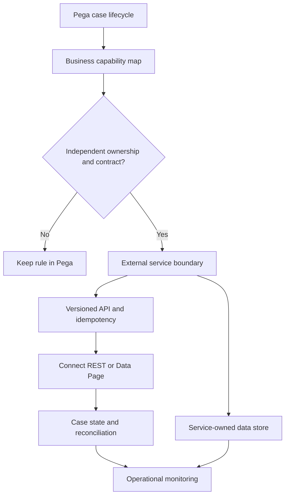

# Identifying boundaries for non-Pega services
## Failure scenario
A logistics company decomposes its Pega delivery claims application by extracting every calculation into a separate microservice. A case assignment now makes seven synchronous REST calls for rules that previously executed locally. A regional outage leaves claims locked while a pricing service is unavailable. Another team copies the same eligibility logic into the service and a Pega Decision Table, so results diverge. The migration increased deployment count but did not establish coherent domain ownership.

## Establish a boundary by capability and consistency
Keep case lifecycle, assignment routing, SLA semantics, access to work, and case audit within Pega when they are core orchestration concerns. Consider external services for independently owned capabilities with a stable contract, such as a specialized optimization engine, external product catalogue or domain-owned rating engine. A service boundary should be justified by independent data ownership, scaling profile, technology need, compliance zone or release cadence, not merely the number of rules in a class.

Draw a system-of-record matrix for each business entity. A Pega `Work-` case may store an authoritative workflow state while a customer master system owns customer identity and a pricing service owns tariff calculations. Define how Pega Data Pages read those sources and how writes occur through supported service contracts. Do not let two systems accept competing authoritative writes to the same field.

## Step-by-step architecture
1. Map the current Pega application: case types, Stages, Steps, Flows, Activities, Decision Tables, Data Transforms, Data Pages, Report Definitions, Queue Processors, integrations and data classes. Record which rules make decisions, which orchestrate work and which perform side effects.
2. Build a capability ownership table. For each candidate extraction, name the domain owner, data authority, transactional invariants, consumer count, SLA, latency budget, privacy constraints and operational team. Reject a boundary without a clear accountable owner.
3. Choose an extraction seam with a stable input/output contract. For example, an external tariff engine can accept `TariffVersion`, `ProductCode`, `Region` and effective date and return a price plus calculation provenance. Avoid sending `pyWorkPage` or proprietary Pega clipboard structures over the wire.
4. Define a versioned service API and explicit error model. Distinguish validation rejection, transient dependency failure, stale reference data and uncertain write outcome. Use an idempotency key for side-effecting commands; a timeout does not prove the command was not applied.
5. Configure `Connect REST` with an Authentication Profile, environment-specific endpoint settings, timeout and response mapping. Where appropriate, wrap read operations in a parameterized read-only Data Page with correct scope and refresh strategy. Use Data Transforms to isolate external JSON schemas from case properties.
6. Keep case orchestration in Flows and Flow Actions. For long-running service work, prefer an asynchronous command plus Queue Processor and correlation ID over holding an interactive case transaction open. Use an explicit waiting state and an SLA or operational escalation.
7. Implement an outbox or command ledger pattern where business consistency requires it. A Pega case commit and an external service write are not automatically one atomic transaction. Reconcile commands that were sent but not acknowledged.
8. Migrate using a strangler approach: run the legacy calculation and external service in shadow mode on synthetic or approved cases, compare outputs, then gradually route a defined cohort. Do not execute both side-effecting implementations in parallel.
9. Separate deployment pipelines but maintain contract tests and a compatibility window. An independently deployed service must support the Pega application versions still active during rolling releases and long-running cases.
10. Establish joint incident ownership, service health dashboards and rollback rules. A service rollback that changes pricing semantics may require compensating case actions rather than simply reverting code.

## Design tradeoffs and failure mechanics
A Pega Decision Table is easier for business delegates to maintain in-context; an external service may better serve multiple technology stacks and specialized compute needs. Extraction introduces network latency, authentication, distributed tracing and independent availability. A shared external service can become a bottleneck or organizational dependency if it has no versioning policy.

The worst failure is a partial commit: the external tariff is updated but the Pega case transaction rolls back, so a retry applies the change again. Another is cache staleness: a node-scoped Data Page returns an old tariff after the service deploys a new version. Define effective dating and invalidation in the contract, and record the version used by each decision.

## Reproducible verification matrix
| Scenario | Stimulus | Expected result | Evidence |
|---|---|---|---|
| Contract parity | Same synthetic input in both engines | Reviewed output differences | Golden dataset |
| API unavailable | Force 503 during case step | Case remains recoverable | Flow and queue trace |
| Ambiguous write | Timeout after external commit | No duplicate side effect | Command ledger |
| Schema evolution | Deploy new optional field | Old Pega version still works | Contract tests |
| Cache refresh | Change tariff version | Correct effective-dated result | Data Page trace |
| Security | Invoke API with revoked role | Denied with audit | Gateway and Pega logs |
| Rollback | Revert external service | Open cases retain valid semantics | Case cohort review |

No lab results or production measurements are asserted. Confirm integration, Data Page and queue capabilities for the target Pega release.
## Verified primary guidance
- [Creating a Data Page, Pega Platform '25](https://docs.pega.com/bundle/platform-25/page/platform/data-integration/creating-data-page.html?workflow=creating-data-pages)
- [Deploy application, Pega Deployment Manager](https://docs.pega.com/bundle/deployment-manager/page/deployment-manager/dm/deploy-application.html)
