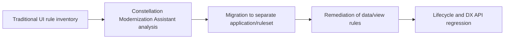

# Traditional UI to Constellation: Migrating the Case Model Before Rebuilding Screens

**PFA-263** | Technical design study for Pega Senior and Lead System Architects | Laboratory verification pending

## Architecture problem

A large Pega application contains custom sections, JavaScript and activities that embed business logic in the UI layer. Simply switching the presentation framework creates missing behaviours. Constellation Modernization Assistant can identify migration issues, but the architecture team must classify application coupling, replace unsupported patterns and validate actual case lifecycle behaviour.

## System design

This diagram records a proposed boundary, not a fabricated Pega runtime screenshot. The interfaces and exact rule forms must be verified in a permitted sandbox.

## Feature inventory and design responsibilities

| Pega rule or component | Review requirement |
|---|---|
| Traditional UI Sections and harnesses | Primary configuration and ownership boundary |
| Constellation Modernization Assistant | Explicit input/output and identity contract |
| App Studio Views | Apply platform-version-specific controls |
| Queryable Data Pages / DX API | Test failure handling and observability |
| Application and Access Group | Validate runtime access and support procedure |

## Implementation approach

1. Run an inventory of all bespoke controls, client scripts, embedded actions and UI-only validations. Categorize each as view, case rule, integration or obsolete behavior.

2. Use the Modernization Assistant analysis in the supported platform version. It can identify issues and assist migration, not remove the need for architecture review.

3. Migrate to a controlled branch or new ruleset/application rather than changing every running portal at once.

4. Replace critical JavaScript-side workflow decisions with server-owned case validation and supported View configuration.

5. Resolve identified Data Page or rule incompatibilities, testing queryable views and metadata returned by Constellation DX API.

6. Keep case lifecycle and authorization test cases independent of which UI renders a form.

7. Pilot one representative case type, record actual upgrade issues and iterate before migrating all high-risk screens.

## Design alternatives

| Option | Architectural trade-off |
|---|---|
| Rebuild legacy sections pixel-for-pixel | Maximizes unsupported customization and upgrade debt |
| Model-driven Constellation redesign | Preserves server business rules and reduces UI coupling |
| Leave legacy UI for all case types | May be valid temporarily but extends maintenance and feature constraints |

Choose the option that satisfies the business consistency contract and operational constraints. Avoid proving only the success path while deferring security, stale state and recovery behaviour.

## Failure modes and troubleshooting

The assistant can flag migration issues without fixing complex JavaScript behaviours. A view can render while hidden server validation no longer applies as expected. Do not treat visual similarity as functional equivalence. Long-running cases and background callbacks must remain compatible after UI transition.

Capture a sanitized case ID or operation identifier, relevant runtime node, application/ruleset version and timestamps. Correlate the origin and outcome across Pega and partner systems instead of relying on a single status message.

## Verification experiments

| Scenario | Evidence required |
|---|---|
| Experiment 1 | Analyze a representative Traditional UI application and categorize every finding. |
| Experiment 2 | Migrate one case to a new ruleset and compare workflow action outcomes. |
| Experiment 3 | Exercise dynamic visibility, editable data and missing Data Page values. |
| Experiment 4 | Run real low-privilege users and confirm server-side denial of forbidden actions. |

These are experiments to perform in a Pega lab. The article does not claim that any test has passed. A lab-verified version should include actual configuration screenshots, observed results and target Pega version.

## Production acceptance

Before deployment, the implementation needs documented data ownership, access context, expected peak volume, case compatibility, timeouts and retry boundaries, monitoring, escalation owner and a tested operational repair path. If the design changes a data model or class structure, verify legacy case paths and queued work.

## Pega technical source

- [Primary Pega reference](https://academy.pega.com/topic/constellation-modernization-assistant/v1)

Independent original technical analysis. Pega version-specific features and terminology must be confirmed against the target release; the scenario is fictional.
