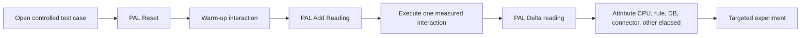

# PAL for Architects: Separate Rule Cost from Integration Wait

**PFA-151** | **Audience:** Senior and Lead System Architects | **Status:** Reference architecture; live Pega test pending

A slow case view does not automatically mean slow database queries. Use a controlled PAL experiment to identify where elapsed time is going before rewriting rules.

## 1. The enterprise failure this design prevents

An onboarding case takes 3.5 seconds to display the Verification step. Developers propose rebuilding the screen and caching all data pages. Production symptoms show the response time fluctuates only when the third-party identity service is under load. The architecture team needs an evidence-based breakdown of **server elapsed, CPU, rule I/O, database I/O, connector elapsed and other work**, while avoiding first-use assembly artifacts in their baseline.

## 2. Component and execution architecture

The following diagram is an **illustrative reference design**. It is not a screenshot from a running Pega environment.

## 3. Which Pega objects own each concern?

| Component | Why it exists |
|---|---|
| `PAL Performance Analyzer` | Session/requestor-side counters and delta readings |
| `Tracer` | Rule execution ordering and selective call details |
| `Clipboard` | Data Page state and page size clues |
| `PDC and application logs` | Production event correlation beyond one requestor |
| `Connect REST` | External wait path with timeout and dependency logging |

The named objects above are a mix of actual Pega rule categories and illustrative application-specific names. They are not a claim that all such rules exist in a default Pega installation.

## 4. Implementation design and decision sequence

1. Choose a reproducible interaction and a representative data shape. State whether it is cold or warm and whether cache was populated.

2. Reset PAL and record baseline before the test. Run one warm-up interaction to separate first-use assembly from steady-state behaviour.

3. Add a reading immediately before and after the precise action. Work in one requestor session and avoid unrelated navigation.

4. Inspect the DELTA, not only cumulative TOTAL figures. Compare server elapsed with CPU, rule I/O, database I/O, connector elapsed and other I/O categories.

5. Where connector elapsed dominates, inspect downstream timing and call count. Where DB elapsed dominates, inspect report and index design. Where rule activity dominates, use targeted trace/profiler.

6. Repeat the same run with and without an isolated change, and keep the case data and environment comparable.

7. Use production PDC and logging to decide whether the test's bottleneck reflects the peak load reality. PAL is not a substitute for system-wide metrics.

## 5. What an architect must choose

| Approach | Effect and trade-off |
|---|---|
| Optimize form rules immediately | Easy to start but likely wasted effort without attribution |
| Cache all data | Reduces some loads but can produce stale state and memory pressure |
| Controlled PAL plus dependency traces | Slower first investigation, faster reliable root-cause decision |

**Decision standard:** choose the smallest design that satisfies consistency, auditability, security, performance and operational recovery, not the design that simply looks easiest in Dev Studio.

## 6. Failure modes and root-cause investigation

**Cold-start contamination:** the first interaction triggers rules assembly and exaggerates rule work. **Wrong measurement window:** several navigation steps happen between PAL readings. **False causality:** connector elapsed rises while underlying service has a regional incident; local data page changes cannot fix it. **GC/headroom:** one requestor looks fine while the node stalls at load. **Misread counters:** different PAL statistics represent different timing components and can overlap; do not blindly add them as disjoint wall-clock buckets.

For troubleshooting, preserve the application/ruleset version, access context, precise business identity, timestamp and correlation ID. Never include secrets or production customer documents in publicly shared traces.

## 7. Verification matrix for a Pega lab

These are **tests to run**, not tests that have already passed.

| Experiment | Evidence and expected assertion |
|---|---|
| Cold vs warm | Compare first-use assembly overhead and a warmed run |
| External delay | Add controlled 500 ms delay to a mock service; verify Connect elapsed response |
| Cache scope | Switch a sample Data Page scope in sandbox; check repeated loads and memory implications |
| Report optimization | Measure matched query with/without a justified index |
| Production parity | Compare reproducible scenario against anonymized PDC and dependency latency distributions |

At the end of the experiment, attach redacted screenshots of the relevant rule forms, Clipboard/Tracer/PAL evidence when applicable, and an actual observed outcome. If any result differs, update the design instead of changing the evidence description.

## 8. Production readiness and ownership

Capture PAL snapshots with release, case shape, requestor identity class, cache state, concurrency and test time. A chart without that context is not performance evidence. Agree performance budgets by transaction so the team can reject regressions before deployment.

**Architecture acceptance:** the design has an explicit owner, a version-specific reproducible test, a failure/recovery procedure, the relevant security controls and a way to detect regressions.

## 9. Product references and limitations

- [Pega Academy: The Performance Analyzer](https://academy.pega.com/topic/performance-analyzer-pal/v8)
- [Pega Academy: Assessing application performance](https://academy.pega.com/challenge/assessing-application-performance/v10)

Pega functionality changes by release. Treat exact editor labels, extension points and service behaviours as version-sensitive until verified in the target environment. This independent article is neither an official Pega document nor a claim of an executed customer implementation.
