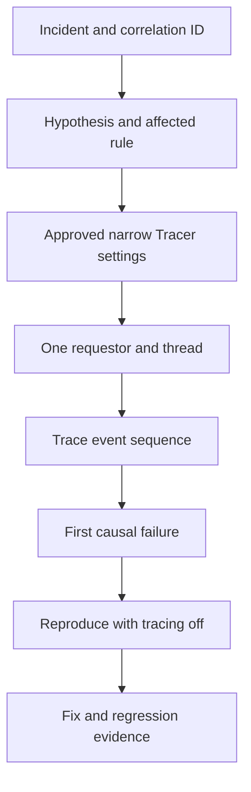

# Using Tracer without changing business behaviour

> Architecture study for Lead System Architects. The failure narrative is a hypothetical engineering scenario; no production incident or test result is claimed.

## Enterprise failure scenario

An insurer reports that a policy premium changes only when an adjuster submits a particular assignment. A developer enables every Tracer event in production for an hour, saturating the requestor, retaining personal data in a trace file and making the error appear to disappear because timing changes. The trace itself has become part of the incident. The objective is to observe a narrow rule path without introducing breakpoints, changing execution order or using Tracer as a performance profiler.

## Architecture decision and Pega rule design

Use a bounded diagnostic session, a known operator and thread, and the smallest event selection that can answer the causal question. Start with logs, case history, PegaRULES alerts and Performance Analyzer (PAL) for performance symptoms. Use Tracer only for rule-execution sequence and clipboard transitions. Prefer a controlled non-production reproduction with representative data; when production tracing is approved, require a change window, retention policy and access-limited evidence store. Do not set interactive breakpoints on live business traffic.

## Technical flow

## Implementation sequence

1. Capture case ID, assignment ID, operator, timestamp, node and requestor context. Redact customer values before distributing the incident ticket.

2. Define a falsifiable hypothesis, such as a Data Transform overwriting .Premium after a When rule selects a special path. Identify the rule classes and event categories necessary to prove or disprove it.

3. Inspect application logs, relevant Pega alerts, PAL deltas and case history before enabling tracing. Determine whether the problem is correctness, authorization, timing or downstream I/O.

4. Open Tracer for the permitted operator or remote requestor only if your release and permissions support it. Restrict rule sets, events and thread selection. Pause capture until immediately before the affected action.

5. Reproduce one deterministic transaction with synthetic or authorized data. Stop capture promptly. Record the first incorrect property transition, rule name, step number and applicable class.

6. Compare the event order with the expected flow and rule resolution. Trace the earliest causative error, not only the final Fail status.

7. Repeat the same action with Tracer disabled. Validate the fix with an automated test and an independent log or business-state assertion.

8. Delete or secure diagnostic artifacts according to the incident retention policy; do not attach raw clipboard exports to broad-access tickets.

## How the design fails in production

Trace volume can add latency, change concurrency timing and trigger memory pressure. A remote requestor may migrate or end before the trace starts. A Tracer watch or breakpoint can alter the incident and should be excluded from live production diagnosis. A successful status on the final activity step does not prove that earlier data transformations were correct. A trace taken against the wrong Access Group can resolve a different rule. In high-throughput incidents, trace a representative synthetic request and rely on platform alerts for scale.

## Genuine tradeoffs

Tracer provides fine-grained execution ordering but poor production representativeness under load. PAL is better for resource consumption; logs are better for distributed correlation; Clipboard inspection is better for a current in-memory snapshot. Choose the tool based on the question, not on which UI is familiar.

## Reproducible verification matrix

| Test setup and stimulus | Expected observable result |
| --- | --- |
| Tracing disabled baseline | Issue reproduced or explicitly marked intermittent |
| Targeted event capture | Only relevant operator, thread and rules appear |
| Known Data Transform defect | First incorrect transition identified |
| Parallel requestors | No unintended requestor captured |
| Trace storage access review | Only incident-approved readers can retrieve file |
| Post-fix run without Tracer | Business outcome correct without instrumentation |

Run each test against a named application version with independent requestors where relevant. Record configuration, input fixtures, observed response, persisted state and log correlation identifiers. The expected results above are acceptance criteria, not claims of execution. A failed row blocks a production recommendation until investigated.

## Release and evidence boundaries

Pega Academy warns that Tracer is resource-intensive and should not be used as a performance-analysis tool. The availability of remote tracing and event filters varies by release and deployment policy. Verify behavior with a version-matched Pega environment and approved sample data. Include security review, recovery runbook, and rollback assessment in the change record. Do not infer correctness from a successful UI response alone.

## Primary references

- [Pega product guidance](https://academy.pega.com/topic/tracer-settings-management/v6)
