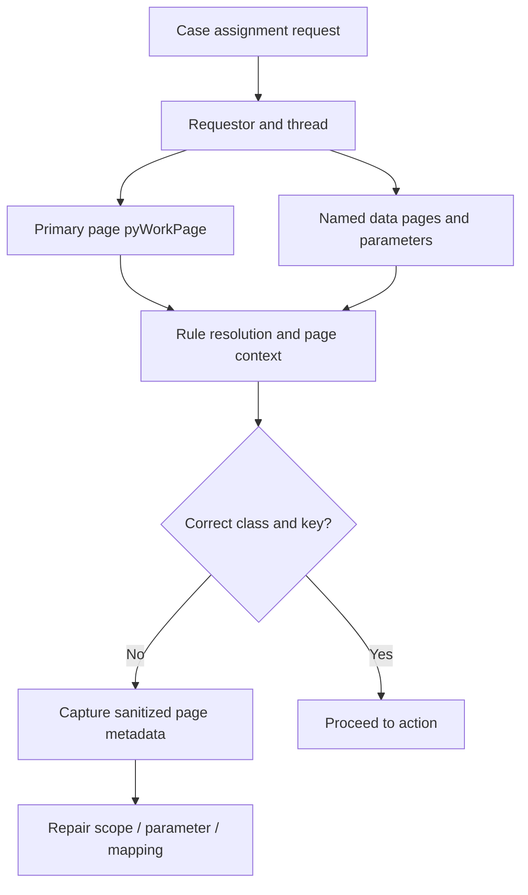

# Clipboard inspection for wrong-instance failures

**Scope:** Pega enterprise architecture and LSA implementation guidance. Platform capabilities and menu paths may vary by release; verify in the target version.

## Incident: a correct rule acting on the wrong object

A mortgage servicing team reports that changing an address in one case updates a different customer's contact record. Tracer shows the intended data transform firing and no exception. The root cause is a stale named clipboard page populated by a previous action in the same requestor. A step references CustomerPage rather than the parameterized data page instance for the current account. The transform is syntactically correct but operates on the wrong pxObjClass and pzInsKey combination.

The first diagnostic question is not which activity ran. It is which instance each rule was operating on at that moment. Pega's clipboard contains pages associated with requestors and threads, and the same rule can behave differently when invoked with another primary page, step page or data page parameter set. A page name is not proof of identity.

## Inspection contract

Start with a reproducible requestor and a controlled non-production case. Capture the operator access group, application stack, ruleset versions, requestor ID, thread and current assignment. Inspect pyWorkPage, the current step page, page class, pxObjClass, pzInsKey, pyID and relevant data page parameters. Prefer identifiers and metadata over personal field values. If the error is intermittent, collect the same metadata before and after the suspect transition.

For a data page such as D_AccountContact[AccountID, Region], distinguish the page definition from each loaded parameterized instance. A load keyed only by AccountID can return the wrong regional record when IDs overlap. Check scope (thread, requestor or node), refresh strategy, parameter defaults and whether the caller passed an empty parameter. Clearing the clipboard after every step hides a defective lifecycle and can increase load; fix the underlying ownership and key semantics.

## Controlled diagnostic procedure

1. Reproduce with two cases that share a contact identifier but differ in account or region. Use synthetic data with unmistakable values.
2. Open the correct requestor and thread in the Clipboard tool. Note page names, classes, page keys and data page parameters before starting the second case.
3. Trace only the relevant rules and events in a test environment. Record the primary page and step page for the suspected Data Transform, Activity, When and data page load.
4. Compare the rule's expected Applies To class with the runtime pxObjClass. Review any Page-New, Page-Copy, Page-Remove, Property-Set and parameter page manipulation in the call chain.
5. Check whether a declarative rule or a data page refresh reloads a page between inspection and action. A snapshot after the fact is not proof of the page at the earlier step.
6. Replace ambiguous named-page references with explicit parameters or a known step page. Keep data transforms narrow and typed; do not rely on a previous flow action having created the page.
7. Re-run both cases in one requestor, then in two concurrent requestors. Include an interrupted flow action and a browser back-navigation path.
8. Remove diagnostic tracing after evidence collection. Persist only sanitized page metadata, rule identifiers and correlation IDs in the incident record.

## Design alternatives

A thread-scoped page limits accidental reuse across parallel threads but still needs correct lifecycle. A requestor-scoped data page may be appropriate for stable operator preferences but not case-specific contact details. Node-scoped caching is only safe for data whose keys and access model are independent of the interactive requestor. Passing a fully qualified data page parameter set makes intent visible; copying large page structures into temporary pages can simplify a complex screen at the cost of stale-data risk and memory pressure.

Prefer Pega data pages and declarative refresh patterns to ad hoc clipboard housekeeping. However, do not assume a data page is automatically correct: an incorrect source mapping or omitted parameter still loads the wrong object reliably.

## Failure mechanics and containment

A production wrong-instance defect may be amplified by optimistic retries. A service layer that retries an update against a stale page can mutate the wrong target repeatedly. Stop affected writes or apply a narrow feature gate, preserve an audit trail of attempted identifiers, and reconcile actual persisted instances. Do not use Tracer indiscriminately in production or expose full clipboard snapshots containing regulated information. Use Pega Diagnostic Center and scoped logging to locate candidate transactions, then reproduce with synthetic data.

## Reproducible verification matrix

| Test | Execution | Pass condition |
| --- | --- | --- |
| Same requestor, two cases | Alternate case A and B without logout | Each update targets its own pzInsKey |
| Different requestors | Execute parallel actions for distinct operators | No page reuse between identities |
| Missing parameter | Omit Region from D_AccountContact request | Explicit validation failure, no fallback to wrong region |
| Interrupted action | Abandon flow action and resume another case | Step page and primary page remain correct |
| Refresh boundary | Invalidate data page then retry | Correct instance reloaded with complete key |
| Production-safe telemetry | Inspect emitted diagnostic event | No personal values or complete clipboard dump |

No lab results are asserted. Collect rule stack, version, synthetic input and page metadata before promoting the correction.

## Primary reference

- [Pega: Removing a data page](https://docs.pega.com/bundle/platform-88/page/platform/data-integration/removing-data-page.html)

## Architecture flow

## Evidence required before production approval

Attach a reviewed design decision, the actual Pega version and deployment topology, rule references with their Applies To classes, test inputs and observed outcomes. Record open risks, remediation owners and rollback criteria. The verification matrix above is a proposed protocol, not fabricated execution evidence.
