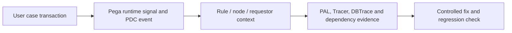

# PDC Incident Triage: From Hundreds of Alerts to One Falsifiable Root Cause

**PFA-154** | Senior / Lead System Architect level | Design reference, not a lab result

## The practical failure

A case view slows intermittently after a release. PDC shows many performance events while teams simultaneously tune SQL, Data Pages and node sizing. Random changes can hide the actual cause. An architect needs a chain from affected interaction through a rule, dependency, resource bottleneck and release window.

## Technical flow

The diagram describes a proposed execution boundary rather than a captured Pega implementation.

## Pega rules and interfaces involved

| Rule or component | Architect's checklist |
|---|---|
| Pega Diagnostic Center | Owns one part of this design |
| Performance Analyzer PAL | Requires clear data and security contract |
| Tracer | Needs actual release-specific configuration |
| DBTrace | Should yield evidence for diagnostics |
| Integration and application logs | Has a testable operational responsibility |

## Implementation design

1. Define the affected business transaction precisely, including case shape, traffic window, affected node and success criteria.

2. Group alerts by signature and time. Check whether failure began after ruleset deployment, an API outage, cache expiry or node rescheduling.

3. Correlate PDC timing with traceable requestor context while redacting client or credential details.

4. Measure PAL deltas in a controlled test; use DBTrace when query time dominates and dependency telemetry when connectors dominate.

5. Form one hypothesis and create a reproducible failure condition before applying broad configuration changes.

6. Compare before/after on identical workloads, including p95 and p99 response, rule count, SQL elapsed and external wait.

7. Keep an incident record mapping symptom, evidence, causal mechanism, correction, rollback and ownership.

## Competing patterns

| Approach | Trade-off |
|---|---|
| Increase infrastructure without profiling | Can mask load temporarily but rarely explains root cause |
| Rewrite an obvious-looking Data Page | May fix one path while changing cache isolation |
| Correlate PDC with controlled performance tools | Slower initial investigation but produces verifiable cause |

A valid architecture makes the consistency, permission and recovery contract explicit. Do not optimize for one successful demonstration while ignoring the retry or failure case.

## Why it breaks in production

A high database alert can be caused by one recently deployed report; a slow connector can be mistaken for Pega CPU time; a single requestor test can miss node-wide GC. Don't sum overlapping performance counters as though they are disjoint wall-clock phases.

For incident triage, retain a redacted operation/case ID, node, ruleset/app version, timestamp and evidence of the dependent system. Never publish private client payloads or authentication tokens.

## Reproduction and verification plan

| Scenario | Evidence to obtain |
|---|---|
| Test 1 | Add controlled delay to a mock connector and show the expected signal path. |
| Test 2 | Reproduce the same case on two nodes to identify node-local versus global effects. |
| Test 3 | Test one targeted tuning change with equivalent traffic and records. |
| Test 4 | Prove the deployment rollback does not create active-case incompatibility. |

These are proposed tests. No claim is made that the scenario has been executed in a Pega lab. A complete validated edition should show the actual Pega rule forms, configuration values and observed result for the target release.

## Release checklist

Record system of record, data and authorization boundary, expected volume, timeout/retry or conflict strategy, owner of failures, migration impact and a repair runbook. Confirm behavior across at least two realistic user/role contexts where applicable.

## Source and version note

- [Relevant Pega Academy reference](https://academy.pega.com/challenge/assessing-application-performance/v10)

Independent original engineering content. Version-specific editor names and configuration controls must be checked against the Pega release used by the reader.
