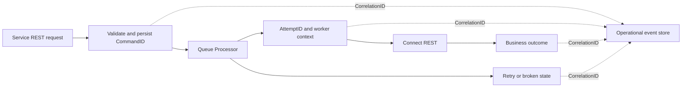

# Correlating service requests with background work

**Audience:** Pega Lead System Architects and platform engineers. Design guidance is not a claim of laboratory validation.

An insurer's claim intake API responds 202 Accepted in under a second, but one in fifty claims never reaches the fraud-screened stage. The service log reports success. The Queue Processor dashboard shows retries, yet support cannot connect an individual API request to the background item because the service requestor ends before the worker starts. The incident becomes a search through timestamps and case IDs, including sensitive identifiers copied into logs.

A correlation design must follow the business command across requestors, queue boundaries, connector calls and retries. Requestor ID alone cannot do this. The durable unit of traceability is the accepted command or case transition.

## Correlation contract

Generate a server-trusted CorrelationID on ingress, or validate an upstream trace identifier under a defined trust boundary. Assign an immutable CommandID for each accepted business operation. Record a parent-child relationship: CorrelationID for the end-to-end journey, CommandID for the operation, AttemptID for each worker execution. Keep pyID or pzInsKey in a restricted operational store if needed, not in unrestricted analytics labels.

A Service REST rule or a supported API entry point records the inbound request and accepted command. A flow step persists the case change and enqueues the command. A Queue Processor processing activity reloads the command and emits start, retry, completion and terminal-failure events. For outbound Connect REST calls, propagate a permitted correlation header; do not leak internal case identifiers or authentication context to unrelated partners.

## Engineering implementation

1. Specify a correlation envelope with CorrelationID, CommandID, AttemptID, CaseReferenceToken, EventType, RuleVersion, TimestampUTC, OutcomeCode and DependencyName. Limit identifiers to bounded length and safe character sets.
2. Add ingress validation in the service layer. Do not trust an arbitrary client-supplied correlation string as authorization or as a database lookup key.
3. Persist the command and its status in a dedicated data class before acknowledging asynchronous acceptance. The API response returns a stable public tracking token where business requirements permit.
4. Pass the CommandID, not a clipboard page snapshot, to the Queue Processor. Reload the command and case from the system of record in the worker.
5. Instrument the worker's activity around key phases: dequeued, authorization checked, external call started, external response interpreted, business status persisted. Emit one structured event per transition.
6. Capture exception categories and sanitized dependency response codes. Avoid full request/response bodies, headers containing credentials, or raw case attachments.
7. Use Pega Diagnostic Center and platform logs for low-level investigation, but reconcile them to the application event stream through a controlled mapping. PDC availability and event coverage depend on hosting and release.
8. Expose an operator-facing timeline keyed by CommandID. Distinguish accepted, pending, retrying, permanently failed and completed. A 202 response must never be represented as business completion.
9. Set alerts for commands without terminal outcome after a defined business deadline and for queue age by priority, not just total exception counts.

## Design alternatives

Propagating distributed tracing headers across every hop can simplify infrastructure correlation, but queue persistence and delayed execution often require an application-level durable identifier anyway. Writing every low-level event into the case history can be convenient for support yet inflates case records and exposes operational details to end users. Prefer a bounded business status on the case plus a secured diagnostic event store with retention and access policies.

## Production failure mechanics

A worker may retry with a new requestor ID and a new thread. Without CommandID, its events appear unrelated to the accepted API call. If a connector times out after the partner completed the transaction, an immediate retry can create a duplicate effect. The correlation record must show that the previous attempt had an ambiguous outcome and trigger reconciliation using a partner-side idempotency reference.

Clock skew across nodes makes timestamp-only joins unreliable. Use IDs and causal sequence numbers rather than asserting ordering from wall-clock time alone. If event emission itself fails, the business operation must not silently become successful; use an outbox or post-commit event recovery process where the audit requirement warrants it.

## Reproducible verification matrix

| Scenario | Reproduction | Pass condition |
| --- | --- | --- |
| Immediate success | Submit API request and drain queue | One command, linked ingress and completion |
| Delayed retry | Fail first connector attempt | Same CommandID, distinct AttemptIDs |
| Worker restart | Stop worker after dequeue | New attempt links to original command |
| Ambiguous timeout | Return timeout after partner accepts | Reconciliation before another effect |
| Log redaction | Include PII in synthetic payload | Diagnostic events contain no raw PII |
| Cross-node skew | Offset one node clock in test | Timeline reconstructed by IDs and sequence |
| Missing terminal event | Suppress completion event | Alert on stale accepted command |

**Primary reference:** [Pega Platform: more about Service REST rules](https://docs.pega.com/bundle/platform-23/page/platform/data-integration/more-about-service-rest-rules.html). Queue and tracing APIs differ by platform release; use only supported instrumentation hooks in the target environment.
