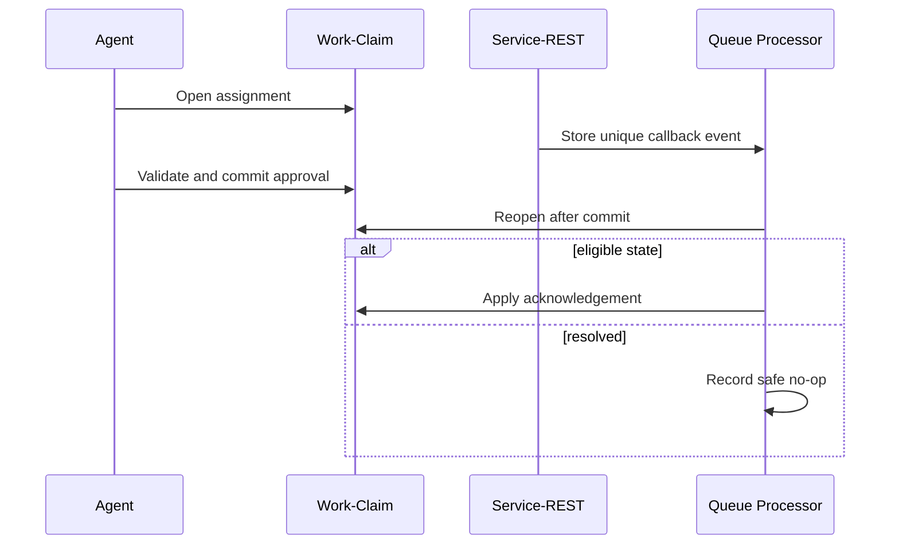

# Finding Root Causes of Intermittent Case Lock Failures

## Enterprise failure scenario

A settlement agent approves a motor claim while a payment callback arrives through Service-REST. One requestor sees a transient lock error; another retries a custom activity and triggers two payment messages. Support increases lock timeouts, worsening the problem. The system needs to distinguish lock contention, stale clipboard state, database transaction scope and duplicate side effects.

## Architecture decision and Pega rule boundary

Keep the Flow Action's case transaction short. Receive callbacks into a durable event with a business idempotency key, then use a Queue Processor to apply a state-aware update after the interactive transaction. Choose optimistic or pessimistic case locking deliberately. Do not use a Pega object lock as a distributed mutex for a remote payment service. Correlate requestor, node, case key, lock owner and rule path without exposing customer data.

## Implementation in order

1. Create a deterministic concurrency test with two operators and one callback targeting the same case. Capture pxUpdateDateTime, case status, node and requestor IDs.

2. Map every writer: Flow Action, SLA, Declare Trigger, Service-REST, queue handler and any custom activity. Identify each lock acquisition, save and commit boundary.

3. Inspect PAL and controlled Tracer traces in a non-production environment. Use PDC and alert logs to separate database latency, rule execution and lock waiting.

4. Remove unnecessary Commit steps from flow-related activities. Pega flow processing normally owns transaction boundaries; custom commits can release locks unexpectedly.

5. Persist callback events before attempting a case mutation. Require a unique external transaction ID so replay after a worker crash cannot issue a second payment.

6. On conflict, reload the current case and re-evaluate the business state. Present an explicit refresh path to the agent instead of overwriting newer changes.

7. Move slow Connect-REST calls outside the case lock window and define a compensation process for confirmed downstream success followed by local failure.

## Failure mechanics in production

A successful Commit can release locks while an old clipboard page remains visible. An optimistic update may detect a conflict only at save time. Retrying the same activity against stale state can duplicate an external payment even when only one case update survives. A slow connector inside the lock window amplifies collision frequency. The exact lock expiration and optimistic locking semantics depend on the case configuration and Pega release.

## Design tradeoffs

- Pessimistic locking protects a single writer but can block agents; optimistic locking requires a visible conflict resolution journey.
- Serialising updates through a queue simplifies ordering but increases event-to-case latency.
- Short transactions reduce contention only when downstream effects are idempotent and durable event acknowledgement is explicit.

## Reproducible verification matrix

Run these checks with synthetic data in a controlled test environment. Capture the application version, ruleset stack, requestor identity, test stimulus and expected persisted outcome. These are proposed checks, not executed results.

| Test and stimulus | Expected result and evidence |
| --- | --- |
| Two agents submit competing updates | One safe outcome; stale writer cannot overwrite |
| Callback arrives during Flow Action | Event durable and applied once after commit |
| Worker dies after payment success | Replay suppresses duplicate payment |
| Case resolves before callback | Handler records no-op without reopening |
| Connector hangs for timeout period | Case lock is not held throughout network wait |
| Requestor disconnects mid-edit | Recovery matches configured lock behaviour |
| Old case resumes after release | No duplicate transition or stale data write |

## Incident runbook

During an incident, gather failing case keys, exact timestamps, lock owner evidence and both interactive and queue requestor logs. Check downstream payment state before resubmitting anything. A lock entry missing at investigation time does not disprove an earlier collision. Reproduce with synthetic cases rather than tracing customer clipboard content.

## LSA release acceptance and limitations

Record expected lock mode by case type, queue retry policy, duplicate-key store and an operator-visible conflict message. Test at the actual platform version, since methods and release-on-commit behaviour can differ from assumptions made in a generic architecture diagram.

The architecture is design-backed and laboratory verification remains pending. A technical reviewer should inspect rule resolution, authorisation, Pega guardrail warnings, negative-path behaviour and rollback feasibility before promoting it. Capture controlled Tracer or PDC evidence only where available, and exclude sensitive clipboard content from shared logs. Do not interpret a diagram as evidence that the implementation has been tested.

## Verified Pega primary references

- [Pega Commit method](https://docs.pega.com/bundle/platform-88/page/platform/reference/methods/commit.html)
- [Pega alerts](https://docs.pega.com/bundle/platform-23/page/platform/app-dev/alerts.html)
