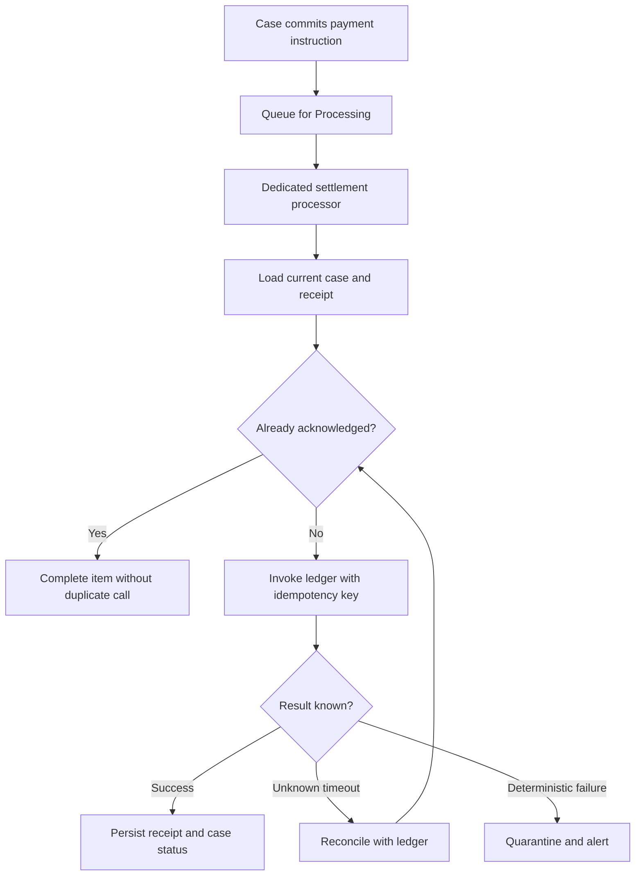

# Investigating queue processor items in broken status

## Failure scenario: repeated payment confirmations

A finance platform queues payment settlement acknowledgements from a Pega case. After an integration certificate change, the queue processor's processing activity fails for several hours. Operators see a rising broken-item count and press reprocess on every item. Some acknowledgements had actually reached the ledger before Pega timed out; reprocessing creates duplicate postings. A blanket queue replay converts a recoverable transport outage into a financial reconciliation incident.

The central design rule is **diagnose the execution and business side effect before changing queue state**. A queue item being broken does not prove the external operation failed. Queue processor semantics also differ from legacy agent queue entries: the `System-Queue-DefaultEntry` and `Broken-Process` model used by older agents must not be assumed to describe every stream-backed queue processor.

## Identify the exact runtime mechanism

Inspect the Queue Processor rule in Dev Studio and the relevant Admin Studio landing pages for the installed version. Determine whether it is standard or dedicated, which processing activity it invokes, which background nodes or threads serve it, and how retry/failure handling is configured. Inspect stream and database dependencies, queue latency, processor health and processing exceptions. Capture the version-specific item status and error fields instead of relying on generic terminology.

The work item should carry a durable business identifier, such as `PaymentInstructionId`, not only a transient clipboard handle. The processing activity must load current business state and use a durable idempotency or settlement receipt check before calling the ledger. Correlate each execution attempt with a non-sensitive trace identifier and queue processor rule name.

## Technical flow

## Investigation runbook

1. **Establish scope and impact.** Record first failure time, affected processor, application release, node classification, queue depth, age of oldest item and business operation. Count unique business IDs separately from raw queue entries. Do not equate queue depth with lost transactions.
2. **Classify failure signatures.** Group by rule exception, missing rule, lock conflict, authentication rejection, connector timeout, schema mismatch and infrastructure unavailability. A single broken status can hide different recovery paths.
3. **Inspect the activity contract.** Check the processing activity's step page class, required parameters, Data Pages, authentication profiles and any `Obj-Open-By-Handle` or `Obj-Save` paths. Confirm that the item can run under a background requestor Access Group with the required privileges.
4. **Check processing dependencies.** Verify the stream service, relevant nodes, queue processor configuration and recent deployments. For dedicated processors, thread and partition settings can affect throughput, but increasing them before fixing a deterministic exception amplifies failure volume.
5. **Reconcile external side effects.** Query the ledger or its approved read API using the business idempotency key. Separate completed-but-unrecorded operations from genuinely unprocessed instructions.
6. **Fix the root cause** in the correct layer: credential, ruleset, missing data, mapping, external availability or resource pressure. Verify the fix with a single synthetic item in a lower environment and then a carefully chosen production canary if approved.
7. **Replay only a bounded cohort.** Define a manifest of IDs, initial status, expected outcome, approval and replay operator. Use supported administration controls for the platform release. Never update stream storage or internal queue tables directly.
8. **Confirm recovery and close.** Compare unique instructions, successful receipts, intentionally rejected instructions and outstanding exceptions. Watch both queue age and duplicate-effect counters until stable.

## Why common fixes fail

Increasing retry attempts cannot repair a revoked certificate. Restarting nodes may clear a transient worker failure but does not make a non-idempotent consumer safe. Editing the case status manually may cause the next queued attempt to apply an out-of-date transition. Requeuing all failed items before reconciling remote state hides the difference between transport failure and business failure.

The appropriate remediation depends on whether the processing activity is **at least once in effect** for its external operation. Assume retries and duplicate delivery are possible; achieve effective once-only business behavior through durable idempotency, not through a promise about queue infrastructure.

## Design tradeoffs

A standard queue processor reduces configuration but shares capacity with other workloads. A dedicated queue processor gives explicit capacity isolation and workload-specific monitoring, at the cost of more operational configuration. A high thread count improves throughput only when the downstream system and database can sustain it. A per-item receipt table adds storage and transaction work, but gives a defensible answer when an external call succeeds and the Pega transaction subsequently fails.

Do not treat a fixed retry count as a business recovery policy. Financial settlement may need human authorization and reconciliation before a retry, while a non-critical notification can often be retried automatically.

## Reproducible verification matrix

| Failure injection | Observation | Pass condition |
| --- | --- | --- |
| Connector returns 503 | Retry and processor diagnostics | No duplicate settlement; bounded retry |
| Remote commit then response timeout | Reconcile external receipt | One ledger effect for one instruction |
| Invalid authentication profile | Capture sanitized exception | Deterministic error is quarantined |
| Case lock held by user | Simulate concurrent edit | Lock conflict does not overwrite newer case data |
| Processor node unavailable | Stop worker in test cluster | Backlog visible; processing resumes after recovery |
| Duplicate queue item | Submit same business key twice | Receipt guard prevents duplicate side effect |
| Replay approved cohort | Use documented admin control | Replayed IDs and outcomes match manifest |
| Background access missing | Remove test privilege | Explicit authorization failure, no partial write |

**Verification status:** Design-backed test plan, lab pending. No queue metrics or successful replay have been observed or asserted.

## Primary references

- [Understanding standard and dedicated queue processors, Pega Platform 8.8](https://docs.pega.com/bundle/platform-88/page/platform/background-processing/queue-processors-understanding.html).
- [Legacy Queue-For-Agent broken queue semantics, Pega Platform '23](https://docs.pega.com/bundle/platform-23/page/platform/reference/methods/queue-for-agent.html). This second reference describes agents, not queue processors.
