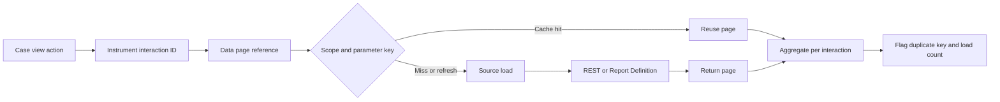

# Detecting repeated data page loads

## Failure scenario
A mortgage servicing portal renders one customer overview in under a second during isolated tests but stalls when a contact-centre agent opens multiple accounts. Tracer shows a connector called repeatedly, even though the page uses a supposedly cached customer data page. A reusable section references `D_Customer[CustomerID:.CustomerID]` from three contexts, one of which passes a formatted ID, while another forces a refresh on every action. An unrelated tab also loads the page eagerly. The real defect is not simply a slow REST endpoint; it is unbounded repeated loading.

## Define what counts as a duplicate
A data page load is expected when its scope, parameters or freshness contract requires it. A duplicate is an avoidable load for the **same effective business key and visibility context** during a defined interaction. Record requestor, thread, data page name, parameter hash, source, cache state and elapsed time. Do not log customer IDs directly. Requestor-scoped data may be shared within that requestor; thread-scoped data is not. Node scope is inappropriate for user-specific results unless the authorization model and parameter isolation are proven.

## Investigation method
1. Reproduce the slow screen with a known case and clean test identity. Capture a browser action timeline and server request correlation, including the page's first render and subsequent tab changes. Separate cold and warm cache runs.
2. Use Performance Analyzer (PAL) and relevant Pega alerts to identify data access and elapsed-time changes. Use Tracer selectively in a non-production or tightly controlled session to map actual rule calls, data transforms and connector executions. PAL deltas are evidence of resource use, not a perfect per-page call count.
3. Inspect each reference to the suspect data page in sections/views, data transforms, when rules, decision logic and other data pages. Search for refresh-on-interaction, parameter expressions and data source fallback chains. A reference can trigger loading indirectly through property access.
4. Compare canonical keys. Normalize whitespace, casing and source-system identifiers before the data page boundary; never normalize two genuinely different customer identifiers into one. Include tenant and authorization-relevant dimensions in the cache key.
5. Evaluate scope deliberately. Thread scope suits transient step-specific state; requestor scope may reuse data during a session but requires revocation handling; node scope suits shared non-sensitive reference data with an explicit invalidation strategy. Check the installed release's supported refresh options rather than assuming one setting works identically everywhere.
6. For connector-backed pages, log source-call counts and latency by a **hashed key** in the service boundary or a controlled test harness. Compare these with Pega-side rule execution. A connector that retries internally may produce more remote calls than Pega reports as page loads.
7. Change only one variable at a time: canonical parameters, load-on-demand, refresh conditions, or cache scope. Repeat with identical cases and load shape; confirm both performance and freshness semantics.

## Tradeoffs and diagnosis pitfalls
Increasing cache duration can hide a load problem while returning stale account balances. Node caching can reduce external traffic but expose one tenant's data to another if the key omits the tenant. Prefetching can improve perceived navigation latency while raising total connector demand. Loading once into a case property can avoid repeated lookups, but may create a stale persisted snapshot and increase BLOB size. A separate service-side coalescing layer may be useful for high fan-out, but then invalidation and fault ownership move outside Pega.

Beware of false duplicates: a legitimately refreshed page after a payment, a different parameter combination, and a new requestor are not necessarily redundant. Conversely, one Pega page load can fan out to several nested pages. Diagnose both the direct page and the entire dependency graph. Instrumentation must not expose parameter values in logs, especially in production.

## Verification matrix
| Scenario | Controlled input | Expected behavior | Proof |
|---|---|---|---|
| Same key, one action | Reuse customer view | One source load or documented cache hit | Correlation and source counter |
| Equivalent key formats | Whitespace and case variants | Canonical business key | Parameter-hash comparison |
| Different tenant | Same local customer ID | Separate authorized result | Tenant test identities |
| Freshness expiry | Advance beyond configured TTL | Reload exactly when contract requires | Cache and source timestamps |
| Revoked access | Remove operator entitlement | No stale unauthorized disclosure | Security outcome |
| Concurrent tabs | Open three tabs | Bounded connector fan-out | Server counters |
| Connector retry | Inject one timeout | Retries distinguishable from page loads | Adapter and Pega logs |

The acceptance thresholds must be set from a measured baseline. No numerical improvement is asserted here. Capture the test dataset, requestor count, Pega release and connector mock version with every result.

## Verified Pega references
- [Pega Infinity application development best practices, Platform '24.2](https://docs.pega.com/bundle/platform-242/page/platform/app-dev/best-practices-infinity-application-development.html)
- [Pega Platform alerts, Platform '23](https://docs.pega.com/bundle/platform-23/page/platform/app-dev/alerts.html)
