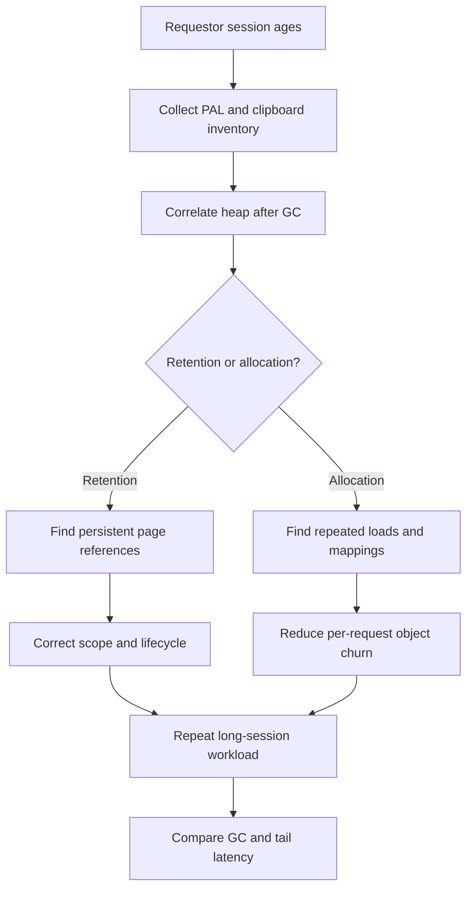

# Diagnosing memory pressure in long requestor sessions
## Incident: heap growth without traffic growth
A government licensing portal stays responsive after deployment, then deteriorates during the afternoon. The number of concurrent operators is stable, yet JVM heap occupancy after garbage collection increases and response times drift upward. The team restarts nodes and sees temporary relief. Investigation finds a screen that opens twenty cases in a tabbed workspace, retaining large embedded page lists on requestor clipboard pages. An integration Data Page scoped to the requestor is also keyed only by account ID, so each operator accumulates historical account variants. Restarting the node conceals the retention mechanism but does not fix it.

## What to measure
Separate requestor lifetime, thread lifetime, node memory, Pega clipboard footprint and JVM garbage collection. A long requestor is not automatically a leak: it can legitimately hold work context. The failure exists when references retain large pages after their business purpose ends, or when cache scope is broader than the reuse requirement. Distinguish high allocation rate, which can cause frequent young collections, from retained old-generation objects and long pauses.

Inspect Pega Clipboard in a controlled test session, the Performance Analyzer (PAL) for request-specific resource indicators, PegaRULES and alert logs, and Pega Diagnostic Center if connected. Pair those with JVM heap metrics and GC logs from the approved runtime observability stack. PAL values are diagnostic clues, not a direct byte-for-byte inventory of all retained Java objects. Heap dumps can contain secrets and personal data; restrict access, collection windows and retention.

## Engineering sequence
1. Reproduce using a synthetic operator with a scripted journey: open, update, switch, close and reopen cases. Preserve the same session for hours in test, and create a control group with fresh sessions. Capture request count, open work items, session age and heap-after-GC time series.
2. Establish a safe baseline under the same traffic and case shapes. Use per-node memory, garbage-collection pause distribution, allocation rate and response-time percentiles. Do not compare an idle node to a loaded node or assume a single GC pause explains a whole incident.
3. Enumerate clipboard pages by class, structure and approximate content volume. Look for embedded `Page List` snapshots copied by Data Transforms into persistent work or requestor pages, repeated results from Report Definitions, and activity steps that leave temporary pages behind.
4. Review `D_AccountHistory` and other Data Page definitions: Page versus List, Thread/Requestor/Node scope, parameters, refresh strategy and source. If a page contains operator-specific data, reject node scope. If the data is needed for one action, prefer thread scope and a narrow payload. A requestor-scoped cache needs explicit expiry or refresh and a defensible key.
5. Check custom Activities that use `Page-New`, `Page-Copy` or `Page-Remove`. Verify cleanup on success, error and cancelled-flow paths. Avoid deleting system pages or assuming all transient pages are safe to remove.
6. Inspect UI and navigation patterns. A Constellation view or traditional section may repeatedly request large lists through a Data Page. Use pagination and purpose-built Data Transforms rather than carrying complete history into every view.
7. Run A/B tests changing only one scope or mapping at a time. Compare the growth slope of post-GC heap and the size of the live clipboard after equivalent journey iterations. A lower allocation rate with unchanged retained heap suggests a different root cause.
8. Add an operational trigger for post-GC heap trend plus rising pause time and requestor age distribution. A heap threshold alone can generate noise from normal JVM ergonomics.

## Tradeoffs and production traps
Thread-scoped pages reduce retention but may increase repeated connector calls; requestor scope reduces round trips but can retain stale and confidential data. Node-scoped shared reference data is useful only when it is truly shareable and its invalidation is defined. Tuning heap size may postpone exhaustion but can lengthen pauses and hide unbounded growth. A forced garbage collection in production changes system behavior and is not a sound diagnostic default.

A common false positive is traffic redistribution after node drain: fewer active requestors lower memory and make a change appear successful. Another is measuring total heap committed rather than live heap after collection. For incident evidence, record application version, JVM version, node type, test population and synthetic data characteristics.

## Verification matrix
| Exercise | Stimulus | Required observation | Evidence |
|---|---|---|---|
| Session aging | 500 synthetic navigation cycles | No unbounded retained-page growth | Clipboard snapshots |
| Failure cleanup | Fail connector mid-activity | Temporary pages not retained | Tracer and clipboard |
| Parameter variation | Rotate account IDs | Cache bounded and correct | Data Page key audit |
| Two users | Same account, different rights | No cross-identity data exposure | Response comparison |
| Fresh-session control | Same workload with new login | Growth cause isolated | JVM and requestor metrics |
| Node drain | Move traffic to another node | No misleading improvement claim | Node routing logs |
| GC correlation | Observe long-session peak | Pauses attributable to measured cause | GC log and latency traces |

No memory savings or production measurements are claimed. Verify the installed Pega Platform and JVM telemetry facilities before running this protocol.
## Primary guidance
- [Creating a Data Page, Platform '25](https://docs.pega.com/bundle/platform-25/page/platform/data-integration/creating-data-page.html?workflow=creating-data-pages)
