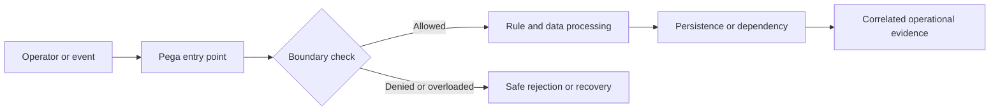

# Incident analysis after a ruleset deployment

## Engineering context and failure scenario

Immediately after deploying a ruleset, one node begins routing cases to an unexpected assignment while another still executes the prior flow version. The incident initially looks like random operator error. This is not merely a user-interface defect. In a distributed Pega application, the effective outcome depends on the access group, resolved rule versions, clipboard state, background processing and the timing of persistence or external acknowledgements. The architecture must specify which component owns the decision, what constitutes a completed operation, and which evidence can be safely retained. The example below is a design exercise, not a claim of observed production results.

## Relevant Pega building blocks

The principal platform objects and diagnostics are **RuleSet versions, ruleset stack, rule resolution, application rule, PDC, PAL, Tracer, deployment pipeline, node caches**. Inspect the exact rule implementations and access configuration in the deployed Pega Platform version; behavior can vary by application stack, UI architecture, deployment model and patch level. Do not assume that a visual control, a connector response or an activity completion implies an authorized durable business outcome. The owner of the relevant case or integration contract must define the authoritative state and acceptable recovery actions.

**Design invariant:** Separate release correlation from causation by identifying effective resolved rules and node-specific execution paths.

## Reference architecture

The boundary decision must happen before an irreversible side effect. Correlation IDs should cross the request, background-work and integration boundaries without carrying protected business payloads. An explicit rejection or pending state is preferable to silently discarding work. Where the decision spans multiple systems, document the transaction boundary and recovery contract instead of promising an atomic commit across services.

## Step-by-step implementation

### 1. Declare an incident window and freeze unrelated releases

Declare an incident window and freeze unrelated releases; record deployment package, application version, node topology and affected case types. Record the responsible rule, configuration owner and expected observable outcome in an architecture decision record. Review whether the behavior is synchronous, asynchronous or eventually consistent, and specify the authorization context for each execution path. Avoid coupling the check to a single screen or portal implementation; direct services and resumed background work require equivalent controls.

### 2. Collect correlation IDs and sanitized case timelines from both successful and failing requests

Collect correlation IDs and sanitized case timelines from both successful and failing requests; compare operator access groups and application versions. Record the responsible rule, configuration owner and expected observable outcome in an architecture decision record. Review whether the behavior is synchronous, asynchronous or eventually consistent, and specify the authorization context for each execution path. Avoid coupling the check to a single screen or portal implementation; direct services and resumed background work require equivalent controls.

### 3. Resolve the effective flow, decision and activity rules under the actual production ruleset stack, including circumstance and availability

Resolve the effective flow, decision and activity rules under the actual production ruleset stack, including circumstance and availability. Record the responsible rule, configuration owner and expected observable outcome in an architecture decision record. Review whether the behavior is synchronous, asynchronous or eventually consistent, and specify the authorization context for each execution path. Avoid coupling the check to a single screen or portal implementation; direct services and resumed background work require equivalent controls.

### 4. Compare rule history and deployment manifests against last-known-good behavior

Compare rule history and deployment manifests against last-known-good behavior; inspect node cache and session-version effects without assuming immediate convergence. Record the responsible rule, configuration owner and expected observable outcome in an architecture decision record. Review whether the behavior is synchronous, asynchronous or eventually consistent, and specify the authorization context for each execution path. Avoid coupling the check to a single screen or portal implementation; direct services and resumed background work require equivalent controls.

### 5. Reproduce the divergence using synthetic cases with controlled access groups and rule versions in a staging environment

Reproduce the divergence using synthetic cases with controlled access groups and rule versions in a staging environment. Record the responsible rule, configuration owner and expected observable outcome in an architecture decision record. Review whether the behavior is synchronous, asynchronous or eventually consistent, and specify the authorization context for each execution path. Avoid coupling the check to a single screen or portal implementation; direct services and resumed background work require equivalent controls.

### 6. Choose rollback, forward fix or controlled drain based on compatibility of open assignments and in-flight work

Choose rollback, forward fix or controlled drain based on compatibility of open assignments and in-flight work; document why. Record the responsible rule, configuration owner and expected observable outcome in an architecture decision record. Review whether the behavior is synchronous, asynchronous or eventually consistent, and specify the authorization context for each execution path. Avoid coupling the check to a single screen or portal implementation; direct services and resumed background work require equivalent controls.

## Design alternatives and trade-offs

Rolling back rules quickly can restore traffic but may strand cases created under new schema; a forward fix avoids rollback risk but takes longer to validate. An architecture review should compare the primary option against a simpler baseline using operational complexity, rollback safety, failure isolation, data sensitivity and support burden. Document what the team deliberately does not automate, especially recovery operations that could produce duplicate business actions. Favor reversible configuration changes and a narrow rollout cohort when the failure mode has not been reproduced in a controlled environment.

## Production failure mechanics

A newly available rule overrides an older circumstance, cached rules differ across nodes, or a long-running assignment resumes against a different flow shape. In incident response, distinguish the original triggering event from secondary effects such as retries, stale cache entries, inconsistent sessions or operator rework. Collect a sanitized timeline with request correlation, effective ruleset, node or execution context, queue state and final persistence outcome. Do not infer root cause from a single error message. An apparently successful connector invocation may be followed by a failed commit, and a displayed stale value may conceal a correct committed write.

## Reproducible verification matrix

| Experiment | Setup and stimulus | Expected evidence | Failure interpretation |
|---|---|---|---|
| V1: Case started before release resumes after release | Seed synthetic data, pin access group and rule versions, then execute the scenario | Correlated trace, authoritative state, safe error category and pass/fail assertion | Compare rule resolution, boundary decision, transaction or queue outcome |
| V2: Different access groups resolve same rule | Seed synthetic data, pin access group and rule versions, then execute the scenario | Correlated trace, authoritative state, safe error category and pass/fail assertion | Compare rule resolution, boundary decision, transaction or queue outcome |
| V3: Fresh versus existing session | Seed synthetic data, pin access group and rule versions, then execute the scenario | Correlated trace, authoritative state, safe error category and pass/fail assertion | Compare rule resolution, boundary decision, transaction or queue outcome |
| V4: Node-local cache invalidation | Seed synthetic data, pin access group and rule versions, then execute the scenario | Correlated trace, authoritative state, safe error category and pass/fail assertion | Compare rule resolution, boundary decision, transaction or queue outcome |
| V5: Rollback with new case properties present | Seed synthetic data, pin access group and rule versions, then execute the scenario | Correlated trace, authoritative state, safe error category and pass/fail assertion | Compare rule resolution, boundary decision, transaction or queue outcome |

Use a version-pinned nonproduction environment with synthetic records. Capture the test input, operator role, application version, rule versions, node type and relevant configuration. Run each experiment both before and after the proposed change, and include a negative test that attempts to bypass the intended UI path. A test passes only when both the business outcome and the security or recovery invariant are satisfied. Do not substitute screenshots for assertions on persisted state, access decisions or integration side effects.

## Operations and rollback

Monitor **error rate by deployment ID, rule-resolution differences, assignment routing divergence, affected-case count**. Agree on an alert owner, escalation window and a documented safe action for each signal. During rollout, use a limited cohort and compare error categories and latency distributions against a recorded baseline rather than a fabricated numerical target. If rollback is required, first identify work already committed or dispatched; reverting rules alone cannot undo external side effects. Keep a replay ledger or idempotency reference for any controlled reprocessing, and audit who approved a manual repair.

## Architecture review checklist

- Is the authoritative state and execution identity explicit at each boundary?
- Are negative paths and direct API or background entry points covered?
- Are logs and diagnostics free of customer payloads and credentials?
- Can support distinguish delayed, rejected, duplicated and committed work?
- Does rollback preserve compatibility with open cases and queued items?
- Are performance and security assumptions testable in the actual platform version?

## Verification status and further reading

**Design-backed, lab verification pending.** The matrix specifies experiments to execute; no lab run, benchmark or platform-version certification is claimed. Use your licensed platform's matching-version documentation for rule configuration and security semantics. Official primary documentation: [Pega Documentation](https://docs.pega.com/) and [Pega Academy](https://academy.pega.com/). Review the actual deployment's supported feature set before adopting these patterns.
