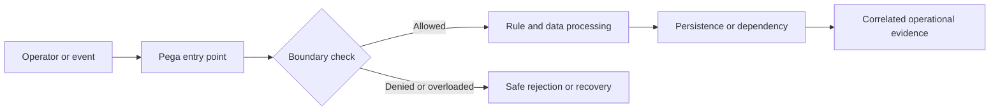

# Defining useful alerts for background backlog growth

## Engineering context and failure scenario

A nightly batch creates thousands of background tasks. Queue depth rises, but an alert based only on absolute item count fires too late for urgent cases and too often during expected overnight peaks. This is not merely a user-interface defect. In a distributed Pega application, the effective outcome depends on the access group, resolved rule versions, clipboard state, background processing and the timing of persistence or external acknowledgements. The architecture must specify which component owns the decision, what constitutes a completed operation, and which evidence can be safely retained. The example below is a design exercise, not a claim of observed production results.

## Relevant Pega building blocks

The principal platform objects and diagnostics are **Queue Processor, Job Scheduler, PDC, node types, broken items, retry policy, service-level goals, Connect-REST**. Inspect the exact rule implementations and access configuration in the deployed Pega Platform version; behavior can vary by application stack, UI architecture, deployment model and patch level. Do not assume that a visual control, a connector response or an activity completion implies an authorized durable business outcome. The owner of the relevant case or integration contract must define the authoritative state and acceptable recovery actions.

**Design invariant:** Alert on customer-impacting age and drain capacity rather than raw queue depth alone.

## Reference architecture

The boundary decision must happen before an irreversible side effect. Correlation IDs should cross the request, background-work and integration boundaries without carrying protected business payloads. An explicit rejection or pending state is preferable to silently discarding work. Where the decision spans multiple systems, document the transaction boundary and recovery contract instead of promising an atomic commit across services.

## Step-by-step implementation

### 1. Inventory queues by business criticality, producer, consumer, retry behavior and expected processing windows

Inventory queues by business criticality, producer, consumer, retry behavior and expected processing windows. Record the responsible rule, configuration owner and expected observable outcome in an architecture decision record. Review whether the behavior is synchronous, asynchronous or eventually consistent, and specify the authorization context for each execution path. Avoid coupling the check to a single screen or portal implementation; direct services and resumed background work require equivalent controls.

### 2. Define oldest-item age and age percentiles for urgent work

Define oldest-item age and age percentiles for urgent work; pair them with arrival rate, completion rate and backlog slope. Record the responsible rule, configuration owner and expected observable outcome in an architecture decision record. Review whether the behavior is synchronous, asynchronous or eventually consistent, and specify the authorization context for each execution path. Avoid coupling the check to a single screen or portal implementation; direct services and resumed background work require equivalent controls.

### 3. Model drain time as backlog divided by sustainable net processing capacity, only where that rate is positive and measured

Model drain time as backlog divided by sustainable net processing capacity, only where that rate is positive and measured. Record the responsible rule, configuration owner and expected observable outcome in an architecture decision record. Review whether the behavior is synchronous, asynchronous or eventually consistent, and specify the authorization context for each execution path. Avoid coupling the check to a single screen or portal implementation; direct services and resumed background work require equivalent controls.

### 4. Set separate warning and critical thresholds for urgent and batch queues

Set separate warning and critical thresholds for urgent and batch queues; include business calendar and known load windows. Record the responsible rule, configuration owner and expected observable outcome in an architecture decision record. Review whether the behavior is synchronous, asynchronous or eventually consistent, and specify the authorization context for each execution path. Avoid coupling the check to a single screen or portal implementation; direct services and resumed background work require equivalent controls.

### 5. Route actionable alerts to an owner with runbook links, recent deployment context and broken-item summaries

Route actionable alerts to an owner with runbook links, recent deployment context and broken-item summaries. Record the responsible rule, configuration owner and expected observable outcome in an architecture decision record. Review whether the behavior is synchronous, asynchronous or eventually consistent, and specify the authorization context for each execution path. Avoid coupling the check to a single screen or portal implementation; direct services and resumed background work require equivalent controls.

### 6. Validate alert sensitivity using controlled backlog injection in nonproduction and review alert noise after each release

Validate alert sensitivity using controlled backlog injection in nonproduction and review alert noise after each release. Record the responsible rule, configuration owner and expected observable outcome in an architecture decision record. Review whether the behavior is synchronous, asynchronous or eventually consistent, and specify the authorization context for each execution path. Avoid coupling the check to a single screen or portal implementation; direct services and resumed background work require equivalent controls.

## Design alternatives and trade-offs

Aggressive age alerts improve response but can cause alert fatigue; dynamic thresholds reduce noise but may hide a gradual capacity regression. An architecture review should compare the primary option against a simpler baseline using operational complexity, rollback safety, failure isolation, data sensitivity and support burden. Document what the team deliberately does not automate, especially recovery operations that could produce duplicate business actions. Favor reversible configuration changes and a narrow rollout cohort when the failure mode has not been reproduced in a controlled environment.

## Production failure mechanics

Retries inflate depth, poison items repeatedly consume capacity, downstream throttling reduces throughput, or a paused consumer makes drain-time estimates invalid. In incident response, distinguish the original triggering event from secondary effects such as retries, stale cache entries, inconsistent sessions or operator rework. Collect a sanitized timeline with request correlation, effective ruleset, node or execution context, queue state and final persistence outcome. Do not infer root cause from a single error message. An apparently successful connector invocation may be followed by a failed commit, and a displayed stale value may conceal a correct committed write.

## Reproducible verification matrix

| Experiment | Setup and stimulus | Expected evidence | Failure interpretation |
|---|---|---|---|
| V1: Sudden producer spike | Seed synthetic data, pin access group and rule versions, then execute the scenario | Correlated trace, authoritative state, safe error category and pass/fail assertion | Compare rule resolution, boundary decision, transaction or queue outcome |
| V2: Consumer node unavailable | Seed synthetic data, pin access group and rule versions, then execute the scenario | Correlated trace, authoritative state, safe error category and pass/fail assertion | Compare rule resolution, boundary decision, transaction or queue outcome |
| V3: Single poison message | Seed synthetic data, pin access group and rule versions, then execute the scenario | Correlated trace, authoritative state, safe error category and pass/fail assertion | Compare rule resolution, boundary decision, transaction or queue outcome |
| V4: Slow dependency throttling | Seed synthetic data, pin access group and rule versions, then execute the scenario | Correlated trace, authoritative state, safe error category and pass/fail assertion | Compare rule resolution, boundary decision, transaction or queue outcome |
| V5: Healthy overnight batch burst | Seed synthetic data, pin access group and rule versions, then execute the scenario | Correlated trace, authoritative state, safe error category and pass/fail assertion | Compare rule resolution, boundary decision, transaction or queue outcome |

Use a version-pinned nonproduction environment with synthetic records. Capture the test input, operator role, application version, rule versions, node type and relevant configuration. Run each experiment both before and after the proposed change, and include a negative test that attempts to bypass the intended UI path. A test passes only when both the business outcome and the security or recovery invariant are satisfied. Do not substitute screenshots for assertions on persisted state, access decisions or integration side effects.

## Operations and rollback

Monitor **oldest pending age, p95 pending age, arrivals/minute, completions/minute, retries, broken items, estimated drain time**. Agree on an alert owner, escalation window and a documented safe action for each signal. During rollout, use a limited cohort and compare error categories and latency distributions against a recorded baseline rather than a fabricated numerical target. If rollback is required, first identify work already committed or dispatched; reverting rules alone cannot undo external side effects. Keep a replay ledger or idempotency reference for any controlled reprocessing, and audit who approved a manual repair.

## Architecture review checklist

- Is the authoritative state and execution identity explicit at each boundary?
- Are negative paths and direct API or background entry points covered?
- Are logs and diagnostics free of customer payloads and credentials?
- Can support distinguish delayed, rejected, duplicated and committed work?
- Does rollback preserve compatibility with open cases and queued items?
- Are performance and security assumptions testable in the actual platform version?

## Verification status and further reading

**Design-backed, lab verification pending.** The matrix specifies experiments to execute; no lab run, benchmark or platform-version certification is claimed. Use your licensed platform's matching-version documentation for rule configuration and security semantics. Official primary documentation: [Pega Documentation](https://docs.pega.com/) and [Pega Academy](https://academy.pega.com/). Review the actual deployment's supported feature set before adopting these patterns.
