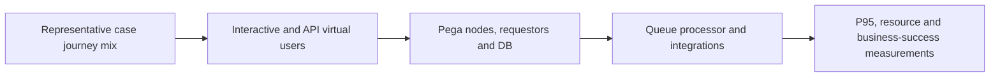

# Load Testing Pega by Business Journey, Not Just HTTP Request Rate

**PFA-166** | Technical design study for Pega Senior and Lead System Architects | Laboratory verification pending

## Architecture problem

A performance test sends thousands of identical CreateCase API calls and passes. The real system slows when agents navigate many stages, leave requestors open, load complex Data Pages, reopen cases and finish assignments. A credible performance workload must reproduce business journeys, state diversity and background work rather than raw endpoint throughput.

## System design

This diagram records a proposed boundary, not a fabricated Pega runtime screenshot. The interfaces and exact rule forms must be verified in a permitted sandbox.

## Feature inventory and design responsibilities

| Pega rule or component | Review requirement |
|---|---|
| Case lifecycle and assignment list | Primary configuration and ownership boundary |
| Performance Analyzer PAL | Explicit input/output and identity contract |
| PDC | Apply platform-version-specific controls |
| DBTrace and partner latency logs | Test failure handling and observability |
| Load test fixtures and test accounts | Validate runtime access and support procedure |

## Implementation approach

1. Choose journeys covering creation, reassignment, lookup, approval, exception, completion and long-lived requestors.

2. Seed realistic case sizes, page lists, attachments and customer-dependent data, with separate tenant identities.

3. Measure concurrency, think time, session lifetime and geographic latency; pure loops are not typical worker behaviour.

4. Stub only dependencies whose real capacity is unavailable, and document which times are simulated.

5. Collect business completion rate, p95/p99 latency, queue lag, DB pressure, JVM memory and external request rate together.

6. Run cold-start and steady-state tests to identify caching or rule assembly effects.

7. Use a controlled performance budget and compare release candidates on identical data and environment state.

## Design alternatives

| Option | Architectural trade-off |
|---|---|
| Max HTTP requests test | Useful endpoint stress, poor business representativeness |
| Journey and dataset-driven load | More setup, stronger production prediction |
| Only small manual test | Good usability feedback, insufficient concurrency evidence |

Choose the option that satisfies the business consistency contract and operational constraints. Avoid proving only the success path while deferring security, stale state and recovery behaviour.

## Failure modes and troubleshooting

A test can pass while queues silently accumulate work. Anonymous API load may not replicate authenticated requestor memory. A fake empty case avoids the Page List volumes responsible for production problems. Include abandoned sessions and retry traffic as part of workload shape.

Capture a sanitized case ID or operation identifier, relevant runtime node, application/ruleset version and timestamps. Correlate the origin and outcome across Pega and partner systems instead of relying on a single status message.

## Verification experiments

| Scenario | Evidence required |
|---|---|
| Experiment 1 | Run 50 concurrent long-lived sessions and inspect heap growth. |
| Experiment 2 | Hold partner API for ten minutes; measure queue catch-up. |
| Experiment 3 | Compare cold and warmed case view latency. |
| Experiment 4 | Test reassignment storms and conflict rate under concurrent operators. |

These are experiments to perform in a Pega lab. The article does not claim that any test has passed. A lab-verified version should include actual configuration screenshots, observed results and target Pega version.

## Production acceptance

Before deployment, the implementation needs documented data ownership, access context, expected peak volume, case compatibility, timeouts and retry boundaries, monitoring, escalation owner and a tested operational repair path. If the design changes a data model or class structure, verify legacy case paths and queued work.

## Pega technical source

- [Primary Pega reference](https://academy.pega.com/challenge/assessing-application-performance/v10)

Independent original technical analysis. Pega version-specific features and terminology must be confirmed against the target release; the scenario is fictional.
