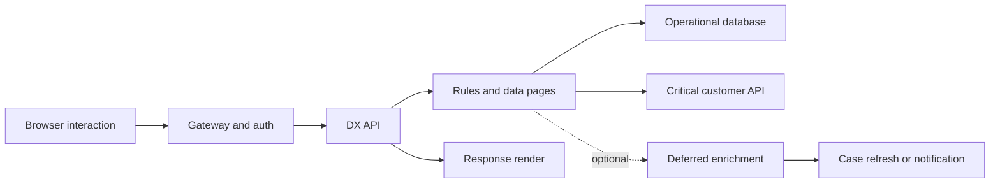

# Latency budgets across case views and external APIs

> Architecture study for Lead System Architects. The failure narrative is a hypothetical engineering scenario; no production incident or test result is claimed.

## Enterprise failure scenario

A complaints case opens in four seconds at the office but takes twelve seconds for mobile agents. The portal loads customer details, an address verification result and a risk score through separate data pages. Each connector appears acceptable in isolation. On a cold requestor, however, data page dependencies serialize and a failing risk provider consumes the whole gateway timeout. The team increases all timeouts, making the user experience worse and tying up more requestors.

## Architecture decision and Pega rule design

Define an end-to-end user journey service-level objective before tuning a connector. Partition the budget into network, authentication, DX API processing, rule assembly, database work, data page loading, external calls and browser rendering. Treat budgets as planning hypotheses, not measured facts. Separate hard-required data from optional enrichment. Prefer a bounded synchronous critical path; move slow, non-essential enrichment to an asynchronous case step or a separately refreshable view where the user journey permits it. Cache only information whose freshness and security contracts allow reuse.

## Technical flow

## Implementation sequence

1. Define three journeys: cold case open, warm case open and assignment submit. For each, specify target percentile, business priority and failure behavior with product owners.

2. Capture a request timeline with correlation IDs across browser network timings, gateway, Pega logs and connector endpoints. Distinguish concurrent calls from serial dependencies rather than adding all timings blindly.

3. Use PAL deltas around the affected interaction. Examine total elapsed, CPU, rule assembly, database I/O and connector elapsed values. Treat first-use rule assembly separately from steady-state behavior.

4. Inspect each Data Page's scope, parameterization, load strategy and refresh conditions. Remove duplicate loads, accidental per-row connector calls and recursive page dependencies.

5. Assign explicit per-dependency deadlines that fit inside the overall request budget. Allow a small margin for serialization, retries and network variation; a retry must not exceed the caller's remaining deadline.

6. Make optional enrichment degradable: display a clearly labelled 'not yet available' state and provide a background refresh path. Never silently replace a required compliance decision with a default success.

7. Load-test representative case shapes, geographic networks, cold and warm caches and provider error modes. Compare percentile distributions, not only arithmetic averages.

8. Add alerts for end-to-end latency, connector timeout rate and background backlog. Review thresholds after observing a real baseline; no numeric performance improvement is asserted here.

## How the design fails in production

A fast average conceals long-tail lock waits and retries. Cache warm-up can make a benchmark look excellent while production cold-starts remain slow. If the gateway timeout is shorter than the Connect REST timeout, work may continue after the client has abandoned the request. An automatic retry on a non-idempotent operation can create duplicate customer updates. Parallel requests can reduce latency but increase load on an already struggling downstream system. An optional widget that blocks assignment submit is not actually optional.

## Genuine tradeoffs

More caching reduces dependency latency but increases staleness and access-revocation risk. Async enrichment protects interaction time but complicates status, user messaging and eventual consistency. Aggressive timeouts preserve capacity but can increase false failures on variable networks. Agree the acceptable behavior per business action.

## Reproducible verification matrix

| Test setup and stimulus | Expected observable result |
| --- | --- |
| Cold requestor and empty cache | Cold path measured separately |
| Warm repeated case open | No redundant connector fan-out |
| Risk provider slow beyond deadline | Optional path degrades or required path fails clearly |
| Gateway aborts request | No unbounded downstream work or duplicate side effects |
| Cross-region high latency | Journey budget assessed at target geography |
| P95/P99 during burst load | Tail distribution and saturation captured |

Run each test against a named application version with independent requestors where relevant. Record configuration, input fixtures, observed response, persisted state and log correlation identifiers. The expected results above are acceptance criteria, not claims of execution. A failed row blocks a production recommendation until investigated.

## Release and evidence boundaries

PAL is a requestor-scoped measurement aid, not a replacement for distributed traces or browser timings. Pega documents first-use rule assembly as a distinct contributor to elapsed time. Verify PAL labels and DX API grouping in the target release. Verify behavior with a version-matched Pega environment and approved sample data. Include security review, recovery runbook, and rollback assessment in the change record. Do not infer correctness from a successful UI response alone.

## Primary references

- [Pega product guidance](https://academy.pega.com/topic/performance-analyzer-pal/v8)
