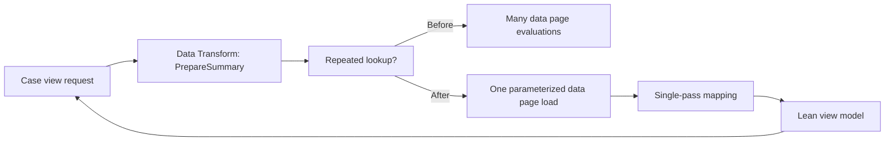

# Hot path optimisation of data transforms

**Scope:** Pega enterprise architecture and LSA implementation guidance. Platform capabilities and menu paths may vary by release; verify in the target version.

## A latency regression without an expensive SQL statement

An insurer's claims summary opens slowly after a release. Database monitoring shows no individual query above the alert threshold. PAL, however, indicates increased rule execution and repeated data access. The PrepareClaimSummary data transform iterates over a page list of 300 line items. Inside the loop it invokes a parameterized data page and performs a nested lookup to calculate a display label. The data page parameters vary in a way that prevents useful reuse, and a superclass transform is called even though no superclass implementation is needed.

The optimization target is the complete request path, not the apparent duration of a single data transform. A transform that costs a few milliseconds once can dominate a page when invoked for every row, for every section refresh and on every background recalculation. First confirm frequency, page size and rule stack. Then remove redundant work without changing observable case behaviour.

## Define the execution budget

Specify a p95 target for the interactive journey and assign a measured share to server rule execution, data retrieval and client rendering. Do not publish invented baseline numbers. Record PAL counters and PDC events under a representative workload, including the number of transform invocations and data page loads. Use Tracer selectively in a lower environment to identify nested steps, iteration count, rule resolution and repeated property writes. Keep instrumentation overhead separate from the benchmark.

Inspect Data Transform rules for excessive nested loops, unnecessary call-superclass flags, repeated Append-and-Map-to operations and broad Page-Copy calls. The goal is not to eliminate all data transforms. They are the appropriate declarative mapping mechanism when inputs and outputs are explicit.

## Architecture and implementation

1. Create a synthetic case distribution with small, median and worst-case line-item counts. Include missing optional fields, multi-currency entries and duplicate reference keys.
2. Capture the original output page shape and business decisions as a golden contract. Serialize only permitted fields, and compare semantically rather than relying on clipboard page ordering.
3. Draw the invocation graph from case view to section data page to PrepareClaimSummary and its nested transforms. Mark repeated reads and loops.
4. Move invariant reference lookups outside the line-item loop. Use a parameterized data page whose key represents the true business identity and refresh requirements. Do not promote customer-specific data to node scope merely to improve a benchmark.
5. Replace repeated list scans with a prepared lookup keyed by the reference identifier where justified. Use a separate reusable Data Transform for normalization and another for projection if their responsibilities differ.
6. Remove unnecessary superclass calls after confirming no inherited override is required in supported applications. Keep the inheritance contract documented so a future framework rule cannot silently change the result.
7. Map only the properties consumed by the view. Avoid copying entire embedded pages or attachment metadata into a screen-specific response.
8. Run side-by-side functional and performance tests on the same dataset and application version. Promote only if output equivalence and agreed p95, CPU and allocation thresholds are satisfied.

## Tradeoffs and architecture boundaries

A precomputed view model reduces request-time work but adds invalidation and storage cost. A node-scoped reference cache can be efficient for immutable product catalogues, but should not contain tenant-specific or operator-specific material. A single large transform is sometimes faster than many small transforms yet harder to test and extend. Choose composition based on the observed call graph and ownership boundaries, not a rule-count target. Database-side aggregation may be appropriate for large datasets, provided it preserves authorization filters and avoids embedding business policy in opaque SQL.

## Production failure mechanics

A common failed optimization is to cache a transformed summary without including case version or tenant in the key. The performance chart improves while operators see stale or foreign data. Another failure is suppressing a declarative recalculation when a dependent property changes. Roll back the cache or transform change if semantic output differs, even when latency improves. Preserve a feature-specific rollback plan and compare the distribution of request times, not only averages.

## Reproducible verification matrix

| Scenario | Method | Required outcome |
| --- | --- | --- |
| Empty and one-item list | Run original and optimized transforms | Equivalent output and no null failure |
| Large case | Replay 300-item synthetic case repeatedly | Same result; latency within agreed budget |
| Duplicate lookup key | Use two rows with same reference ID | Correct cardinality and label |
| Tenant context | Execute identical keys in separate tenants | No cross-tenant cached output |
| Invalidation | Update dependent case property and refresh | Recalculation uses new value |
| Load | Mixed concurrent case sizes | No throughput collapse or excessive allocation |

All figures in this article are scenario inputs, not measured production performance. Record the exact Pega release, PAL evidence and test harness configuration before accepting the change.

## Primary reference

- [Pega: Best practices for Pega Infinity application development](https://docs.pega.com/bundle/platform-242/page/platform/app-dev/best-practices-infinity-application-development.html)

## Architecture flow

## Evidence required before production approval

Attach a reviewed design decision, the actual Pega version and deployment topology, rule references with their Applies To classes, test inputs and observed outcomes. Record open risks, remediation owners and rollback criteria. The verification matrix above is a proposed protocol, not fabricated execution evidence.
