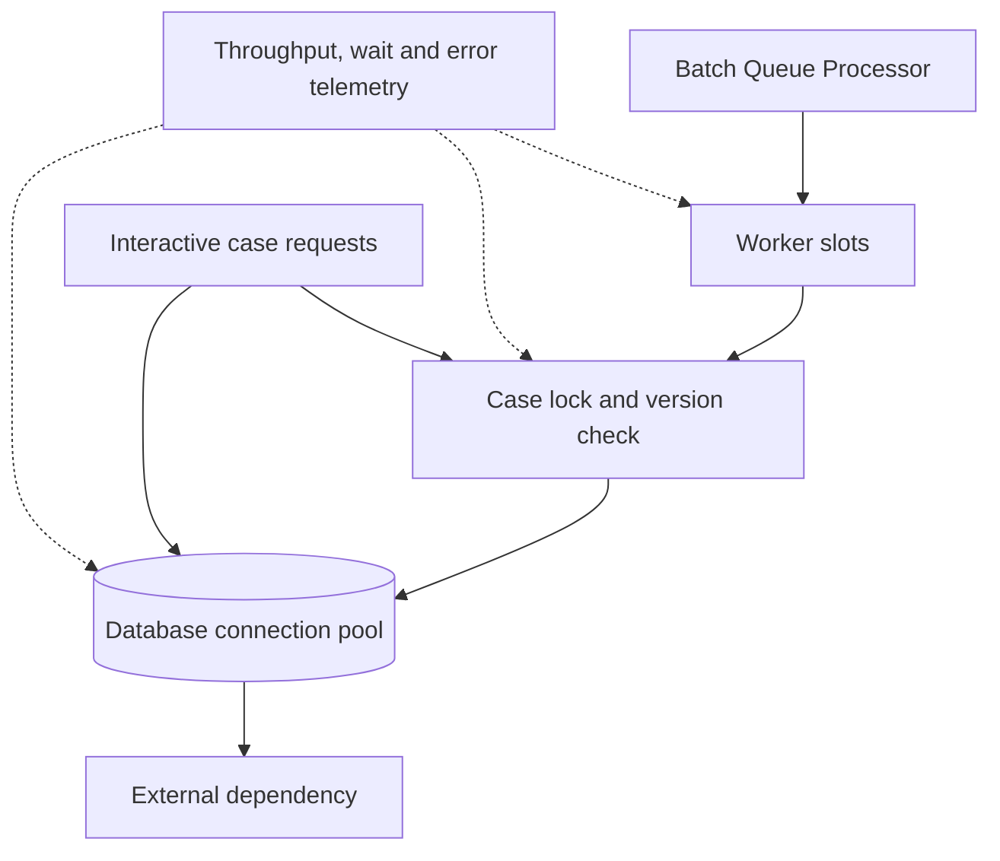

# Thread contention during mass case updates

**Audience:** Pega Lead System Architects and platform engineers. Design guidance is not a claim of laboratory validation.

A bank launches an overnight remediation of 400,000 dormant customer cases. The team increases worker concurrency from 8 to 80 because each item appears lightweight. Interactive complaints cases become sluggish, lock acquisition fails more often, and database connections saturate. The batch completes fewer cases per minute than before. Increasing threads multiplied contention on shared resources instead of increasing useful throughput.

The architecture question is not how many workers a node can start. It is how much concurrent work the end-to-end path can sustain while preserving interactive service objectives and case consistency.

## Contention map

Model the path from queue item to Pega requestor/thread, rule execution, data page access, case lock, database transaction and outbound dependency. A thread may be runnable but blocked waiting for a case lock, connection-pool slot or remote response. Queue depth alone does not distinguish productive throughput from blocked work.

## Architecture and implementation

1. Define separate service objectives: interactive p95 response time, maximum acceptable case-lock wait, batch completion deadline and allowed failure rate. State which objective takes precedence during contention.
2. Sample realistic case shapes. A simple open-and-save path differs from a case with declarative expressions, history, attachments, subcases and multiple data page loads. Do not extrapolate from an empty case type.
3. Profile the current batch with Pega Performance Analyzer, PDC where available, database wait statistics and dependency timing. Correlate queue depth with successful commits per minute, not only dequeues.
4. Partition work by stable business key so one case is not updated concurrently by multiple workers. Use a deterministic deduplication key for repeated source records.
5. Implement small, idempotent processing units in a Queue Processor activity. Reopen the case under the appropriate lock or optimistic concurrency contract, validate the current status, apply one bounded transition and persist the result.
6. Avoid unbounded loops and large Page Lists on the worker clipboard. Release temporary pages and do not keep a requestor session holding thousands of case objects.
7. Bound concurrency at the worker, database and integration layers. Coordinate with platform operations before changing node types or Queue Processor configuration; the control surfaces differ across Pega versions and Pega Cloud.
8. Reserve capacity for interactive transactions through workload isolation where the deployment supports it, and schedule low-priority work in windows with sufficient spare capacity.
9. Add adaptive back pressure based on successful throughput, database wait and interactive latency. Pause new batch intake when the service objective is breached; do not rely on queue growth as the only signal.
10. Reconcile a sampled set of case IDs and history entries after the run. Record skipped, retried, conflicted and completed outcomes separately.

## Tradeoffs

A larger worker pool improves throughput only while downstream resources have spare capacity. Serializing by case key reduces conflicts but may underuse resources when a few keys dominate. Smaller transactions lower lock duration but increase commit overhead and require explicit checkpointing. Bulk SQL updates can be faster than case APIs, but bypassing Pega case processing, audit, declarative rules and flow semantics can make them unacceptable for live work.

## Production failure mechanics

A deadlock or lock timeout may be retried automatically, turning a burst into a retry storm. Retries consume the same constrained connections and can starve live users. Apply bounded exponential delay with jitter, classify permanent business conflicts separately and use a circuit breaker for downstream dependencies. A second trap is database connection exhaustion while threads wait on a slow external service inside a transaction. Move non-transactional side effects to a durable asynchronous step with idempotent reconciliation where business semantics permit.

Measure saturation with paired signals: worker utilization plus successful case completions, database wait plus connection occupancy, and case lock conflicts plus retry age. A high worker count with flat throughput is evidence to reduce concurrency, not increase it.

## Reproducible verification matrix

| Load condition | Execution | Pass criterion |
| --- | --- | --- |
| Baseline | Interactive-only journey mix | Reference latency and error envelope recorded |
| Moderate batch | Add bounded worker load | Interactive objective maintained |
| Saturated batch | Increase workers past capacity | Back pressure activates; no runaway retries |
| Hot case key | Enqueue repeated updates to one case | Serialized or conflict-safe result |
| DB slowdown | Inject elevated database response time | Workers shed load and recover |
| Connector stall | Hold external responses | No long-lived case locks across stall |
| Restart | Terminate worker mid-transaction | No duplicate case transition |

**Primary reference:** [Pega Platform: best practices for Infinity application development](https://docs.pega.com/bundle/platform-242/page/platform/app-dev/best-practices-infinity-application-development.html). Platform internals, pool settings and worker management vary by release and hosting model.
