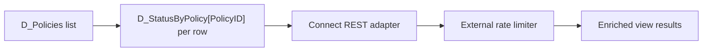

# N+1 Connect REST Calls: How a List View Can Exceed Every Vendor Quota

**PFA-170** | Senior / Lead System Architect level | Design reference, not a lab result

## The practical failure

A policy dashboard loads one Data Page listing 120 policies, then loads a second parameterized Data Page for each policy's current claims status. The UI's innocent-looking layout multiplies external calls by row count and concurrent sessions. Partner rate limiting causes retries that further amplify the spike.

## Technical flow

The diagram describes a proposed execution boundary rather than a captured Pega implementation.

## Pega rules and interfaces involved

| Rule or component | Architect's checklist |
|---|---|
| D_Policies | Owns one part of this design |
| D_StatusByPolicy parameterized | Requires clear data and security contract |
| Connect REST | Needs actual release-specific configuration |
| Bulk status adapter or paged loading | Should yield evidence for diagnostics |
| View and refresh configuration | Has a testable operational responsibility |

## Implementation design

1. Trace the view's complete Data Page dependency graph, including hidden views, transforms and declarative references.

2. Measure external call count for five, twenty-five and 120 rows, both cold and warm requestor cache.

3. Estimate peak traffic as simultaneous users multiplied by uncached child lookups and retry factor.

4. Where offered, use a bulk vendor endpoint with authorised bounded policy IDs; otherwise paginate or defer noncritical enrichment.

5. Choose Thread or Requestor scope based on intended security and freshness. Node-scoped sensitive customer records are not a performance shortcut.

6. Set a cap on outbound concurrency, retry attempts and latency budget; display partial data where a status is unavailable.

7. Monitor both user-facing p95 and connector calls per interaction after the change.

## Competing patterns

| Approach | Trade-off |
|---|---|
| Per-row lookup | Easy to model but poor scale |
| Bulk endpoint | Efficient but needs upstream support and careful entitlement filtering |
| Lazy enrichment | Faster initial page but more complex interactive loading |

A valid architecture makes the consistency, permission and recovery contract explicit. Do not optimize for one successful demonstration while ignoring the retry or failure case.

## Why it breaks in production

Nested references can generate hidden fan-out; automatic Data Page refresh can reload the entire set; retries after 429 can turn an isolated rate limit into an outage. Counting only the calls made in one developer session hides peak system demand.

For incident triage, retain a redacted operation/case ID, node, ruleset/app version, timestamp and evidence of the dependent system. Never publish private client payloads or authentication tokens.

## Reproduction and verification plan

| Scenario | Evidence to obtain |
|---|---|
| Test 1 | Capture connector counts at 5, 25 and 120 rows. |
| Test 2 | Simulate 429 and verify bounded retry. |
| Test 3 | Load policies from two tenants with colliding IDs; no data leakage. |
| Test 4 | Compare bulk and paginated approaches at peak simulated load. |

These are proposed tests. No claim is made that the scenario has been executed in a Pega lab. A complete validated edition should show the actual Pega rule forms, configuration values and observed result for the target release.

## Release checklist

Record system of record, data and authorization boundary, expected volume, timeout/retry or conflict strategy, owner of failures, migration impact and a repair runbook. Confirm behavior across at least two realistic user/role contexts where applicable.

## Source and version note

- [Relevant Pega Academy reference](https://academy.pega.com/topic/data-pages/v6)

Independent original engineering content. Version-specific editor names and configuration controls must be checked against the Pega release used by the reader.
