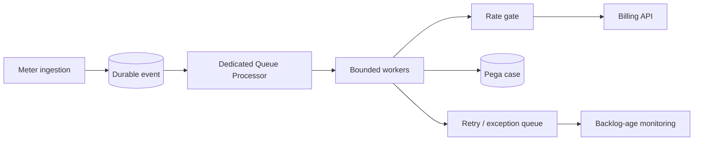

# Scaling Workers for Bursty Queue Processor Demand

## Enterprise failure scenario

At 18:00 a utility company imports thousands of meter exceptions. Its dedicated Queue Processor drains in a quiet test but production retries explode after the billing API begins returning 429. Adding threads increases database connection pressure and reduces completed work. Queue depth later stops growing only because ingestion is paused, misleading the operations dashboard.

## Architecture decision and Pega rule boundary

Capacity is constrained by arrival rate, processing time, partition skew, database pool, external quotas and retry cost. Use a dedicated Queue Processor for the isolated meter workload with Queue-For-Processing or Run in Background where appropriate. Persist a business event identifier for deduplication. Define an overload policy and measure age of oldest actionable item, not just queue length. Worker count and stream topology are release and hosting dependent.

## Implementation in order

1. Collect arrival and completion time series for a representative billing cycle. Include the largest payloads, the fraction requiring case locks and downstream p95 latency.

2. Classify failures as retryable 429/503, temporary database contention or permanent validation errors. Give permanent errors a separate reviewed exception state.

3. Assign a stable idempotency key per meter exception and retain the billing response identifier. Never assume message acknowledgement means business completion.

4. Load test incremental worker and partition configurations against a realistic API quota. Stop increasing concurrency when throughput plateaus or retry ratio grows.

5. Add bounded exponential backoff with jitter and a circuit or admission gate that protects the billing API. Respect contractual Retry-After when available.

6. Keep queue item payloads small; rehydrate necessary case data inside the worker. Avoid copying large clipboard pages into every message.

7. Reserve database and compute capacity for interactive work, and alert on oldest item age, successful drain rate and retry age, segmented by queue and business priority.

## Failure mechanics in production

Increasing concurrency past a dependency limit creates more in-flight retries, which consume workers and DB connections without producing successful completions. Hot partitions create uneven worker utilisation. A worker may commit a case change then crash before acknowledging the message; the next delivery can repeat the side effect unless the handler is idempotent. Large clipboard payloads increase heap pressure and garbage collection. A healthy stream service does not imply an acceptable business backlog.

## Design tradeoffs

- Dedicated queues isolate failure domains but add deployment and support overhead compared with standard processing.
- Additional partitions increase potential parallelism, not the billing API's quota.
- Durable acceptance avoids lost events but needs an explicit queue-age SLA and safe overload behaviour.

## Reproducible verification matrix

Run these checks with synthetic data in a controlled test environment. Capture the application version, ruleset stack, requestor identity, test stimulus and expected persisted outcome. These are proposed checks, not executed results.

| Test and stimulus | Expected result and evidence |
| --- | --- |
| Replay a representative evening burst | Oldest-item age and drain time meet agreed budget |
| Double threads at fixed API quota | Measured throughput plateaus without uncontrolled retries |
| Return 429 and Retry-After | Workers back off without flooding API |
| Crash after remote success | Replayed message does not double-bill |
| Skew one key to a partition | Skew detected and accounted for |
| Saturate DB pool | Interactive p95 protected or overload surfaced |
| Pause and resume ingestion | All accepted unique events eventually reconcile |

## Incident runbook

When backlog grows, compare enqueue rate, completion rate, retry count, oldest-item age and downstream latency in the same window. Reduce concurrency if the dependency is already saturated. Before bulk replay, reconcile remote billing outcomes and the local idempotency ledger. Never infer success from a falling depth graph alone.

## LSA release acceptance and limitations

Document target load assumptions, partition distribution, rate-limit contract and worker/node topology. Verify the queue processor controls available in the deployed Pega version; standard versus dedicated processor capabilities and stream infrastructure vary by platform release.

The architecture is design-backed and laboratory verification remains pending. A technical reviewer should inspect rule resolution, authorisation, Pega guardrail warnings, negative-path behaviour and rollback feasibility before promoting it. Capture controlled Tracer or PDC evidence only where available, and exclude sensitive clipboard content from shared logs. Do not interpret a diagram as evidence that the implementation has been tested.

## Verified Pega primary references

- [Pega queue processors](https://docs.pega.com/bundle/platform-88/page/platform/background-processing/queue-processors-understanding.html)
- [Pega external Kafka deployment](https://docs.pega.com/bundle/platform-88/page/platform/deployment/externalization-of-services/deploy-external-kafka.html)
