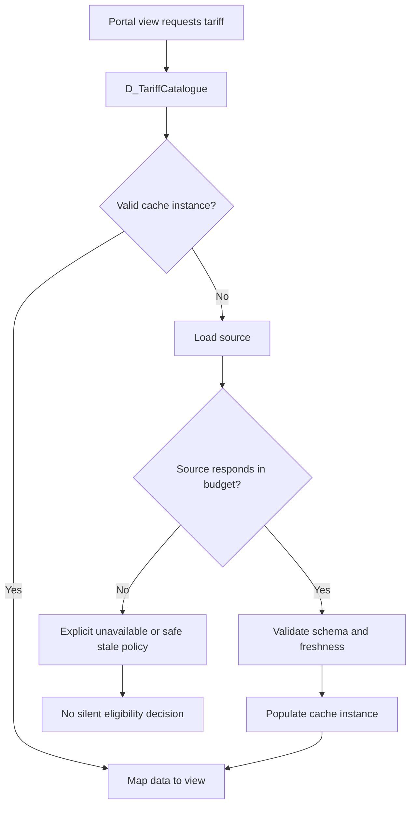

# Response time variation after cache refresh

## Failure scenario: a quiet deployment creates a peak-hour latency spike

A national utility's Pega service portal reads tariff, eligibility and regional product data through node-level Data Pages. A release changes the reference data refresh strategy. At the next expiry boundary, many requestors hit a cold page simultaneously. Each node loads from the same tariff API, the service saturates, and the first users see slow views or a timeout. Later users see normal latency. A team looking only at median response time concludes that the release was healthy.

This is a **latency distribution and cache-key** problem, not simply an integration defect. An architect must measure cold and warm requests separately, account for each node's refresh timing and ensure that a node-scoped cache does not hold user-specific information.

## Pega-specific design surface

The relevant rules are `D_TariffCatalogue`, `D_EligibilityRules[Region,Product]`, their Load Management settings, source Connect REST rules or Report Definitions, and the Data Transforms that map results. Review the scope of each Data Page: Thread, Requestor or Node. A node-level page can reduce repeated calls but should contain only data safe for all requestors who can access that node.

Pega documentation explains that a node-level page can be removed across nodes and that time-based reload may occur at different times per node. Parameterized Data Pages create distinct instances for distinct parameter values unless configured to limit instances. These details matter when a supposed single cache is actually a large family of regional keys.

## Request and refresh path

## Architecture and implementation

1. **Write a freshness contract.** For tariffs, specify maximum acceptable age and whether a stale value can be displayed or used to calculate a binding quote. Displaying stale reference text and making a financial eligibility decision have different risks.
2. **Inventory Data Page consumers.** Use rule references to identify every view, When rule, Decision Table and activity that calls the page. Trace nested pages: a single portal load may fan out through `D_Region`, `D_Products` and `D_EligibilityRules`.
3. **Choose scope deliberately.** Keep global, non-sensitive reference data at Node scope only when the access and lifecycle contract supports it. Keep user-specific entitlements at Requestor or narrower scope, or parameterize with a fully justified isolation key. A tenant ID in a key is not a substitute for authorization checks.
4. **Specify refresh and invalidation.** Use the Data Page Load Management options supported by the installed Pega release. Document whether reload is time-based, condition-based or triggered by a known business update. Verify the behavior of each parameterized instance.
5. **Bound load fan-out.** Prefer a bulk catalogue fetch with in-memory filtering for small, stable catalogues; prefer targeted parameterized fetches for large or sensitive datasets. Estimate cardinality as the product of parameter dimensions, not just the number of Data Page rule names.
6. **Define failure behavior.** A timeout must not be cached as an empty catalogue. Separate no eligible products from a failed source. For regulated calculations, fail closed with a business-visible recovery path instead of quietly using an unknown-aged value.
7. **Instrument cold and warm paths.** Capture request latency by node, Data Page name, parameter cohort, cache hit/miss and downstream call duration where instrumentation permits. Use PDC and PAL evidence with sanitized correlation IDs. Avoid capturing full customer identifiers.
8. **Roll out with controlled warming.** If a warm-up mechanism is supported and approved, spread loads by node or cohort rather than issuing a synchronized full cache flush at peak time. Verify that warm-up uses the correct Access Group and does not accidentally cache operator-specific data.

## Tradeoffs and failure mechanics

Longer cache lifetime lowers API demand but increases stale business data exposure. Shorter lifetime improves freshness while raising cache churn and tail latency. Node scope reduces source load but can produce cross-node inconsistency. Requestor scope improves isolation but may multiply identical requests. Parameterized pages allow targeted loads but can exhaust memory if high-cardinality parameters are unbounded.

A refresh storm can also arise from application restarts, node autoscaling, data page removal, or downstream cache invalidation. Distinguish them by aligning node events, deployment timestamps, source call volume and latency percentiles. Do not conclude that garbage collection caused the spike merely because memory usage rose while pages reloaded.

## Reproducible verification matrix

| Experiment | Controlled input | Required observation |
| --- | --- | --- |
| Warm cache | Repeat identical lookup on same node | Source not unnecessarily re-invoked; result consistent |
| Cold cache | Clear page with supported mechanism | One cold-load latency recorded, no silent timeout |
| Parallel cold requests | Concurrent requests after expiry | Bounded source traffic and acceptable tail latency |
| Multiple nodes | Stagger access to each node | Node-level refresh behavior documented |
| High-cardinality keys | Generate region/product combinations | Instance count and memory remain within budget |
| Source 503 | Return error on reload | Error not treated as valid empty catalogue |
| Reference update | Publish revised tariff version | New value appears within documented freshness window |
| Cross-tenant access | Request two tenant contexts | No tenant-specific values leak through shared page |

**Verification status:** No timings or cache-hit figures have been measured. Thresholds must be agreed with the business and proven in a representative lab.

## Primary references

- [Removing and refreshing a Data Page, Pega Platform 8.8](https://docs.pega.com/bundle/platform-88/page/platform/data-integration/removing-data-page.html).
- [Parameterized Data Page instance behavior, Pega Platform 8.8](https://docs.pega.com/bundle/platform-88/page/platform/data-integration/data-pages-parameters.html).
