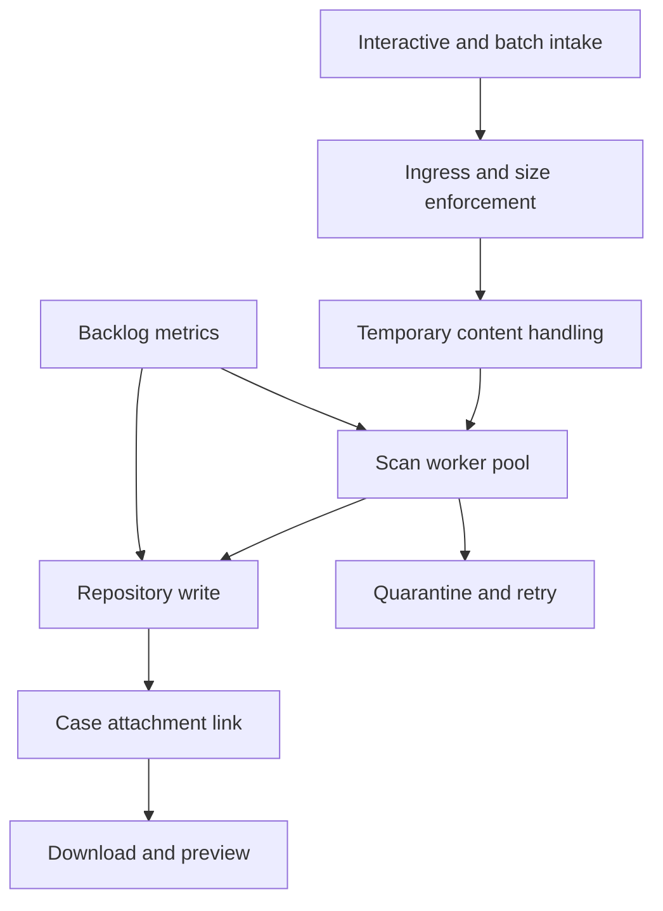

# Sizing attachment processing capacity

## Failure scenario
A commercial lending system adds a document intake service. Interactive case uploads succeed in testing, but month-end bulk onboarding creates long pauses, failed PDF previews and a rising queue of files waiting for scanning. Operations increase web-node heap, yet performance barely changes: the bottleneck is an external repository's write throughput and a shared malware-scanning service with limited workers. The problem is a capacity pipeline, not a single maximum file-size setting.

## Capacity model and boundaries
Model the stages separately: gateway ingress, Pega request handling, temporary storage, malware scan, optional transformation, durable repository write, case-link persistence and retrieval. Define arrival rate by file count and bytes, size distribution, peak concurrency, and retry amplification. For stage i, utilization is approximately arrival_rate multiplied by mean service_time divided by worker_count; this is a planning approximation, not a Pega-specific performance guarantee. Use observed p95 and tail sizes for risk analysis, not just averages.

## Architecture and implementation
1. Partition workloads by service objective. Interactive uploads need quick acknowledgment; bulk evidence imports can tolerate delayed availability. Use a durable intake reference and an explicit processing status for asynchronous designs. Do not promise immediate download before scanning and storage completion.
2. Inventory content paths. Standard Pega attachments, DX API upload endpoints and custom Service REST routes can have different buffering and size behavior. Check the actual release and UI architecture. Platform '24.2 documents a smaller-of-two limit involving `MaximumFileUploadSizeMB` and `pyMaxDragDropAttachSizeMB`, but gateways and repositories may impose further limits.
3. Select storage according to supported deployment configuration. Pega's repository guidance notes streaming advantages over database attachment storage; confirm the exact implementation's memory profile rather than assuming every upload is zero-copy.
4. Design a scan worker pool with bounded concurrency and a durable retry policy. Distinguish transient scanner unavailability from permanent malicious verdicts. Use an idempotent content ID and checksum so that a retry cannot create multiple case links.
5. Define resource pools and budgets: request threads, connection pool, scan workers, repository requests, bandwidth and disk/temp-space limits. Reserve capacity for case actions so that a bulk intake cannot monopolize interactive requestors.
6. Establish queue-age, bytes-in-flight, scan failure rate, repository 429/5xx and heap/GC dashboards. Track the oldest unprocessed item, not only queue depth. An empty queue can still hide stuck items in a processing state.
7. Load-test realistic file mixes: tiny images, multi-megabyte PDFs, maximum-allowed files and compressed archives. Include repeated filenames, retries and a simultaneous case search workload. Avoid real personal documents in the test set.

## Production mechanics and tradeoffs
Synchronous scanning simplifies user expectations but ties response latency to scanner tail latency. Asynchronous processing protects web threads but introduces eventual availability and requires a visible state model. Raising parallelism can lower queue age until the repository throttles; after that, more workers increase retries and contention. A CDN may accelerate safe downloads but is unsuitable for unrestricted caching of confidential evidence. External repositories change the backup and disaster-recovery boundary; case metadata and content must be recoverable together.

A gateway 413 indicates a size-policy rejection, while an application 500 may indicate encoding, memory or storage pressure. Neither alone identifies the failing stage. A successful upload response may precede completed case linkage. Trace a single content correlation ID through all stages before classifying an incident. Also account for scanning updates that cause previously accepted file types to be rejected.

## Verification matrix
| Load case | Fault or demand | Pass condition | Evidence |
|---|---|---|---|
| Interactive baseline | Small PDFs | Accepted within agreed budget | End-to-end latency histogram |
| Bulk peak | Representative burst | Bounded backlog, no UI starvation | Queue age and web latency |
| Maximum file | Largest permitted payload | Defined acceptance or explicit 413 | Gateway and Pega response |
| Scanner outage | Stop scanner | Files isolated; retry bounded | Scan state and retries |
| Repository throttling | Inject 429 or 503 | Backoff without duplicate links | Object and case-link counts |
| Mixed workload | Search plus uploads | Priority transactions protected | p95 search and queue age |
| Recovery | Restart workers mid-file | No lost or duplicate content | Checksums and durable state |

No throughput numbers are invented. Size each stage from repeatable measurements and rerun after storage, scanner or Pega version changes.

## Verified Pega references
- [Best practices and known issues for large file attachments, Platform '24.2](https://docs.pega.com/bundle/platform-242/page/platform/case-management/large-file-attachment-handling-across-ui-frameworks.html)
- [Storing case attachments using external storage, Platform '23](https://docs.pega.com/bundle/platform-23/page/platform/case-management/storing-case-attachments-using-external.html)
