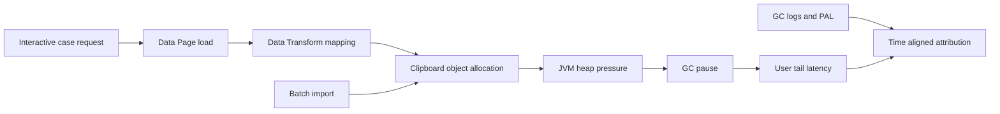

# Garbage collection pauses and interactive response time
## The symptom
A bank's Pega onboarding application meets its median response-time target but misses the 99th-percentile target whenever document ingestion and a heavy account lookup overlap. The infrastructure team sees high CPU and increases worker threads. Latency becomes worse: each requestor allocates more short-lived objects and the JVM pauses more frequently. A custom Data Transform copies a complete customer transaction history into the clipboard for a view that needs only the last five entries. The performance issue is neither a slow database nor a slow browser; it is object allocation amplified by concurrent work.

## Attribution before tuning
Track wall-clock response time and distinguish application execution, connector wait, database time, thread queuing, and JVM stop-the-world pauses. Use Pega PAL for request-level investigation, alert and application logs for slow operations, and JVM GC logs for pause durations and heap behavior. Correlate by node, timestamp and request identifier; a GC event on another node cannot explain the observed response. Tail latency should be evaluated per transaction class, not averaged across all endpoints.

Pega Data Pages can load through connectors, Report Definitions or Data Transforms. Their Page/List structure and Thread/Requestor/Node scope change both allocation and retention. A read-only high-throughput configuration may be available on supported releases but restricts clipboard functionality; verify that declarative rules, encryption and advanced references are not required before enabling it. Do not treat a Pega rule as a JVM tuning knob.

## Implementation plan
1. Define three transaction cohorts: open case, save assignment and view account history. Establish separate p50, p95 and p99 acceptance thresholds with stakeholders. Record browser/network time separately from server processing so the budget is not double-counted.
2. Capture an unchanged baseline at realistic concurrency with synthetic cases of different sizes. Store GC log timestamps, pause type, heap occupancy before/after, request node, Pega alerts, PAL samples and connector timings. Mask or avoid sensitive values.
3. Reproduce overlap with an ingestion job and interactive traffic. Verify whether the same JVM handles both and whether request queue time increases before pause time. Avoid asserting GC is causal merely because two charts rise together.
4. Trace `D_AccountTransactions` and the view's response Data Transform. Replace an unbounded list with a bounded, queryable or paginated source where the installed version supports it. Expose only the five fields and records needed for the interaction.
5. Examine transient pages created by custom Activities, particularly `Page-New` and `Page-Copy`, and remove only application-owned temporary pages at the correct lifecycle boundary. Avoid retaining connector response bodies in error pages or logging them.
6. Choose appropriate Data Page scope and refresh behavior. A node cache can reduce repeated allocations for immutable shared reference data but is unsafe for per-customer authorization-sensitive content. Thread scope bounds lifetime but may increase loads.
7. Isolate batch concurrency using approved deployment topology and job scheduling controls. Do not promise that increasing queue-processor threads improves throughput; it can move bottlenecks to database connections and heap.
8. Only after rule-level reduction, review JVM collector and heap configuration with the platform operator. Validate Pega Cloud support boundaries or client-managed runtime recommendations; never copy arbitrary GC flags from another JVM version.
9. Repeat tests at the same traffic shape and compare tail latency, allocation rate, post-GC live heap, pause distribution and business error rate. A faster p99 that drops requests is not a successful optimization.

## Tradeoffs and failure mechanics
More aggressive caching reduces connector allocations but increases retained heap and invalidation complexity. Pagination lowers object count but can add network round trips; tune page size using actual business interaction patterns. Larger heaps may decrease collection frequency while increasing worst-case pauses depending on collector and JVM. Moving ingestion to a separate node pool can protect interactive work but adds operational cost and cross-node coordination.

An especially misleading fix is lowering concurrency until GC pauses disappear while the queue grows without bound. Another is measuring p99 from too few requests. Report sample count and distribution without inventing improvements. Record whether a request was delayed by a GC pause or by waiting for a saturated thread pool.

## Reproducible verification matrix
| Scenario | Input | Pass condition | Evidence |
|---|---|---|---|
| Interactive only | Representative open/save requests | Meets approved latency budget | Per-route histograms |
| Ingestion overlap | Concurrent attachment batch | Tail latency within agreed guardrail | Node and GC timeline |
| Large case | High-cardinality transaction list | Bounded clipboard and response size | PAL and payload sizes |
| Connector timeout | Delayed upstream response | Time attributed to wait, not GC | Connector timing |
| Cache invalidation | Updated reference data | Correct result without runaway retention | Data Page reload trace |
| Concurrency change | Vary worker count | No hidden backlog or error increase | Queue and error metrics |
| Node comparison | Same load on two nodes | Repeatable direction of effect | JVM/version manifest |

These are proposed acceptance tests, not completed benchmarks. Confirm version-specific Data Page features and JVM guidance for the target release.
## Primary guidance
- [Creating a Data Page, Platform '25](https://docs.pega.com/bundle/platform-25/page/platform/data-integration/creating-data-page.html?workflow=creating-data-pages)
