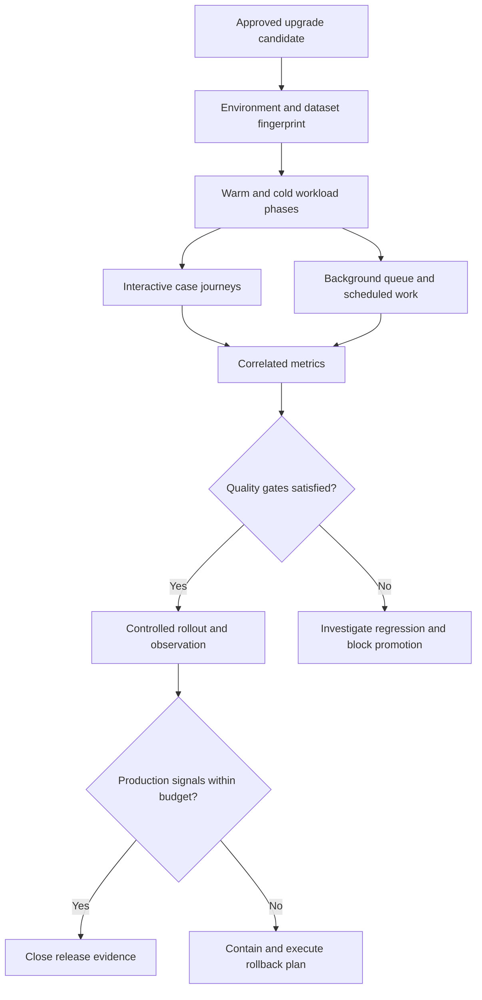

# Performance regression gates before a Pega upgrade

## Incident scenario

A national insurer upgrades its Pega Platform environment after a successful functional regression suite. On the first business morning, opening complex motor claims becomes slow. A subset of users experiences long waits while simpler cases remain responsive. The nightly batch is also delayed. Operations proposes increasing JVM heap, but no comparable pre-upgrade performance record exists. Without a baseline, nobody can distinguish ruleset resolution changes, database plans, cache warmup, connector latency or changed requestor concurrency.

The LSA's job is to turn upgrade performance from an informal expectation into an explicit release contract. A useful gate tests representative journeys with known workloads and clearly defines which differences are acceptable. A passing average response time is insufficient when the worst-affected users handle complex cases or when background items accumulate.

## Reference architecture

Use Deployment Manager and the organisation's existing release pipeline to link a versioned package to a repeatable performance experiment. Record application and ruleset versions, Pega Platform build, database schema, node types, external service stubs, test fixtures, warmup procedure and workload generator configuration. Capture PDC alerts and diagnostics alongside request metrics, database wait, JVM behavior and queue processor age. PAL can assist with controlled diagnostic comparisons; do not run intrusive tracing indiscriminately in production.

## Engineering implementation

1. **Choose critical journeys.** Include case creation, opening an existing complex case, assignment submission, search, attachment retrieval and a background processing path. Select case shapes from actual operational distributions, not only the easiest fixture.
2. **Declare budgets before testing.** Specify latency percentiles, throughput, error rate, queue oldest-item age and database resource ceilings per journey. The business must agree which thresholds block release.
3. **Fingerprint environments.** Record hardware, node count, JVM settings, database size and statistics, data distribution, integrations, caching state and concurrent user mix. Do not compare unlike test environments without an explicit adjustment.
4. **Separate cold and steady-state phases.** Cold caches, new ruleset compilation and first-use connectors can create a different latency profile from warmed requestors. Measure and report both rather than hiding the first phase.
5. **Replay deterministic workload.** Seed equivalent cases and run the same workload generator, arrival profile, think times and external service responses before and after the upgrade. Use enough repetitions to expose variance; do not invent a universal sample size.
6. **Inspect tail behavior.** Evaluate p50, p95 and p99 for each journey and error categories separately. A small aggregate improvement can conceal a severe regression for one case type.
7. **Correlate bottlenecks.** Match PDC and application log events to case and request IDs. Examine database plans and connection waits before tuning JVM memory. Check queue processor backlog separately from interactive response time.
8. **Promote with rollback evidence.** Keep a compatible prior package, database recovery procedure, traffic switch and open-case state plan. Test the rollback path, including asynchronous work created during the upgrade.

## Design decisions and failure mechanics

A shared environment makes testing cheaper but introduces noisy neighbors. A dedicated performance environment improves reproducibility but may be unrepresentative if its database, external latency or node topology differs from production. Document the compromises. Likewise, service virtualization enables deterministic regression checks but cannot prove live dependency performance. Use both a stable gate and a bounded end-to-end validation.

The critical distinction is a **release gate** versus a dashboard. A dashboard observes a metric; a gate states the workload, threshold, failure action, evidence owner and exception approval. Avoid arbitrary percentage thresholds copied from another application. An upgrade that changes database indexing may improve a common path and worsen a rare but critical query. Case-type segmented metrics prevent that regression from disappearing in a blended average.

Queue processors may appear healthy by throughput while oldest-item age rises. Conversely, a spike in cold-start latency can resolve after warmup without justifying a rollback if the agreed cold-start budget allows it. Keep separate alert thresholds and never declare success based on a single synthetic request.

## Verification matrix

| Experiment | Setup | Expected result | Evidence |
|---|---|---|---|
| Baseline | Current release, fixed data and workload | Stable documented distribution | Version and metric export |
| Cold start | Restart nodes and clear only approved caches | Cold-start budget evaluated | Timestamped trace IDs |
| Warmed traffic | Repeat controlled case journeys | Percentiles within signed budgets | p50/p95/p99 by journey |
| Batch contention | Interactive load plus scheduled work | Critical journeys retain budget | Queue age and DB waits |
| Slow dependency | Inject bounded connector latency | Error and timeout policy behaves as designed | Correlated logs |
| Upgrade failure | Introduce known regression fixture | Promotion gate blocks release | Pipeline result |
| Rollback | Restore compatible release and traffic | Open cases and queues remain recoverable | Reconciliation report |
| Production observation | Limited rollout with real monitoring | No unexplained regression | PDC and operational approval |

No measurements or test results are claimed here. Lab verification is pending and the test harness must be adapted to the deployed Pega version.

## Operational acceptance

Before sign-off, the release owner must identify the accountable performance engineer, business journey owner, rollback decision-maker and the exact evidence archive. Preserve package digest, approved budgets, test scripts, environment fingerprint, metrics and exceptions. For a failed gate, record the rule or dependency hypothesis, reproduction steps and corrective commit. An exception is a documented risk decision, not a silent override of a failed test.

A mature gate becomes a quarterly architecture fitness test: it catches drift in case complexity, database size, background load and service latency before an upgrade forces a rushed incident response.
