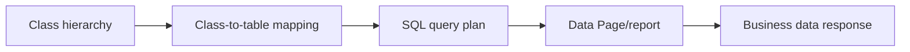

# Class-to-table mapping for large operational datasets

**PFA-076** | SSA/LSA engineering case | Design study, laboratory proof pending

## Production symptom and business risk

An application stores orders, payments and shipments under one broad Data class mapped to a single large table. Queries for a narrow shipment subtype retrieve excessive columns and compete with writes for unrelated objects.

The outcome must be provable across the case record, the data source and any cached or indexed read model. A green Flow Action is not a substitute for verifying where the authoritative state was committed.

## System sequence

## Pega components and design responsibilities

1. **Database Table record.** Record the rule/class mapping, execution context, data owner and a measurable acceptance condition.
2. **Data classes.** Record the rule/class mapping, execution context, data owner and a measurable acceptance condition.
3. **Report Definition.** Record the rule/class mapping, execution context, data owner and a measurable acceptance condition.
4. **Data Page.** Record the rule/class mapping, execution context, data owner and a measurable acceptance condition.
5. **DBTrace.** Record the rule/class mapping, execution context, data owner and a measurable acceptance condition.

## Architecture and implementation steps

1. Model data objects around ownership and access patterns before selecting shared or separate class-to-table mappings.

2. Check which concrete classes actually share a physical table, and how Pega class keys discriminate records.

3. For high-volume subtype queries, inspect generated SQL, exposed columns and indexes. Measure before splitting tables.

4. Ensure Rule resolution and class inheritance remain correct after changing persistence mapping; database inheritance is not rule inheritance.

5. Stage data migration with old/new read compatibility and test reporting joins and referential relationships.

A detailed implementation should name classes, property types, parameters, indexes and connector contracts for the chosen product release. Where sample names are needed, use domain-specific names, not copied vendor rules.

## Options and design decision

- **Option 1:** Single table reduces migrations but can grow wide and hot.
- **Option 2:** separate tables isolate workloads but add joins and maintenance.

Evaluate cost under realistic result cardinality, transaction rate, retry load and permission changes. An optimized read path that violates ownership or consistency is not a valid optimization.

## Failure analysis

Changing a Data class table mapping without migrating historic rows makes reports incomplete or breaks lookup by key.

Collect source record IDs, case version, exact Data Page parameters or SQL query, node/requestor, rule stack and partner operation ID as applicable. Separate a stale cache/index result from a failed database write.

## Reproducible tests

1. **Scenario 1:** Run reports on each subtype before/after remap. Capture expected values and the actual committed/source state.
2. **Scenario 2:** test batch migrations. Capture expected values and the actual committed/source state.
3. **Scenario 3:** inspect query plans with realistic volumes. Capture expected values and the actual committed/source state.

No tests described here have yet been executed by this publication. Verify in a release-matched Pega sandbox with sanitized Clipboard, DBTrace, Tracer, integration logs and screenshots where applicable.

## Capacity, security and recovery

Document source-specific freshness and tenant isolation, peak query/request volume, failure backlog and a supportable recovery action. Retain historical case/audit integrity during migration and do not infer successful external transactions from a Pega commit alone.

## Pega technical reading

- [Data modeling](https://academy.pega.com/topic/data-modeling/v1)

*Independent design study with fictional scenario, not a report of production benchmarks.*
