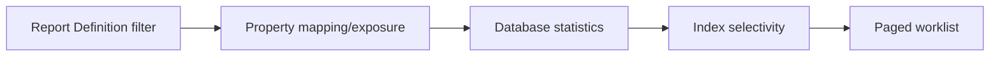

# Exposed columns and reporting selectivity

**PFA-077** | SSA/LSA engineering case | Design study, laboratory proof pending

## Production symptom and business risk

A worklist report filters a customer-risk value stored inside the case BLOB. A developer creates a Report Definition and assumes a WHERE clause will be index-selective, but the database lacks an exposed column for the field.

The outcome must be provable across the case record, the data source and any cached or indexed read model. A green Flow Action is not a substitute for verifying where the authoritative state was committed.

## System sequence

## Pega components and design responsibilities

1. **Property Optimization.** Record the rule/class mapping, execution context, data owner and a measurable acceptance condition.
2. **Report Definition.** Record the rule/class mapping, execution context, data owner and a measurable acceptance condition.
3. **Pega database.** Record the rule/class mapping, execution context, data owner and a measurable acceptance condition.
4. **DBTrace.** Record the rule/class mapping, execution context, data owner and a measurable acceptance condition.
5. **index maintenance.** Record the rule/class mapping, execution context, data owner and a measurable acceptance condition.

## Architecture and implementation steps

1. Capture the actual SQL and row count for a representative high-cardinality filter.

2. Expose properties that are frequently searched or sorted, not every field on the case. Determine whether an embedded list needs a Declare Index.

3. Measure selectivity: a boolean Yes/No flag can still be poorly selective even when indexed.

4. Examine query plan estimates, sort operations and write overhead after property exposure.

5. Retest against historical cases whose BLOB data was persisted before exposure; ensure backfill and indexing are complete.

A detailed implementation should name classes, property types, parameters, indexes and connector contracts for the chosen product release. Where sample names are needed, use domain-specific names, not copied vendor rules.

## Options and design decision

- **Option 1:** Expose all fields sounds future-proof but adds write/storage cost.
- **Option 2:** targeted exposure optimizes known queries with governance.

Evaluate cost under realistic result cardinality, transaction rate, retry load and permission changes. An optimized read path that violates ownership or consistency is not a valid optimization.

## Failure analysis

Optimizing an index for low-selectivity status can slow writes without improving the plan; source data not backfilled leaves null exposed values.

Collect source record IDs, case version, exact Data Page parameters or SQL query, node/requestor, rule stack and partner operation ID as applicable. Separate a stale cache/index result from a failed database write.

## Reproducible tests

1. **Scenario 1:** Compare plan before/after exposure. Capture expected values and the actual committed/source state.
2. **Scenario 2:** query old migrated rows. Capture expected values and the actual committed/source state.
3. **Scenario 3:** simulate writes during large report. Capture expected values and the actual committed/source state.

No tests described here have yet been executed by this publication. Verify in a release-matched Pega sandbox with sanitized Clipboard, DBTrace, Tracer, integration logs and screenshots where applicable.

## Capacity, security and recovery

Document source-specific freshness and tenant isolation, peak query/request volume, failure backlog and a supportable recovery action. Retain historical case/audit integrity during migration and do not infer successful external transactions from a Pega commit alone.

## Pega technical reading

- [Data modeling](https://academy.pega.com/topic/data-modeling/v1)

*Independent design study with fictional scenario, not a report of production benchmarks.*
