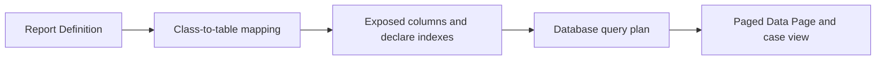

# Report Definitions at Scale: When Correct Rules Produce Expensive SQL

**PFA-078** | **Audience:** Senior and Lead System Architects | **Status:** Architecture design, live Pega verification pending

## The actual failure

A worklist report filters 800,000 cases by assignment group, status and last update and sorts by most recent change. A property inside an embedded list drives a filter. The generated SQL may require BLOB reads and high-cost joins or sorts. The architect needs evidence from the real query plan, not speculative index changes.

## System interaction and ownership

This is a conceptual reference architecture, not a product screenshot or observed runtime trace. Its boundaries must be verified for the actual Pega deployment version and external systems.

## Pega implementation inventory

| Component or rule | Design consideration |
|---|---|
| Rule-Obj-Report-Definition | Owns a defined runtime decision or state boundary |
| Database Class Mappings | Needs a documented input/output contract |
| Property Optimization | Requires version-specific access and execution testing |
| Declare Index | Produces diagnostics for failure isolation |
| DBTrace / Explain Plan | Carries operational ownership |

## How to implement and validate the architecture

1. Capture the actual Report Definition SQL and bind values using Pega DBTrace or database profiling in an approved environment.

2. Inspect database EXPLAIN for scans, high-cost joins, sorts and row estimates before changing properties.

3. Expose only frequently filtered or sorted properties. Extra columns increase storage and write/index maintenance cost.

4. For embedded-list reporting, consider Declare Index and correct join conditions rather than repeatedly extracting a BLOB.

5. Paginate results with a stable order, but still examine any expensive total count or broad filter.

6. Benchmark before and after under both search traffic and normal case writes; retain explain plans and elapsed times.

For a production build, annotate the actual class names, access group, ruleset version, node role and recovery owner. Ensure each external operation has an explicit system of record; a successful Pega case save does not, by itself, certify that an external service committed a change.

## Architectural choices

| Pattern | Consequence |
|---|---|
| Optimize every property | Might improve isolated searches but increases row width and maintenance |
| Selective exposure plus justified indexes | Usually better for known query patterns; requires measured evidence |
| Dedicated reporting data source | Reduces operational DB load but introduces freshness and replication tradeoffs |

Choose by the actual confidentiality, scale, consistency and failure-recovery constraints. A seemingly quicker configuration can shift cost into production support, data repair or lost auditability.

## Failure mechanics and support diagnosis

Adding many indexes may slow frequent inserts and updates. An outer join can magnify rows. Contains filters and unbounded descending sorts may still force scans. A replicated reporting database may be inappropriate for a live assignment queue if it does not meet freshness requirements.

Correlate one affected case ID and operation ID across rule execution, logs and dependent services. Record the effective application/ruleset versions and node. Avoid exporting live client data or confidential prompts in community evidence.

## Test matrix

| Test | Expected verification |
|---|---|
| Experiment 1 | Capture exact SQL and explain plan on baseline dataset. |
| Experiment 2 | Expose candidate filter property and compare matched query. |
| Experiment 3 | Measure write throughput with newly added index. |
| Experiment 4 | Page through live-changing records and check duplicates or missing assignments. |

These are **experiments to execute**, not assertions of a completed test. Include Pega configuration screenshots and sanitized Clipboard, Tracer, PAL or service evidence only after an authorised lab run. A failing experiment is valuable evidence and should update the design.

## Release and production readiness

Before promoting the design, confirm: observable business state; retry and rollback constraints; tenant and privilege isolation; capacity target; accountable support team; release-specific configuration; and a documented repair procedure. A green rule test or a running node does not imply the complete business operation succeeded.

## Primary reference

- [Pega Academy technical documentation](https://academy.pega.com/topic/configuring-rules-improve-report-performance/v7)

This article is an independent architectural study. The example scenario is fictional. It is not affiliated with Pegasystems, and no performance measurement or live test result is claimed.
