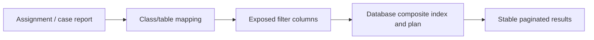

# Indexes for Pega Worklists: Making a Million Cases Searchable Without Slowing Every Save

**PFA-079** | Technical design study for Pega Senior and Lead System Architects | Laboratory verification pending

## Architecture problem

A regulated insurer has one million cases and a work queue filtered by region, status and update timestamp. The first page loads slowly despite paging, and adding an index on every visible property threatens write throughput. A query plan must determine which keys actually narrow the result and whether a composite index fits the database workload.

## System design

This diagram records a proposed boundary, not a fabricated Pega runtime screenshot. The interfaces and exact rule forms must be verified in a permitted sandbox.

## Feature inventory and design responsibilities

| Pega rule or component | Review requirement |
|---|---|
| Report Definition | Primary configuration and ownership boundary |
| Assignment and work class mapping | Explicit input/output and identity contract |
| Property Optimization | Apply platform-version-specific controls |
| DBTrace and Explain Plan | Test failure handling and observability |
| Database index deployment | Validate runtime access and support procedure |

## Implementation approach

1. Inventory the top workload queries with actual filters, order direction and result counts, not a theoretical list of all reports.

2. Capture real SQL from DBTrace with representative parameters, and examine plan estimates, join order and actual elapsed time.

3. Expose properties that matter for recurring filters and sorts, after identifying whether they are stored in the BLOB.

4. Evaluate a composite index on selective equality predicates plus an ordered time/key suffix where supported by the database. Validate against the exact plan.

5. Preserve stable pagination with a deterministic secondary key to avoid duplicate rows when update timestamps tie.

6. Benchmark case creation, updates and queue processing as well as reporting. Every extra index must be maintained on writes.

7. Document index ownership and deployment order, because schema rollback and Pega rules rollback are different operations.

## Design alternatives

| Option | Architectural trade-off |
|---|---|
| Index every displayed property | High maintenance and storage cost |
| Workload-led targeted composite index | Improves selected queries if plan and selectivity support it |
| Read replica/reporting database | Reduces writer contention but may be too stale for real-time assignments |

Choose the option that satisfies the business consistency contract and operational constraints. Avoid proving only the success path while deferring security, stale state and recovery behaviour.

## Failure modes and troubleshooting

An index may not be selected if predicates are nonselective or wrapped in expressions. A sort may dominate even after filtering. Paging can still require a full sort, and a read replica may misrepresent recently reassigned work. Monitor read gains against write impact.

Capture a sanitized case ID or operation identifier, relevant runtime node, application/ruleset version and timestamps. Correlate the origin and outcome across Pega and partner systems instead of relying on a single status message.

## Verification experiments

| Scenario | Evidence required |
|---|---|
| Experiment 1 | Compare explain plans before and after one justified index. |
| Experiment 2 | Measure case saves per second under write-heavy load. |
| Experiment 3 | Page a queue while updates occur; verify no missing or repeated assignments. |
| Experiment 4 | Check row-level access constraints are still applied in reporting. |

These are experiments to perform in a Pega lab. The article does not claim that any test has passed. A lab-verified version should include actual configuration screenshots, observed results and target Pega version.

## Production acceptance

Before deployment, the implementation needs documented data ownership, access context, expected peak volume, case compatibility, timeouts and retry boundaries, monitoring, escalation owner and a tested operational repair path. If the design changes a data model or class structure, verify legacy case paths and queued work.

## Pega technical source

- [Primary Pega reference](https://academy.pega.com/topic/database-tuning-improve-report-performance/v4/in/46436/46401)

Independent original technical analysis. Pega version-specific features and terminology must be confirmed against the target release; the scenario is fictional.
